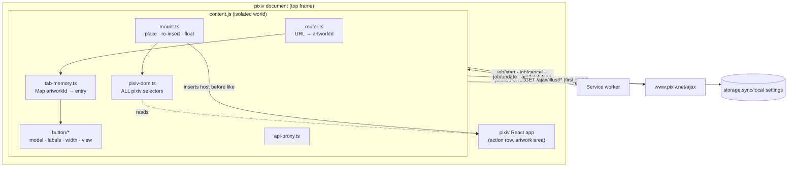
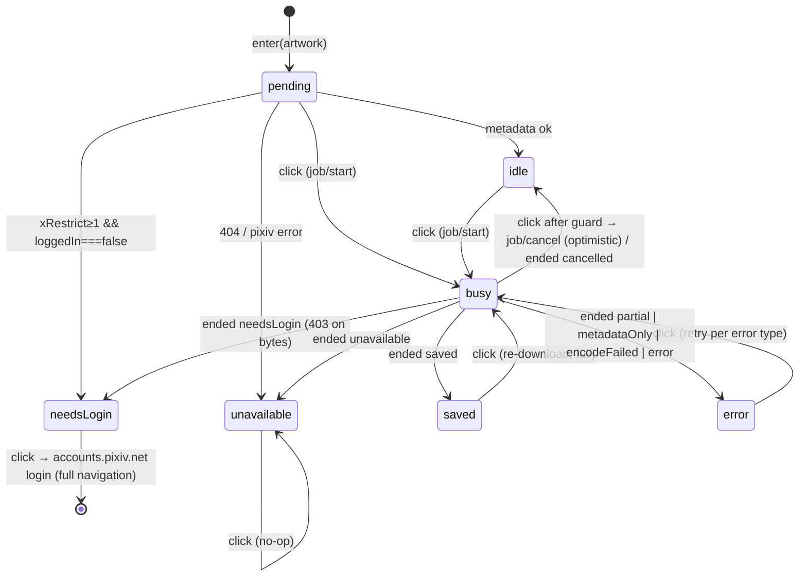
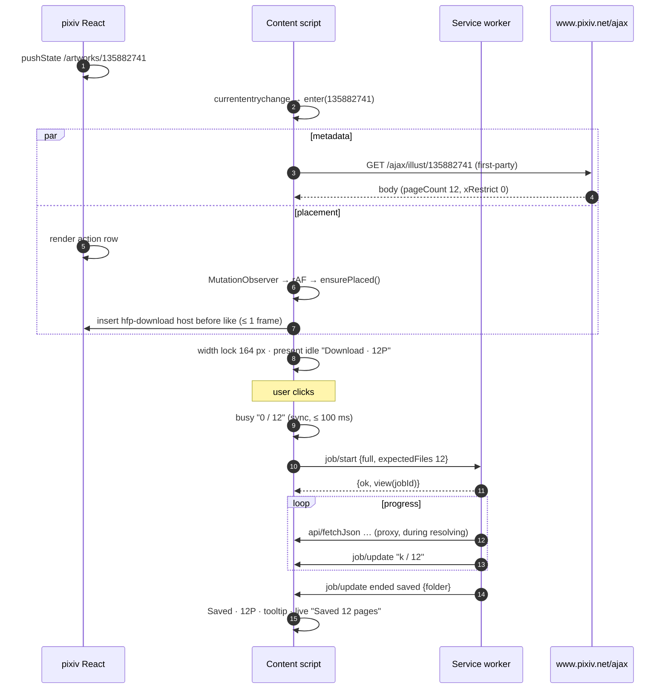

# Artwork Button (content script)

> Last updated: 2026-10-22 18:08:04 (UTC+9)
> Serves: prd-000 — CUJ-1 (button, states, SPA, memory), CUJ-2 (ugoira hint/progress), CUJ-4 (per-tab progress only), CUJ-5 (needs-login, error states, floating fallback); PRD §4.7 entirely; index "Accessibility", "Internationalization", "Theming"

## Overview

The content script (`src/content/`, bundled as one classic IIFE `content.js`) runs in the top frame of every `https://www.pixiv.net/*` document. It:

1. detects artwork routes, including pixiv's SPA navigations;
2. fetches render-time metadata (`/ajax/illust/{id}`, first-party) and reads the page's login state and theme;
3. finds pixiv's action row and keeps **exactly one** Download button in it, immediately before the like button, re-inserting within 500 ms after pixiv re-renders, or floats it after 3 s if the row cannot be found;
4. renders the button's state machine with locale-locked fixed width, full a11y, and a live region;
5. remembers per-artwork state for the life of the document, and reattaches to its own running jobs after a reload;
6. acts as the first-party API proxy (`api/fetchJson`) for the SW's jobs ([system.md §8.3](system.md)).

It never downloads anything itself: the job runs in the SW and offscreen document, so tab independence holds.

## Goals & Non-Goals

**Goals**
- Pixel and behavior fidelity to PRD §4.7 and mocks `cuj-1-*`, `cuj-2-*`, `cuj-5-*`.
- Resilience to pixiv's React re-renders and to DOM redesigns (selectors isolated in `pixiv-dom.ts`).
- No interference with pixiv: style isolation via Shadow DOM, no global listeners that alter pixiv behavior, no main-world script injection.
- Cheap: < 1 ms per DOM-mutation frame on pixiv, < 30 KB bundle.

**Non-Goals**
- Buttons on non-artwork pages, thumbnails, or listings (PRD Not in v1).
- Persisting state across reloads (PRD §4.1 #1, §4.7.6). The only exception is reattaching to in-flight jobs.
- Any popup, toast, or explanatory text outside the button (PRD CUJ-5 Context).

## System Context



## Detailed Design

### Module map

| File | Responsibility |
|---|---|
| `content.ts` | Entry. Guards against double init (`window.__hfpInit`). Reads `localeTag`, `isLoggedIn`, theme. Registers `runtime.onMessage`. Starts the router. Calls `job/listForTab` to reattach. Tears down on "Extension context invalidated". |
| `router.ts` | Parses the current URL, detects SPA changes, and emits `enter(artworkId)` / `leave()`. |
| `pixiv-dom.ts` | **The only file with pixiv selectors and markers:** `findActionRow`, `findArtworkArea`, `readIsLoggedIn`, `detectTheme`, `observeTheme`. |
| `mount.ts` | Owns the host element. `ensurePlaced()` (rAF-coalesced from a `MutationObserver`), the floating fallback, the single-host invariant. |
| `tab-memory.ts` | `Map<artworkId, Entry>` for the document's life. |
| `api-proxy.ts` | Handles `api/fetchJson` from the SW. |
| `button/model.ts` | `ButtonState` union and the pure transition function `reduce(state, event)`. |
| `button/labels.ts` | Pure `present(state, ctx) → Presentation` (icon, label, hint, title, aria) from Appendix A keys. |
| `button/width.ts` | Width candidates and measurement. |
| `button/view.ts` | Shadow DOM, rendering a `Presentation`, ring, interaction (click guard, cancel arming). |
| `button/styles.ts` | Constructable stylesheet text (PRD colors and geometry). |
| `button/icons.ts` | Constant SVG strings (download, check, x, warning). The only module allowed to use `innerHTML`. |
| `button/live-region.ts` | Polite live region with a 5 s progress throttle. |

### Startup

```ts
// content.ts (document_end, top frame)
if (window.__hfpInit) return; window.__hfpInit = true;
const ctx = {
  locale: localeTag(),                         // chrome.i18n.getMessage('locale_tag') → 'en'|'ja'|'zh-CN'|'zh-TW'
  loggedIn: readIsLoggedIn(document),          // true | false | null (unknown)
  theme: detectTheme(document),                // 'light' | 'dark'
};
chrome.runtime.onMessage.addListener(onMessage);   // job/update, api/fetchJson (target 'tab')
observeTheme(document, t => mount.setTheme(t));
router.start();                                     // emits enter/leave
sendToSw({ type: 'job/listForTab' }).then(({ views }) => views.forEach(v => memory.applyView(v)));   // reload reattach (PRD §4.7.6)
```

`readIsLoggedIn` is evaluated **once per document**, because pixiv's login state can only change through a full load (PRD CUJ-5 edge cases: "Logged in elsewhere after this page loaded … still shows Log in to download"). Strategy, in order (implemented in `pixiv-dom.ts`):
1. `/"isLoggedIn"\s*:\s*(true|false)/` over the text of the page's inline data scripts (e.g. `script#__NEXT_DATA__`, then other inline `<script>` elements without `src`);
2. the same regex over `meta[name="global-data"]`'s `content`;
3. not found → `null`.

`null` never produces needs-login: the button stays idle, and a refused click ends in `Retry` with `tip_refused`, which is correct for that case.

### Routing and SPA detection (router.ts)

- Artwork route: `^/(?:[a-z]{2}(?:-[a-z]{2,4})?/)?artworks/(\d{1,12})/?$` on `location.pathname`. This matches `/artworks/<id>` and locale-prefixed `/en/artworks/<id>` (PRD §4.7.1). Anything else → no button.
- Change detection (all funnel into one `check()` that compares `location.href` with the last value):
  1. **Navigation API:** `navigation.addEventListener('currententrychange', check)`. It fires for pixiv's `pushState`/`replaceState` and traversals. DOM events on the shared `navigation` object reach isolated-world listeners.
  2. `window.addEventListener('popstate', check)`.
  3. The `MutationObserver` callback (already running for placement) calls `check()`. This catches any missed event at frame granularity.
- `enter(id)`:
  - get or create the memory entry;
  - start the render-time metadata fetch if `entry.work` is absent;
  - start the 3 s fallback timer;
  - `mount.show(entry)`.
- `leave()`: `mount.hide()` (host removed from the DOM; memory kept).
- Artwork → artwork navigation is `leave()` then `enter(newId)` in the same tick.

### Render-time metadata

On `enter(id)` with no cached `work`: `fetchWithRetry('/ajax/illust/{id}', { responseType: 'json' })` (same-origin, first-party cookies, shared retry policy).

| Result | Entry update |
|---|---|
| 200, valid body | `work = parseIllust(body)`. If `xRestrict ≥ 1 && loggedIn === false` → state `needsLogin` (pre-emptive, CUJ-5 step 1). If `illustType === 2` → `caps/get { width, height }` → `effectiveFormat(settings.ugoiraOutput, caps)`. |
| 404 or `pixivError` body | state `unavailable` (CUJ-5 step 7: "If the 404 already happens at render time, the button renders as Unavailable immediately") |
| Other failure after retries | stay `pending`. A click runs the job, and the SW classifies any failure. |

`work` is cached in the entry for the document's life (it does not change). The fetch runs in parallel with waiting for the action row and is never awaited before first render (PRD §4.7.1: the button appears idle with no hint if metadata is late).

### pixiv DOM contract (pixiv-dom.ts)

```ts
export interface ActionRowHit { group: HTMLElement; before: Element }   // insert host into `group` before `before` (pixiv's like control)
export function findActionRow(doc: Document): ActionRowHit | null;
export function findArtworkArea(doc: Document): HTMLElement | null;     // the artwork image container (floating fallback anchor)
export function readIsLoggedIn(doc: Document): boolean | null;
export function detectTheme(doc: Document): 'light' | 'dark';
export function observeTheme(doc: Document, cb: (t: 'light' | 'dark') => void): () => void;
```

- **Selector policy.** Use only stable hooks, in this order of preference:
  1. ARIA/role/`data-*` attributes;
  2. link `href` shapes (bookmark/like endpoints);
  3. structure relative to `main` and the artwork `figure`;
  4. SVG path signatures as a last resort.

  pixiv's generated class names (`sc-…`) are never used. Each function holds an **ordered list of strategies**, and the first strategy whose result passes validation wins.
- **Validation of an action-row hit:** `group` is inside `main`; `before` is a child of `group`; `group` contains `before` plus at least one other interactive control (the bookmark control); and the row has a non-zero bounding box. It must be the first such row after the artwork figure in document order, which excludes thumbnails' mini-actions.
- **Concrete selectors** are pinned from a live DOM capture in ENG-002, which also commits `test/fixtures/pixiv/artwork-*.html` snapshots (light, dark, logged-out R-18 wall, ugoira). Unit tests run every strategy against these fixtures, so a pixiv redesign shows up as a fixture refresh plus a selector change confined to this file.
- **Theme:** strategy 1 is pixiv's own theme marker on `<html>`/`<body>` (exact attribute pinned in ENG-002). The fallback is the relative luminance of `getComputedStyle(document.body).backgroundColor` < 0.4 → `dark`. Either way the theme is read from pixiv's page, never from the OS (PRD §4.7.4). `observeTheme` watches attribute changes on `<html>` and `<body>`.

### Mounting (mount.ts)

**Host element:** `<hfp-download>`, a valid custom-element name that is deliberately never registered (`customElements` is unavailable in isolated worlds, and none is needed). It is created once per document and moved between artworks and placements.
- Attributes: `lang=<localeTag>`, `data-theme=light|dark`, `data-mode=row|floating|viewport`.
- Closed shadow root containing the `<button>`, the measurement button and the live region.
- Host style: `display: inline-flex; flex-shrink: 0; vertical-align: middle;`.

```
ensurePlaced():                                  // rAF-coalesced; called from MutationObserver, enter(), timers
  if not on an artwork route: remove host if connected; return
  remove any other <hfp-download> in the document (single-host invariant; also cleans up an orphaned previous version)
  hit = findActionRow(document)
  if hit:
     if host.parentElement !== hit.group or host.nextElementSibling !== hit.before:
        hit.group.insertBefore(host, hit.before); mode = 'row'
     cancel fallback timer
  else if fallbackTimer has fired (3 s since enter):
     area = findArtworkArea(document)
     mode = area ? 'floating' : 'viewport'; ensure host is a child of document.body; position()
```

- **Re-insertion latency:** pixiv re-renders → mutation records → next animation frame → `ensurePlaced()`. Typical latency is one frame (≤ 17 ms), far inside the 500 ms requirement. The host keeps its shadow root and state when moved, so the state is unchanged (PRD §4.7.1).
- **Spacing:** if `hit.group` uses flex `gap` (computed `column-gap` ≠ `normal`), nothing is needed (12 px in mocks). Otherwise the host copies the computed `margin-inline-start/end` of `hit.before`.
- **Floating mode** (PRD CUJ-5 step 11): `position: fixed; z-index: 2147483000;`, shadow `0 2px 8px rgba(0,0,0,.24)` on the button. `position()` sets `left = rect.right − 16 − width`, `top = rect.bottom − 16 − 40` from `area.getBoundingClientRect()`. It is updated on `scroll` (passive, capture), `resize`, and a `ResizeObserver` on `area`, rAF-throttled. Fixed positioning is used instead of absolute inside pixiv's container because that container may be statically positioned, and changing pixiv's styles is off-limits.
- **Viewport mode:** `right: 24px; bottom: 24px` fixed.
- If the action row appears later, the next `ensurePlaced()` moves the host into the row and clears the floating styles; state is kept.
- **Observer scope:** one `MutationObserver(document.body, { childList: true, subtree: true })` for the document's life. On non-artwork routes its callback only runs `router.check()`.

### Button state model (button/model.ts)

```ts
export type ButtonState =
  | { s: 'pending' }                                                     // no metadata yet: "Download", no hint
  | { s: 'idle' }                                                        // presentation derives from entry.work + settings + caps
  | { s: 'busy'; jobId: string; progress: JobProgress | null; startedAt: number; armed: boolean }
  | { s: 'saved'; folder: string; kind: 'pages' | 'ugoira'; pages?: number; format?: UgoiraOutput }
  | { s: 'error'; err:
        | { t: 'partial'; folder: string; total: number; saved: number; failedPages: number[] }
        | { t: 'metadataOnly'; folder: string; total: number }
        | { t: 'encodeFailed'; folder: string; format: 'mp4' | 'webm' }
        | { t: 'cause'; cause: ErrorCause } }
  | { s: 'needsLogin' }
  | { s: 'unavailable' };

export interface Entry {
  artworkId: string;
  work: WorkInfo | null;
  format: UgoiraOutput | null;     // effective, ugoira only
  state: ButtonState;
  width: number | null;            // locked px
  interacted: boolean;             // blocks the one-time widen after first click
  cancelledJobs: Set<string>;      // jobs the user cancelled locally (late 'running' updates ignored)
}
```



**Click actions:**

| State | Click → `job/start` payload |
|---|---|
| `pending` | `{ mode: 'full', expectedFiles: 0 }` |
| `idle` | `{ mode: 'full', expectedFiles: work.illustType === 2 ? 1 : work.pageCount }` |
| `saved` | same as `idle` (re-download, current settings; PRD CUJ-1 step 8) |
| `error.partial` | `{ mode: 'retryPages', folder, pages: failedPages, total }` (PRD CUJ-5 step 5) |
| `error.metadataOnly` | `{ mode: 'retryMetadata', folder }` |
| `error.encodeFailed` | `{ mode: 'retryEncode', folder, format }` (CUJ-5 step 8) |
| `error.cause` | `{ mode: 'full', … }` (CUJ-5 step 6: "runs the whole job again with the current settings") |
| `needsLogin` | `location.assign('https://accounts.pixiv.net/login?return_to=' + encodeURIComponent(location.href))` (CUJ-5 step 2) |
| `busy` | if `now − startedAt < 500 ms` → ignore (double-click guard, PRD §4.7.5); else `job/cancel { jobId }`, then optimistic `idle`, `cancelledJobs.add(jobId)`, announce `live_cancelled` |
| `unavailable` | nothing |

**Busy feedback ≤ 100 ms** (PRD NFR): the click handler synchronously sets `busy` with an optimistic progress: `{ kind: 'pages', done: offset, total }`, or `{ kind: 'percent', percent: 0, phase: 'frames' }` for ugoira. It renders, then sends `job/start`. The response's `jobId` is attached to the state. If `job/start` fails (SW error, context invalidated) → `error.cause = 'server'`.

**`job/update` handling:** look up `memory[view.artworkId]`. Ignore the update if `view.jobId` is in `cancelledJobs` and the view is still running. If ended, apply the outcome even if cancelled locally (truth wins, e.g. the job completed before the cancel landed). Otherwise apply `view.progress` and, on `ended`, map `outcome` to a state: `saved` → saved, `cancelled` → idle, `partial`/`metadataOnly`/`encodeFailed`/`error` → error, `needsLogin` → needsLogin, `unavailable` → unavailable. Re-render only if the entry is the displayed one. Progress for an artwork the user navigated away from keeps updating in memory, so coming back shows live progress (PRD CUJ-1 edge "SPA navigation mid-download").

### Presentation (button/labels.ts)

`present(entry, settings, locale) → { variant, icon, label, hint?, title?, ariaLabel, ariaBusy, ariaDisabled, ring? }`. English examples are shown; keys are from PRD Appendix A plus the derived keys in [system.md §11.4](system.md).

| State | Variant | Icon | Label · hint | `title` | `aria-label` |
|---|---|---|---|---|---|
| pending | primary | download | `btn_download` | — | `btn_download` |
| idle, pages, n > 1 | primary | download | `Download · 12P` (`btn_download` · `hint_pages`) | — | `aria_idle_pages` |
| idle, pages, n = 1 | primary | download | `Download` | — | `aria_idle_single` |
| idle, ugoira | primary | download | `Download · MP4\|WebM\|ZIP` (`hint_format`) | — | mp4/webm: `aria_idle_ugoira` (metadata on) / `aria_idle_ugoira_nometa`; zip: `aria_idle_ugoira_zip` |
| busy, pages | primary | ring (done/total) | `7 / 12` (`btn_progress_pages`) | `tip_cancel` | `aria_busy_pages` (`_one` when total = 1) |
| busy, ugoira frames | primary | ring (p%) or indeterminate arc | `58%` (`btn_progress_percent`) | `tip_cancel` | `aria_busy_frames` |
| busy, ugoira encode | primary | ring | `58%` | `tip_cancel` | `aria_busy_encode` |
| busy, cancel face (hover, armed) | cancel | x | `Cancel` (`btn_cancel`) | `tip_cancel` | unchanged (already says "Click to cancel.") |
| saved, pages | saved | check | `Saved · 12P` / `Saved` (n = 1) | `tip_saved` | `aria_saved_pages` / `aria_saved_pages_one` |
| saved, ugoira | saved | check | `Saved · MP4\|WebM\|ZIP` | `tip_saved` | `aria_saved_ugoira` |
| needsLogin | neutral | none | `Log in to download` | `tip_login` | `aria_login` |
| error, partial | error | warning | `Retry · 3 failed` (`hint_failed`) | `tip_partial` / `tip_partial_one` | `aria_partial` |
| error, cause | error | warning | `Retry` | `tip_offline` / `tip_refused` / `tip_server` / `tip_disk` | `aria_failed` (embeds the tooltip) |
| error, metadataOnly | error | warning | `Retry` | `tip_metadata_only` | the tooltip text (it already ends with the action) |
| error, encodeFailed | error | warning | `Retry · MP4\|WebM` | `tip_encode_failed` | the tooltip text |
| unavailable | disabled | none | `Unavailable` | `tip_unavailable` | `tip_unavailable`; `aria-disabled="true"` |

`tip_saved` and the saved aria strings contain `Downloads/<folder>` with the resolved folder from the job outcome (PRD CUJ-1 step 6).

### Fixed width (button/width.ts)

PRD §4.7.2: the width equals the widest label this button can show for this artwork in the active locale. It is locked at first render and never changes between states. In English it is 164 px for ≤ 99 pages.

```
candidates(work | null, locale):
  pages(n):  idle(n) · busy(`n / n`) · cancel · saved(n) · needsLogin · retry(`n failed`) · retry · unavailable
  ugoira:    idle(MP4|WebM|ZIP) · busy(`100%`) · cancel · saved(MP4|WebM|ZIP) · needsLogin · retry · retry(MP4|WebM) · unavailable
  null:      pages(99) ∪ ugoira                         // "starts at the 2-digit width"
width = max(ceil(measure(c)) for c in candidates, LOCALE_FLOOR_PX[locale])
LOCALE_FLOOR_PX = { en: 164, ja: 0, 'zh-CN': 0, 'zh-TW': 0 }
```

- **Measurement:** a hidden `<button>` in the same shadow root (`position: absolute; visibility: hidden; width: auto; left: -9999px`) is rendered with each candidate's `Presentation` by the same `view.ts` renderer. Its `getBoundingClientRect().width` is read. This takes ~15 candidates per artwork, under 2 ms. It runs after `document.fonts.ready` (system fonts resolve immediately).
- **Why the English floor:** AC CUJ-1 fixes 164 px for every ≤ 99-page English work, including single-page works whose widest label measures narrower. System fonts differ by OS (SF, Segoe UI, Roboto), so a measured-only width would not hit 164 everywhere. Other locales use the measured value, as the PRD rule states.
- **Lock and widen-once:** `entry.width` is set at first render. When metadata arrives later, the width is recomputed. If the new value is larger and `entry.interacted === false`, it widens once (PRD §4.7.2: 100+ page works, "may widen once … before any interaction"). It never shrinks. The width is stored per artwork, so SPA back/forward shows the same width.
- Settings changes (MP4 ↔ WebM ↔ ZIP) never change the width, because all formats are already candidates.

### View, styles, interaction (button/view.ts, styles.ts)

Shadow DOM structure:
```html
<style>…</style>
<button type="button" class="pill" part="button">
  <span class="icon"></span><span class="label"></span><span class="dot">·</span><span class="hint"></span>
</button>
<button class="pill measure" tabindex="-1" aria-hidden="true"></button>
<div class="sr-live" role="status" aria-live="polite"></div>
```

Styles follow PRD §4.7.2–4.7.4 exactly:
- **`:host`:** `all: initial` then explicit `font-family: -apple-system, BlinkMacSystemFont, "Segoe UI", Roboto, "Hiragino Sans", "Noto Sans JP", "Noto Sans SC", "Noto Sans TC", sans-serif`.
- **`.pill`:** `height: 40px; border-radius: 9999px; padding: 0 12px; gap: 8px; white-space: nowrap; flex-shrink: 0; width: var(--hfp-width)`, label 14 px 600, hint 13 px 400 at opacity .85, dot at .6, counters `font-variant-numeric: tabular-nums`, `transition: background-color 120ms`.
- **Variants:** primary `#0096FA`/hover `#0084DC`, shadow `0 1px 2px rgba(0,0,0,.08)`; saved white/1.5 px `#0096FA`/hover `#e6f4fe`; neutral white/`#c4c7c5`/`#3c4043`, hover `#f5f7f9` + border `#8a8f94`; error white/`#d93025` (hint opacity 1)/hover `#fdeceb`; disabled `#f1f3f4`/`#80868b`/`cursor: not-allowed`/no hover; cancel face `#3c4043` + white.
- **Focus:** `.pill:focus-visible { outline: 2px solid #0096FA; outline-offset: 3px }`; `:host([data-theme=dark]) .pill:focus-visible { outline-color: #5fb9fb }`.
- **Ring:** SVG 18×18, `viewBox 0 0 20 20`, `r = 8`, track `rgba(255,255,255,.2)`, stroke 2.5, round caps, `rotate(-90deg)` (12 o'clock start, clockwise). `C = 2π·8 = 50.265`; `stroke-dashoffset = C × (1 − fraction)`, `transition: stroke-dashoffset 300ms ease`. The indeterminate variant is a 25 % arc rotating 360° per second.
- **Reduced motion:** `@media (prefers-reduced-motion: reduce)` sets every transition and animation to `none` and stops the indeterminate rotation (PRD §4.7.4, §4.7.5).

**Cancel face arming** (PRD §4.7.5):
- On the starting click, `armed = false`, and the hover CSS for the cancel face is gated on `.pill.busy.armed:hover`.
- The first `pointerleave` after the click sets `armed = true`.
- Keyboard focus never swaps faces.

**Live region** (`role="status"`, polite). The text is replaced; it is never appended.

| Moment | Message |
|---|---|
| Job start | `live_start` / `live_start_one` (pages); derived `live_start_ugoira` |
| Progress (≤ once per 5 s, only while this artwork is displayed) | derived `live_progress_pages` (`<done> of <total> pages saved`), `live_progress_percent` (`<p> percent`) |
| End | `live_saved` / `live_saved_one`; derived `live_saved_ugoira` (`Saved <format>`); `live_failed` / `live_failed_one` (partial); for cause, metadataOnly and encodeFailed errors, the tooltip text; `live_cancelled`; needs-login → `aria_login` |

`aria-busy="true"` is set on the button while busy (PRD §4.7.7).

### Settings and codec reactivity

- The content script reads settings with the shared `readSettings()` (sync + local, newest wins; [design-settings-model.md](design-settings-model.md)).
- It listens to `chrome.storage.onChanged` for the `settings` key in `sync` or `local`. On change it re-reads, and for an **idle** ugoira entry recomputes `format = effectiveFormat(settings.ugoiraOutput, caps)` and re-presents (hint and aria change; width does not). This meets "within 1 s" (PRD CUJ-2 step 1, CUJ-3 step 7): `onChanged` fires within milliseconds. Busy, saved and error entries are untouched, because the running job keeps its snapshot (PRD §4.1 #8).

### API proxy (api-proxy.ts)

`api/fetchJson { url }`:
1. validate `url` against the API allowlist ([system.md §11.1](system.md));
2. `fetchWithRetry(url, { responseType: 'json', init: { credentials: 'same-origin' } })`;
3. `sendResponse({ ok: true, result })`; return `true`.

The work is independent of the displayed artwork and of the button, so it serves any job this tab started, even after SPA navigation.

### Extension update / context invalidation

After an extension update, Chrome does not re-inject content scripts into open tabs (that would need `scripting`, which is not requested). The old instance's `chrome.runtime` becomes invalid. Any `sendMessage` that throws "Extension context invalidated" makes the instance **tear down**: disconnect observers, remove its host. That leaves no dead button. The next page load gets the new version.

## Data Flow



## Alternatives Considered

| Criteria | **Shadow DOM host (closed)** | Light-DOM button with prefixed classes | iframe-hosted button |
|---|---|---|---|
| Isolation from pixiv CSS | Full | Partial (`all: revert` games) | Full |
| Fits pixiv's row layout (flex gap, baseline) | Yes (host is a flex item) | Yes | Poor (fixed iframe box, focus trapping) |
| A11y (native button in page tab order) | Yes | Yes | Awkward (separate document) |
| Cost | Tiny | Tiny | Heavy |
| **Verdict** | **Selected** | Rejected | Rejected |

| Criteria | **Navigation API + popstate + MutationObserver check** | Patch `history.pushState` via main-world script | Poll `location.href` every 250 ms |
|---|---|---|---|
| Needs `web_accessible_resources`/main-world injection | No | Yes | No |
| Latency | Same tick | Same tick | ≤ 250 ms |
| Robust to missed events | Yes (observer fallback) | Moderate | Yes |
| **Verdict** | **Selected** | Rejected (surface, store review) | Rejected (latency, wasteful) |

| Criteria | **Measured width + English floor** | Hard-coded per-locale widths | CSS `min-width` only |
|---|---|---|---|
| Meets "widest label for this artwork" | Yes | No (page-count dependent) | No (shifts between states) |
| Meets English 164 px AC on all OS fonts | Yes (floor) | Yes | No |
| Robust to translation edits | Yes | No (needs re-tuning) | — |
| **Verdict** | **Selected** | Rejected | Rejected |

Vanilla TS vs a UI framework: see [system.md §3](system.md).

## Cross-Cutting Concerns

- **Error handling:**
  - Render-fetch failures leave `pending`, never an error (the click path classifies).
  - Messaging failures → `error.cause = 'server'`, except "context invalidated", which triggers teardown.
  - `tabs.sendMessage` from the SW to a tab that has navigated off pixiv simply fails on the SW side.
- **Security:**
  - No `innerHTML` with data; folder strings and titles go into `title`/`aria-label` attributes and `textContent` only.
  - The closed shadow root prevents pixiv scripts from reading or styling the button.
  - The API proxy accepts only allowlisted pixiv API URLs.
  - No main-world code.
- **Performance:**
  - Bundle < 30 KB.
  - Steady state on pixiv: one `MutationObserver`, rAF-coalesced checks (< 0.5 ms each).
  - Zero work on non-artwork routes beyond a string compare.
  - Memory map entries ~1 KB each.
- **Accessibility:**
  - Native `<button type="button">` in DOM order between pixiv's More and Like (PRD CUJ-1 edge "Keyboard").
  - Enter/Space by default; `aria-busy`, `aria-disabled` (still focusable); full-meaning `aria-label` per state; polite live region; focus ring per theme; reduced motion.
  - `lang` on the host for CJK glyph selection (index "CJK rendering").
- **Observability:** `debug` for route changes, placement mode changes (row → floating), selector strategy used, and width computed. A `warn` when the floating fallback engages ("action row not found"), the first signal of a pixiv redesign.
- **Testing:**
  - Unit (happy-dom): router regex and change detection; `pixiv-dom` strategies against committed live fixtures (ENG-002); `reduce()` transitions; `present()` for every row of the presentation table in all 4 locales; width candidates; click guard and arming with fake timers; live-region throttle.
  - E2E: placement latency, re-insertion after a simulated React re-render, single-host invariant, floating fallback, SPA memory, reload reattach, dark theme focus ring, 4-locale width snapshots ([design-test-harness.md](design-test-harness.md)).

## Dependencies & Integration Points

- **Depends on:** `src/shared/{retry, pixiv-api, settings, i18n, types, messages, dom}`; the SW message contract ([design-download-engine.md](design-download-engine.md)); pixiv's DOM (via `pixiv-dom.ts` only).
- **Depended on by:** the SW (API proxy; receiving `job/update`), the e2e harness (fake pixiv pages must satisfy `pixiv-dom.ts` strategies).

## Open Questions & Risks

- **Live pixiv selectors and theme marker are unknown until ENG-002 captures the DOM.** This chapter fixes the contract and validation rules, not the literal selectors.
- **React reconciliation and foreign nodes:** inserting a node into a React-managed container is common practice (other pixiv extensions do it), but React may remove or reorder it on re-render. `ensurePlaced()` re-inserts within a frame. If pixiv's React ever throws on our sibling, the floating fallback still works. Watch during QA.
- **Derived copy** (`live_start_ugoira`, `live_progress_*`, `live_saved_ugoira`, `_one` variants) is flagged for pm in [system.md §15](system.md).
