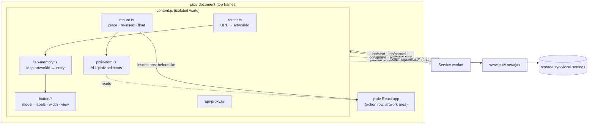
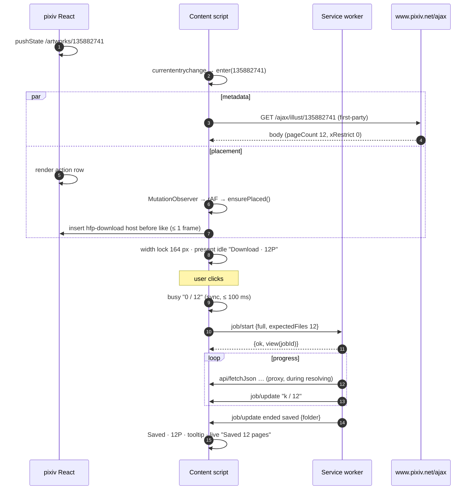
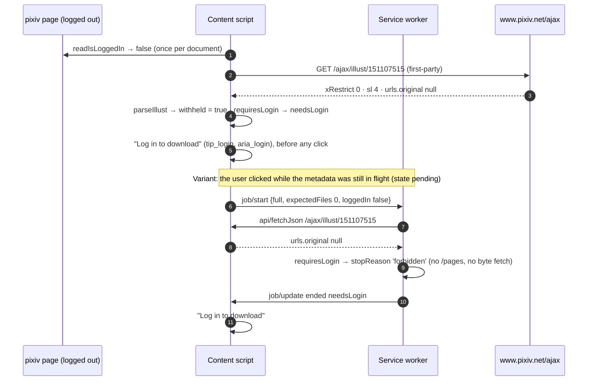

# Artwork Button (content script)

> Last updated: 2026-10-27 20:32:56 (UTC-7)
> Serves: prd-000 — CUJ-1 (button, states, SPA, memory; step 8 and §4.7.3/§4.7.6: the Saved tooltip and `aria-label` name the folder actually used, suffix included, refined 2026-10-27), CUJ-2 (ugoira hint/progress), CUJ-4 (per-tab progress only), CUJ-5 (needs-login incl. pixiv's login walls per R-003, error states, floating fallback); PRD §4.7 entirely; index "Accessibility", "Internationalization", "Theming"; R-004 S1 (widths), S2 (contrast), S4 (floating-fallback anchor), S7 (keyboard order), S13 (no busy 100%); R-007 item 6 (a Retry re-writes a `metadata.json` that did not land)

## Overview

The content script (`src/content/`, bundled as one classic IIFE `content.js`) runs in the top frame of every `https://www.pixiv.net/*` document. It:

1. detects artwork routes, including pixiv's SPA navigations;
2. fetches render-time metadata (`/ajax/illust/{id}`, first-party) and reads the page's login state and theme, and from them decides the pre-emptive needs-login state, including pixiv's sensitive-content wall (R-003, [system.md §8.5](system.md));
3. finds pixiv's action row and keeps **exactly one** Download button in it, immediately left of pixiv's Like on screen, re-inserting within 500 ms after pixiv re-renders, or floats it within 3 s, measured to the pill on screen, if the row cannot be found;
4. renders the button's state machine with locale-locked fixed width, full a11y, and a live region;
5. remembers per-artwork state for the life of the document, and reattaches to its own running jobs after a reload;
6. acts as the first-party API proxy (`api/fetchJson`) for the SW's jobs ([system.md §8.3](system.md)).

It never downloads anything itself: the job runs in the SW and offscreen document, so tab independence holds.

## Goals & Non-Goals

**Goals**
- Pixel and behavior fidelity to PRD §4.7 and mocks `cuj-1-*`, `cuj-2-*`, `cuj-5-*`.
- Resilience to pixiv's React re-renders and to DOM redesigns (selectors isolated in `pixiv-dom.ts`).
- No interference with pixiv: style isolation via Shadow DOM, no global listeners that alter pixiv behavior, no main-world script injection.
- Cheap: < 1 ms per DOM-mutation frame on pixiv; `content.js` ≤ 40 KB minified and ≤ 15 KB gzip ([system.md §11.6](system.md); 34.4 KB / 12.6 KB measured at the end of iteration 1).
- Never offer a download pixiv withholds from the viewer: logged out, a work behind any pixiv login wall shows `Log in to download` (R-003).

**Non-Goals**
- Buttons on non-artwork pages, thumbnails, or listings (PRD Not in v1).
- Persisting state across reloads (PRD §4.1 #1, §4.7.6). The only exception is reattaching to in-flight jobs.
- Any popup, toast, or explanatory text outside the button (PRD CUJ-5 Context).

## System Context



## Detailed Design

### Module map

| File | Responsibility |
|---|---|
| `content.ts` | Entry. Guards against double init (`window.__hfpInit`). Reads `localeTag`, `isLoggedIn`, theme. Registers `runtime.onMessage`. Starts the router. Calls `job/listForTab` to reattach. Tears down on "Extension context invalidated". |
| `router.ts` | Parses the current URL, detects SPA changes, and emits `enter(artworkId)` / `leave()`. |
| `pixiv-dom.ts` | **The only file with pixiv selectors and markers:** `findActionRow`, `findArtworkArea`, `renderedArtworkId`, `readIsLoggedIn`, `detectTheme`, `observeTheme`. |
| `mount.ts` | Owns the host element. `ensurePlaced()` (rAF-coalesced from a `MutationObserver`), the floating fallback, the single-host invariant. |
| `tab-memory.ts` | `Map<artworkId, Entry>` for the document's life. |
| `api-proxy.ts` | Handles `api/fetchJson` from the SW. |
| `button/model.ts` | `ButtonState` union and the pure transition function `reduce(state, event)`. |
| `button/labels.ts` | Pure `present(state, ctx) → Presentation` (icon, label, hint, title, aria) from Appendix A keys. |
| `button/width.ts` | Width candidates and measurement. |
| `button/view.ts` | Shadow DOM, rendering a `Presentation`, ring, interaction (click guard, cancel arming). |
| `button/styles.ts` | Constructable stylesheet text (PRD colors and geometry). |
| `button/icons.ts` | Constant SVG strings (download, check, x, warning). The only module allowed to use `innerHTML`. |
| `button/live-region.ts` | Polite live region with a 5 s progress throttle. |

### Startup

```ts
// content.ts (document_end, top frame)
if (window.__hfpInit) return; window.__hfpInit = true;
const ctx = {
  locale: localeTag(),                         // chrome.i18n.getMessage('locale_tag') → 'en'|'ja'|'zh-CN'|'zh-TW'
  loggedIn: readIsLoggedIn(document),          // true | false | null (unknown)
  theme: detectTheme(document),                // 'light' | 'dark'
};
chrome.runtime.onMessage.addListener(onMessage);   // job/update, api/fetchJson (target 'tab')
observeTheme(document, t => mount.setTheme(t));
router.start();                                     // emits enter/leave
sendToSw({ type: 'job/listForTab' }).then(({ views }) => views.forEach(v => memory.applyView(v)));   // reload reattach (PRD §4.7.6)
```

`readIsLoggedIn` is evaluated **once per document**, because pixiv's login state can only change through a full load (PRD CUJ-5 edge cases: "Logged in elsewhere after this page loaded … still shows Log in to download"). Strategy, in order (implemented in `pixiv-dom.ts`; markers verified live by ENG-002, `scripts/spike/FINDINGS.md` §5.4):
1. `script#__NEXT_DATA__[type="application/json"]` → `JSON.parse(textContent).props.pageProps.isLoggedIn`, if it is a boolean. pixiv's artwork page is Next.js; this script stays in the DOM after hydration.
2. `/"isLoggedIn"\s*:\s*(true|false)/` over the text of every inline `script:not([src])`. pixiv's theme bootstrap script carries `{"isLoggedIn":false,…}`.
3. not found → `null`.

The legacy `meta[name="global-data"]` / `#meta-preload-data` markers are absent from pixiv's current HTML and are not used.

`null` never produces needs-login: the button stays idle, and a refused click ends in `Retry` with `tip_refused`, which is correct for that case.

### Routing and SPA detection (router.ts)

- Artwork route: `^/(?:[a-z]{2}(?:-[a-z]{2,4})?/)?artworks/(\d{1,12})/?$` on `location.pathname`. This matches `/artworks/<id>` and locale-prefixed `/en/artworks/<id>` (PRD §4.7.1). Anything else → no button.
- Change detection (all funnel into one `check()` that compares `location.href` with the last value):
  1. **Navigation API:** `navigation.addEventListener('currententrychange', check)`. It fires for pixiv's `pushState`/`replaceState` and traversals. DOM events on the shared `navigation` object reach isolated-world listeners.
  2. `window.addEventListener('popstate', check)`.
  3. The `MutationObserver` callback (already running for placement) calls `check()`. This catches any missed event at frame granularity.
- `enter(id)`:
  - get or create the memory entry;
  - start the render-time metadata fetch if `entry.work` is absent;
  - start the floating-fallback timer (fires 2750 ms after entry so the pill is on screen within 3 s; "Mounting");
  - `mount.show(entry)`.
- `leave()`: `mount.hide()` (host removed from the DOM; memory kept).
- Artwork → artwork navigation is `leave()` then `enter(newId)` in the same tick.

### Render-time metadata

On `enter(id)` with no cached `work`: `fetchWithRetry('/ajax/illust/{id}', { responseType: 'json' })` (same-origin, first-party cookies, shared retry policy).

| Result | Entry update |
|---|---|
| 200, valid body | `work = parseIllust(body)` (which sets `work.withheld`, [system.md §8.5](system.md)). If `requiresLogin(work, ctx.loggedIn)` → state `needsLogin` (pre-emptive, CUJ-5 step 1, R-003); otherwise `idle`. If `illustType === 2` → `caps/get { width, height }` → `effectiveFormat(settings.ugoiraOutput, caps)`. |
| 404 or `pixivError` body | state `unavailable` (CUJ-5 step 7: "If the 404 already happens at render time, the button renders as Unavailable immediately") |
| Other failure after retries | stay `pending`. A click runs the job, and the SW classifies any failure (including the login wall, below). |

`work` is cached in the entry for the document's life (it does not change). The fetch runs in parallel with waiting for the action row and is never awaited before first render (PRD §4.7.1: the button appears idle with no hint if metadata is late; "The hint, or the needs-login state, is applied when the metadata arrives").

#### Needs-login decision (R-003)

`requiresLogin(work, loggedIn)` lives in `src/shared/pixiv-api.ts`, because the SW resolver applies the same predicate. It is `loggedIn === false && (work.xRestrict >= 1 || work.withheld)`, where `work.withheld` is `body.urls.original === null` (with an `sl ≥ 4` fallback only when the `urls` shape is missing). The signal, its live evidence (150 ranking works plus rendered pages, 2026-10-23), the rejected alternatives and what it misses are specified once in [system.md §8.5](system.md). In this chapter:

| Case (page logged out unless stated) | `xRestrict` | `urls.original` | Button before any click |
|---|---|---|---|
| R-18 / R-18G (pixiv: "R-18 works cannot be displayed") | 1 / 2 | `null` | `Log in to download` |
| All-ages behind the sensitive-content wall (pixiv: "This work may contain sensitive content. … Please log in to view this work.") | 0 | `null` | `Log in to download` (R-003) |
| All-ages, shown by pixiv | 0 | URL | `Download · NP` (CUJ-5 AC "pixiv shows without a login wall") |
| Any work, page logged in | any | any | idle; pixiv's answers to the job decide (`refused` if R-18 display is off, CUJ-5 step 6) |
| Login marker not found (`loggedIn === null`) | any | any | idle (unchanged rule: `null` never produces needs-login) |

- The decision is made once per artwork per document, when the metadata arrives in state `pending`. Later events never re-derive it: the login state is read once per document and the work does not change.
- **A click before the metadata arrives** (state `pending`) cannot use this decision, so `job/start` carries the page's `loggedIn` and the SW resolver repeats the check on its own `/ajax/illust` answer before calling `/pages` or `ugoira_meta` ([design-download-engine.md](design-download-engine.md) "Resolving"). The job then ends `needsLogin`, and the button shows `Log in to download` exactly as if the metadata had arrived first. Without this, a quick click on a walled all-ages work would download it, because pixiv serves `/pages` and the originals to logged-out sessions for such works.
- Logging: the content script logs each needs-login decision at `debug` with its reason (`xRestrict` or `withheld`). `parseIllust` logs a `warn` whenever it has to use the `sl` fallback, because that means pixiv changed the `urls` shape; `warn` reaches `chrome://extensions` → Errors, where a user's issue report would show it ([system.md §11.3](system.md)).

### pixiv DOM contract (pixiv-dom.ts)

```ts
export interface ActionRowHit {
  group: HTMLElement;              // the action-row container (a `section` inside `main`)
  like: HTMLElement;               // the element child of `group` that wraps pixiv's like button
  side: 'before' | 'after';        // DOM side of `like` the host goes on: 'after' when `group` is flex row-reverse
  via: string;                     // name of the strategy that found `like` (logging)
}
export function findActionRow(doc: Document, artworkId?: string): ActionRowHit | null;
export function findArtworkArea(doc: Document): HTMLElement | null;     // the artwork figure (floating fallback anchor)
export function renderedArtworkId(doc: Document): string | null;        // the work pixiv's column currently shows
export function readIsLoggedIn(doc: Document): boolean | null;
export function detectTheme(doc: Document): 'light' | 'dark';
export function observeTheme(doc: Document, cb: (t: 'light' | 'dark') => void): () => void;
```

The first design returned `{ group, before }` and inserted the host before the like control. ENG-002 measured the live row as `display: flex; flex-direction: row-reverse` (DOM order share, bookmark, like; screen order like, bookmark, share), so "immediately left of Like on screen" (PRD §4.7.1) is DOM position **after** the like wrapper there. `side` carries that decision so `mount.ts` stays layout-agnostic: `side = getComputedStyle(group).flexDirection === 'row-reverse' ? 'after' : 'before'`.

- **Selector policy** (unchanged). Use only stable hooks, in this order of preference:
  1. ARIA/role/`data-*` attributes;
  2. link `href` shapes;
  3. structure relative to `main` and the artwork `figure`;
  4. SVG signatures as a last resort.

  pixiv's generated class names (`sc-…`, CSS-module `style_*__hash`, utility classes) and the hand-authored `gtm-*` analytics classes are never used. Each function holds an **ordered list of strategies**, and the first strategy whose result passes validation wins.
- **Concrete hooks, verified live** (ENG-002, 2026-10-22, logged out; `scripts/spike/FINDINGS.md` §5; captures `test/fixtures/pixiv/artwork-live-light.html` and `artwork-live-ugoira.html`):

| Hook | Rule | Evidence |
|---|---|---|
| Artwork figure (`findArtworkArea`) | first `main figure` that is not inside an `a` | Illust: `figure` with `div[role="presentation"] … img[src^="https://i.pximg.net/img-master/"]`, 704×757 live. Ugoira: `figure > div[role="presentation"] > div > canvas`. The other `figure`s are "Other works" thumbnails inside `a[data-ga4-label="thumbnail_link"]`. |
| Action-row candidates | every `main section` that **follows** the artwork figure in document order (`compareDocumentPosition`) | The row `section` sits in a sticky wrapper between the `figure` and the `figcaption`; the outer `main > section` contains the figure, so it is excluded automatically. |
| Control role of each element child `w` of a candidate (`roleOf`) | `w > button` absent → none; `aria-haspopup="true"` → menu (share); `button svg mask` → bookmark heart; like strategy match → like; else other | The three row buttons have no `aria-label`; share has `aria-haspopup`, the heart is the only SVG with a `<mask>`. |
| Like, strategy 1 `icon+label` | `button > svg` plus a direct `span` child with non-empty text | The only row control with an icon and a visible text label (`Like` in en; localized, so only non-emptiness is checked). |
| Like, strategy 2 `svg-signature` (last resort) | `button > svg[viewBox="0 0 12 12"]` | The like icon's viewBox, in case a redesign drops the label. |
| Row validation | a like wrapper plus ≥ 1 other control (≥ 2 non-`none` children), and a non-zero box; first such section wins | Live: 704×48 box, 3 controls. Thumbnail mini-actions (`div[data-ga4-label="bookmark_button"] > button`) have no label and are not in a following `section`. |
| Rendered-work guard (`renderedArtworkId`, `findActionRow(doc, artworkId)`) | `main figcaption [data-ga4-label="work_content"][data-ga4-entity-id]` → `illust/<id>`; when present and ≠ the route's id, no row is returned | During SPA navigation pixiv briefly keeps the previous work's column; the guard stops the host from settling into the old row. Ugoira also uses the `illust/` prefix. |
| Theme (`detectTheme`) | `<html data-theme="dark\|light">`; otherwise the relative luminance of the body background < 0.4 → dark | Live: `<html lang="en" data-theme="light">`, body `rgb(245,245,245)`. pixiv's bootstrap sets the attribute before first paint. Logged out it is always `light` (`allowNologinDarkTheme: false`), so `dark` is inferred from pixiv's code and **not observed live**. |
| Theme changes (`observeTheme`) | `MutationObserver` on `<html>` and `<body>`, `attributeFilter: ['data-theme', 'class', 'style']` | `class`/`style` cover the luminance fallback. |
| Login marker (`readIsLoggedIn`) | "Startup" above | `__NEXT_DATA__` present after hydration in both captures. |

- **happy-dom caveat.** happy-dom 21 evaluates `:has(> …)` incorrectly, so structural tests are written with child iteration and `:scope >` queries, never `:has()`. happy-dom has no layout or CSS: unit tests stub `getBoundingClientRect` and `getComputedStyle(group).flexDirection` to cover both `side` branches.
- **Fixtures and their limits.** Unit tests run every strategy against the two live captures. There is no dark capture (impossible logged out), no logged-out walled capture (the wall replaces the image area; the action row is unaffected, and the needs-login decision does not use the DOM), and **no logged-in capture**: the logged-in row (possible extra controls) and `data-theme="dark"` remain unverified until an owner-run `npm run qa:live` with a session or the L5 checklist ([design-test-harness.md](design-test-harness.md)). A pixiv redesign shows up as a fixture refresh (`node scripts/spike/run.mjs --capture`) plus a selector change confined to this file.

### Mounting (mount.ts)

**Host element:** `<hfp-download>`, a valid custom-element name that is deliberately never registered (`customElements` is unavailable in isolated worlds, and none is needed). It is created once per document and moved between artworks and placements.
- Attributes: `lang=<localeTag>`, `data-theme=light|dark`, `data-mode=row|floating|viewport`.
- Closed shadow root containing the `<button>`, the measurement button and the live region.
- Host style: `display: inline-flex; flex-shrink: 0; vertical-align: middle;`.

```
ensurePlaced():                                  // rAF-coalesced; called from MutationObserver, show(), the fallback timer
  if not shown (not on an artwork route): return
  remove any other <hfp-download> in the document (single-host invariant; also cleans up an orphaned previous version)
  if the last hit is still in place: return       // group connected, like still its child, host on hit.side of like
  hit = findActionRow(document, routeArtworkId)
  if hit:
     if not in place: (hit.side === 'after' ? hit.like.after(host) : hit.like.before(host)); clear floating styles;
                      copy spacing; mode = 'row'
  else if fallbackFired (the fallback timer fired: FLOAT_FALLBACK_MS − FLOAT_PLACEMENT_BUDGET_MS = 2750 ms after route entry):
     area = findArtworkArea(document)
     mode = area has a box ? 'floating' : 'viewport'; ensure host is a child of document.body; position()
```

- **Fallback timer** (PRD §4.7.1, CUJ-5 step 11 and its AC; R-004 S4, D14). The PRD measures the 3 s from the artwork page loading (the extension starts once the page's HTML has been parsed) or from pixiv's in-app navigation to it (the URL change), **to the floating pill appearing on screen**, so the time needed to place it counts inside the 3 s.
  - **Anchor: route entry.** `show()` runs synchronously at both PRD anchors. On a full load, `router.start()` enters the route when the content script starts (`run_at: document_end`, after the HTML is parsed). On SPA navigation, the Navigation API's `currententrychange` fires in the same task as pixiv's `pushState`. Navigation start is not used as an anchor: pixiv renders its action row after `document_end`, so an earlier anchor would float the pill on slow loads and then jump it into the row (pm-review iteration 2, priority 3).
  - **Placement budget.** `show()` starts a timer of `FLOAT_FALLBACK_MS − FLOAT_PLACEMENT_BUDGET_MS` = 3000 − 250 = **2750 ms** (both in `src/shared/constants.ts`; `FLOAT_FALLBACK_MS` stays the PRD's 3000). Its callback sets `fallbackFired` and calls `ensurePlaced()` synchronously: `float()` appends the host to `body`, `onPlaced` locks the width, and `position()` sets `left`/`top`, so the pill is painted at the next frame. The iteration-2 timer fired at exactly 3000 ms, and the pill appeared 11–23 ms late in QA's runs (direct load 3018–3023 ms, SPA 3011–3013 ms) and up to 79 ms late in the code review's loaded runs: timer lateness behind pixiv's main-thread work, plus placement, plus one frame. 250 ms covers three times the worst measurement. The cost: if pixiv renders its row between 2.75 s and 3 s after entry, the pill floats for that moment and then moves into the row. That is rarer than the slow-render case the PRD already accepts at 3 s, and the state is kept.
  - The timer is **not** cancelled when the row is found. Once it has fired, any later moment without a row (pixiv removed the row, or a re-render left it missing for a frame) floats the host at once instead of waiting again; when the row returns, the next `ensurePlaced()` moves the host back. `hide()` (route left) resets it, and the next `show()` starts a fresh one.

- **Re-insertion latency:** pixiv re-renders → mutation records → next animation frame → `ensurePlaced()`. Typical latency is one frame (≤ 17 ms), far inside the 500 ms requirement. The host keeps its shadow root and state when moved, so the state is unchanged (PRD §4.7.1).
- **Spacing:** if `hit.group` has a positive computed `column-gap`, nothing is needed (12 px in mocks). Otherwise the host copies the like wrapper's computed `margin-left`/`margin-right` (pixiv is left-to-right only). Live, the group has `column-gap: normal` and the like wrapper `margin: 0 20px 0 0`; under `row-reverse` the copied `margin-right: 20px` is exactly the gap between the pill and Like.
- **Floating mode** (PRD CUJ-5 step 11): `position: fixed; z-index: 2147483000;`, shadow `0 2px 8px rgba(0,0,0,.24)` on the button. `position()` sets `left = rect.right − 16 − width`, `top = rect.bottom − 16 − 40` from `area.getBoundingClientRect()`. It is updated on `scroll` (passive, capture), `resize`, and a `ResizeObserver` on `area`, rAF-throttled. Fixed positioning is used instead of absolute inside pixiv's container because that container may be statically positioned, and changing pixiv's styles is off-limits.
- **Viewport mode:** `right: 24px; bottom: 24px` fixed.
- If the action row appears later, the next `ensurePlaced()` moves the host into the row and clears the floating styles; state is kept.
- **Observer scope:** one `MutationObserver(document.body, { childList: true, subtree: true })` for the document's life. On non-artwork routes its callback only runs `router.check()`.

### Button state model (button/model.ts)

```ts
export type ButtonState =
  | { s: 'pending' }                                                     // no metadata yet: "Download", no hint
  | { s: 'idle' }                                                        // presentation derives from entry.work + settings + caps
  | { s: 'busy'; jobId: string; progress: JobProgress | null; startedAt: number; armed: boolean }
  | { s: 'saved'; folder: string; kind: 'pages' | 'ugoira'; pages?: number; format?: UgoiraOutput }
                                   // folder: the folder actually used, suffix included (`JobOutcome.saved.folder` = `JobRecord.folder`;
                                   // PRD §4.7.6, design-download-engine.md "Folder choice"). Only shown in the tooltip and aria-label.
  | { s: 'error'; err:
        | { t: 'partial'; folder: string; total: number; saved: number; failedPages: number[];
            metadataFailed?: true }    // from the outcome (system.md §10 row 6); never shown, only sent with the Retry (R-007)
        | { t: 'metadataOnly'; folder: string; total: number }
        | { t: 'encodeFailed'; folder: string; format: 'mp4' | 'webm' }
        | { t: 'cause'; cause: ErrorCause } }
  | { s: 'needsLogin' }
  | { s: 'unavailable' };

export interface Entry {
  artworkId: string;
  work: WorkInfo | null;
  format: UgoiraOutput | null;     // effective, ugoira only
  state: ButtonState;
  width: number | null;            // locked px
  interacted: boolean;             // blocks the one-time widen after first click
  cancelledJobs: Set<string>;      // jobs the user cancelled locally (late 'running' updates ignored)
}
```

```mermaid
stateDiagram-v2
  [*] --> pending: enter(artwork)
  pending --> idle: metadata ok
  pending --> needsLogin: requiresLogin(work, loggedIn) (xRestrict≥1 or withheld, page logged out; R-003)
  pending --> unavailable: 404 / pixiv error
  pending --> busy: click (job/start)
  idle --> busy: click (job/start)
  saved --> busy: click (re-download, full)
  error --> busy: click (retry per error type)
  needsLogin --> [*]: click → accounts.pixiv.net login (full navigation)
  busy --> idle: click after guard → job/cancel (optimistic) / ended cancelled
  busy --> saved: ended saved
  busy --> error: ended partial | metadataOnly | encodeFailed | error
  busy --> needsLogin: ended needsLogin (403 on bytes, or the resolver's login-wall check)
  busy --> unavailable: ended unavailable
  unavailable --> unavailable: click (no-op)
```

**Click actions:**

| State | Click → `job/start` payload |
|---|---|
| `pending` | `{ mode: 'full', expectedFiles: 0, loggedIn: ctx.loggedIn }` (the SW repeats the needs-login check, R-003) |
| `idle` | `{ mode: 'full', expectedFiles: work.illustType === 2 ? 1 : work.pageCount, loggedIn: ctx.loggedIn }` |
| `saved` | same as `idle` (re-download, current settings; PRD CUJ-1 step 8). The request carries nothing about the earlier folder: the SW's folder choice reads Chrome's download history and sends the new job to `<folder> (n)` (design-download-engine.md "Folder choice"), so the tab keeps no history (PRD §4.1 #1) and a reload changes nothing about where a repeat run lands |
| `error.partial` | `{ mode: 'retryPages', folder, pages: failedPages, total }`, plus `withMetadata: true` when `metadataFailed` (PRD CUJ-5 step 5 and edge "Pages and `metadata.json` both failed", R-007 item 6). `folder` is the earlier job's folder as its outcome reported it, suffix included, so a Retry of a `(1)` job writes into `(1)` (PRD CUJ-5 step 5 "suffix included if it had one"); the same holds for `metadataOnly` and `encodeFailed` below |
| `error.metadataOnly` | `{ mode: 'retryMetadata', folder }` |
| `error.encodeFailed` | `{ mode: 'retryEncode', folder, format }` (CUJ-5 step 8) |
| `error.cause` | `{ mode: 'full', … }` (CUJ-5 step 6: "runs the whole job again with the current settings") |
| `needsLogin` | `location.assign('https://accounts.pixiv.net/login?return_to=' + encodeURIComponent(location.href))` (CUJ-5 step 2) |
| `busy` | if `now − startedAt < 500 ms` → ignore (double-click guard, PRD §4.7.5); else `job/cancel { jobId }`, then optimistic `idle`, `cancelledJobs.add(jobId)`, announce `live_cancelled` |
| `unavailable` | nothing |

**Busy feedback ≤ 100 ms** (PRD NFR): the click handler synchronously sets `busy` with an optimistic progress: `{ kind: 'pages', done: offset, total }`, or `{ kind: 'percent', percent: 0, phase: 'frames' }` for ugoira. It renders, then sends `job/start`. The response's `jobId` is attached to the state. If `job/start` fails (SW error, context invalidated) → `error.cause = 'server'`.

**`job/update` handling:** look up `memory[view.artworkId]`. Ignore the update if `view.jobId` is in `cancelledJobs` and the view is still running. If ended, apply the outcome even if cancelled locally (truth wins, e.g. the job completed before the cancel landed). Otherwise apply `view.progress` and, on `ended`, map `outcome` to a state: `saved` → saved, `cancelled` → idle, `partial`/`metadataOnly`/`encodeFailed`/`error` → error, `needsLogin` → needsLogin, `unavailable` → unavailable. Re-render only if the entry is the displayed one. Progress for an artwork the user navigated away from keeps updating in memory, so coming back shows live progress (PRD CUJ-1 edge "SPA navigation mid-download").

### Presentation (button/labels.ts)

`present(entry, settings, locale) → { variant, icon, label, hint?, title?, ariaLabel, ariaBusy, ariaDisabled, ring? }`. English examples are shown; keys are from PRD Appendix A plus the derived keys in [system.md §11.4](system.md).

| State | Variant | Icon | Label · hint | `title` | `aria-label` |
|---|---|---|---|---|---|
| pending | primary | download | `btn_download` | — | `btn_download` |
| idle, pages, n > 1 | primary | download | `Download · 12P` (`btn_download` · `hint_pages`) | — | `aria_idle_pages` |
| idle, pages, n = 1 | primary | download | `Download` | — | `aria_idle_single` |
| idle, ugoira | primary | download | `Download · MP4\|WebM\|ZIP` (`hint_format`) | — | mp4/webm: `aria_idle_ugoira` (metadata on) / `aria_idle_ugoira_nometa`; zip: `aria_idle_ugoira_zip` |
| busy, pages | primary | ring (done/total) | `7 / 12` (`btn_progress_pages`) | `tip_cancel` | `aria_busy_pages` (`_one` when total = 1) |
| busy, ugoira frames | primary | ring (p%) or indeterminate arc | `58%` (`btn_progress_percent`) | `tip_cancel` | `aria_busy_frames` |
| busy, ugoira encode | primary | ring | `58%` | `tip_cancel` | `aria_busy_encode` |
| busy, cancel face (hover, armed) | cancel | x | `Cancel` (`btn_cancel`) | `tip_cancel` | unchanged (already says "Click to cancel.") |
| saved, pages | saved | check | `Saved · 12P` / `Saved` (n = 1) | `tip_saved` | `aria_saved_pages` / `aria_saved_pages_one` |
| saved, ugoira | saved | check | `Saved · MP4\|WebM\|ZIP` | `tip_saved` | `aria_saved_ugoira` |
| needsLogin | neutral | none | `Log in to download` | `tip_login` | `aria_login` (`Log in to pixiv to download this work.`, neutral per R-003: also used for a mid-job 403 on an all-ages work) |
| error, partial | error | warning | `Retry · 3 failed` (`hint_failed`) | `tip_partial` / `tip_partial_one` | `aria_partial` |
| error, cause | error | warning | `Retry` | `tip_offline` / `tip_refused` / `tip_server` / `tip_disk` | `aria_failed` (embeds the tooltip) |
| error, metadataOnly | error | warning | `Retry` | `tip_metadata_only` | the tooltip text (it already ends with the action) |
| error, encodeFailed | error | warning | `Retry · MP4\|WebM` | `tip_encode_failed` | the tooltip text |
| unavailable | disabled | none | `Unavailable` | `tip_unavailable` | `tip_unavailable`; `aria-disabled="true"` |

`tip_saved` and the saved aria strings contain `Downloads/<folder>`, where `<folder>` is **the folder actually used, suffix included**: `JobOutcome.saved.folder`, which is `JobRecord.folder` after the SW's folder choice (PRD CUJ-1 steps 6 and 8, §4.7.3 Saved row, §4.7.6, Appendix A `tip_saved`; refined 2026-10-27). After a repeat run the tooltip reads `Saved to Downloads/pixiv/みずき-135882741 (1)` and the `aria-label` `Saved 12 pages to Downloads/pixiv/みずき-135882741 (1). Click to download again.`, while the face stays `Saved · 12P`: no new state, no index on the face (mock `cuj-1-saved-again.html`). The string is interpolated verbatim through `$FOLDER$`; nothing in the content script parses or formats it, so the suffix needs no code here beyond what the outcome carries.

### Fixed width (button/width.ts)

PRD §4.7.2: the width equals the widest label this button can show for this artwork in the active locale. It is locked at first render and never changes between states or when Ugoira output changes. In English it is 164 px for illustrations and manga up to 99 pages, and 176 px for every ugoira (R-004 S1).

```
candidates(work | null, locale):
  pages(n):  idle(n) · busy(`n / n`) · cancel · saved(n) · needsLogin · retry(`n failed`) · retry · unavailable
  ugoira:    idle(MP4|WebM|ZIP) · busy(`100%`) · cancel · saved(MP4|WebM|ZIP) · needsLogin · retry · retry(MP4|WebM) · unavailable
             // busy(`n / n`) is likewise an upper bound for the pages face: a job's running label tops at `n−1 / n`
             // (PRD CUJ-1 AC, R-006 rev. 3; design-download-engine.md "Progress counter"), but `n / n` can still show past
             // the 2 s settle cap, so it stays a candidate: the width is a maximum, and an upper bound can never clip
             // busy(`100%`) is an upper bound for the percent face: the label never shows 100% (PRD §4.7.5, R-004 S13),
             // and the face is far narrower than `Download · WebM`, so it never decides the width
  null:      pages(99)                                  // metadata not known yet: "starts at the 2-digit width"
width = max(ceil(measure(c)) for c in candidates, floor(work, locale))
floor(work, locale) = work?.illustType === 2 ? UGOIRA_LOCALE_FLOOR_PX[locale] : LOCALE_FLOOR_PX[locale]
LOCALE_FLOOR_PX        = { en: 164, ja: 0, 'zh-CN': 0, 'zh-TW': 0 }   // pages, and metadata unknown
UGOIRA_LOCALE_FLOOR_PX = { en: 176, ja: 0, 'zh-CN': 0, 'zh-TW': 0 }   // iteration 3 (R-004 S1)
```

- **Provisional width (`work === null`).** Before the metadata arrives the button cannot know whether the work is an ugoira, so it uses the 99-page faces only, exactly the PRD's "starts at the 2-digit width" (§4.7.2): 164 px in English. The first design used `pages(99) ∪ ugoira` there, which measures 176 px in English (`Download · WebM`), and because the width never shrinks, every illustration whose metadata lost the race against the action row stayed at 176 px, breaking the CUJ-1 AC "164 px … on a work of 99 or fewer pages" (PM iteration-1 review). With the fix:
  - an illustration or manga ≤ 99 pages keeps 164 px whether or not its metadata was late;
  - a 100+ page work or an ugoira widens **once**, when its metadata arrives, if the user has not interacted yet (the existing widen-once rule);
  - if the user clicks **before** the metadata arrives (`interacted` is set), the width stays provisional for the life of the document. On an ugoira whose effective format is WebM, the hint of `Download · WebM` / `Saved · WebM` / `Retry · WebM` can then exceed the pill by up to ~12 px in English. The `.hint` span therefore has `min-width: 0; overflow: hidden; text-overflow: ellipsis` inside the flex pill, so the label stays whole and the hint is cut (`Saved · We…`) instead of overflowing the pill's border. This is a rare edge (a click inside the metadata window, on an ugoira, with WebM effective), keeps the "never changes after interaction" rule, and is accepted in PRD §4.7.2 (R-004 S1).
- **Ugoira width** (PRD §4.7.2, CUJ-2 step 1 and AC; R-004 S1). An ugoira's candidates include every format's faces, because `Download · WebM` is a label the button can reach whatever the setting (the output follows the setting and codec support). That measures **176 px** in English, the PRD's and the widened mocks' number, in idle, busy, Cancel-hover and Saved, and across Ugoira-output changes.

- **Measurement:** a hidden `<button>` in the same shadow root (`position: absolute; visibility: hidden; width: auto; left: -9999px`) is rendered with each candidate's `Presentation` by the same `view.ts` renderer. Its `getBoundingClientRect().width` is read. This takes ~15 candidates per artwork, under 2 ms. It runs after `document.fonts.ready` (system fonts resolve immediately).
- **Why the English floors:** AC CUJ-1 fixes 164 px for every ≤ 99-page English work, including single-page works whose widest label measures narrower, and since R-004 S1 the CUJ-2 AC fixes 176 px for every English ugoira. System fonts differ by OS (SF, Segoe UI, Roboto), so a measured-only width would not hit either number everywhere: `Download · WebM` measures 176 px with the fonts of the dev and e2e machines and may measure less elsewhere. A floor never cuts a label: where a font measures wider, the measured value wins, exactly as for 164. The provisional width (`work === null`) keeps the 164 floor, and an ugoira widens once to its floor or its measured width when the metadata arrives (before any interaction). Other locales use the measured value, as the PRD rule states. The e2e ugoira check becomes `toBe(176)` in English (it was `≥ 164` while the PRD said 164; pm-review iteration 2, 5b).
- **Lock and widen-once:** `entry.width` is set at first render. When metadata arrives later, the width is recomputed. If the new value is larger and `entry.interacted === false`, it widens once (PRD §4.7.2: 100+ page works, "may widen once … before any interaction"). It never shrinks. The width is stored per artwork, so SPA back/forward shows the same width.
- Settings changes (MP4 ↔ WebM ↔ ZIP) never change the width, because all formats are already candidates.

### View, styles, interaction (button/view.ts, styles.ts)

Shadow DOM structure:
```html
<style>…</style>
<button type="button" class="pill" part="button">
  <span class="icon"></span><span class="label"></span><span class="dot">·</span><span class="hint"></span>
</button>
<button class="pill measure" tabindex="-1" aria-hidden="true"></button>
<div class="sr-live" role="status" aria-live="polite"></div>
```

Styles follow PRD §4.7.2–4.7.4 exactly:
- **`:host`:** `all: initial` then explicit `font-family: -apple-system, BlinkMacSystemFont, "Segoe UI", Roboto, "Hiragino Sans", "Noto Sans JP", "Noto Sans SC", "Noto Sans TC", sans-serif`.
- **`.pill`:** `height: 40px; border-radius: 9999px; padding: 0 12px; gap: 8px; white-space: nowrap; flex-shrink: 0; width: var(--hfp-width)`, label 14 px 600, hint 13 px 400 at opacity .85, dot at .6, counters `font-variant-numeric: tabular-nums`, `transition: background-color 120ms`.
- **Variants:** primary `#0096FA`/hover `#0084DC`, shadow `0 1px 2px rgba(0,0,0,.08)`; saved white/1.5 px `#0096FA`/hover `#e6f4fe`; neutral white/`#c4c7c5`/`#3c4043`, hover `#f5f7f9` + border `#8a8f94`; error white/`#d93025` (hint opacity 1)/hover `#fdeceb`; disabled `#f1f3f4` fill with `#5f6368` text (5.44:1; PRD §4.7.3, CUJ-5 step 7, R-004 S2), `cursor: not-allowed`, no hover; cancel face `#3c4043` + white.
- **Pill height** `40px` is exported from `styles.ts` as `PILL_HEIGHT_PX` and interpolated into the stylesheet; `mount.ts` imports it for the floating position instead of keeping its own copy (code review W9).
- **Focus:** `.pill:focus-visible { outline: 2px solid #0096FA; outline-offset: 3px }`; `:host([data-theme=dark]) .pill:focus-visible { outline-color: #5fb9fb }`.
- **Ring:** SVG 18×18, `viewBox 0 0 20 20`, `r = 8`, track `rgba(255,255,255,.2)`, stroke 2.5, round caps, `rotate(-90deg)` (12 o'clock start, clockwise). `C = 2π·8 = 50.265`; `stroke-dashoffset = C × (1 − fraction)`, `transition: stroke-dashoffset 300ms ease`. The indeterminate variant is a 25 % arc rotating 360° per second.
- **Reduced motion:** `@media (prefers-reduced-motion: reduce)` sets every transition and animation to `none` and stops the indeterminate rotation (PRD §4.7.4, §4.7.5).

**Cancel face arming** (PRD §4.7.5):
- On the starting click, `armed = false`, and the hover CSS for the cancel face is gated on `.pill.busy.armed:hover`.
- The first `pointerleave` after the click sets `armed = true`.
- Keyboard focus never swaps faces.

**Live region** (`role="status"`, polite). The text is replaced; it is never appended.

| Moment | Message |
|---|---|
| Job start | `live_start` / `live_start_one` (pages); derived `live_start_ugoira` |
| Progress (≤ once per 5 s, only while this artwork is displayed) | derived `live_progress_pages` (`<done> of <total> pages saved`), `live_progress_percent` (`<p> percent`) |
| End | `live_saved` / `live_saved_one`; derived `live_saved_ugoira` (`Saved <format>`); `live_failed` / `live_failed_one` (partial); for cause, metadataOnly and encodeFailed errors, the tooltip text; `live_cancelled`; needs-login → `aria_login` |

`aria-busy="true"` is set on the button while busy (PRD §4.7.7).

### Settings and codec reactivity

- The content script reads settings with the shared `readSettings()` (sync + local, newest wins; [design-settings-model.md](design-settings-model.md)).
- It listens to `chrome.storage.onChanged` for the `settings` key in `sync` or `local`. On change it re-reads, and for an **idle** ugoira entry recomputes `format = effectiveFormat(settings.ugoiraOutput, caps)` and re-presents (hint and aria change; width does not). This meets "within 1 s" (PRD CUJ-2 step 1, CUJ-3 step 7): `onChanged` fires within milliseconds. Busy, saved and error entries are untouched, because the running job keeps its snapshot (PRD §4.1 #8).

### API proxy (api-proxy.ts)

`api/fetchJson { url }`:
1. validate `url` against the API allowlist ([system.md §11.1](system.md));
2. `fetchWithRetry(url, { responseType: 'json', init: { credentials: 'same-origin' } })`;
3. `sendResponse({ ok: true, result })`; return `true`.

The work is independent of the displayed artwork and of the button, so it serves any job this tab started, even after SPA navigation.

### Extension update / context invalidation

After an extension update, Chrome does not re-inject content scripts into open tabs (that would need `scripting`, which is not requested). The old instance's `chrome.runtime` becomes invalid. Any `sendMessage` that throws "Extension context invalidated" makes the instance **tear down**: disconnect observers, remove its host. That leaves no dead button. The next page load gets the new version.

## Data Flow



**Logged out, a walled all-ages work (R-003).** Render-time path, then the pending-click path that the resolver closes:



## Alternatives Considered

| Criteria | **Shadow DOM host (closed)** | Light-DOM button with prefixed classes | iframe-hosted button |
|---|---|---|---|
| Isolation from pixiv CSS | Full | Partial (`all: revert` games) | Full |
| Fits pixiv's row layout (flex gap, baseline) | Yes (host is a flex item) | Yes | Poor (fixed iframe box, focus trapping) |
| A11y (native button in page tab order) | Yes | Yes | Awkward (separate document) |
| Cost | Tiny | Tiny | Heavy |
| **Verdict** | **Selected** | Rejected | Rejected |

| Criteria | **Navigation API + popstate + MutationObserver check** | Patch `history.pushState` via main-world script | Poll `location.href` every 250 ms |
|---|---|---|---|
| Needs `web_accessible_resources`/main-world injection | No | Yes | No |
| Latency | Same tick | Same tick | ≤ 250 ms |
| Robust to missed events | Yes (observer fallback) | Moderate | Yes |
| **Verdict** | **Selected** | Rejected (surface, store review) | Rejected (latency, wasteful) |

| Criteria | **Measured width + English floor** | Hard-coded per-locale widths | CSS `min-width` only |
|---|---|---|---|
| Meets "widest label for this artwork" | Yes | No (page-count dependent) | No (shifts between states) |
| Meets the English 164 px (CUJ-1) and 176 px (CUJ-2) ACs on all OS fonts | Yes (floors) | Yes | No |
| Robust to translation edits | Yes | No (needs re-tuning) | — |
| **Verdict** | **Selected** | Rejected | Rejected |

Vanilla TS vs a UI framework: see [system.md §3](system.md). The login-wall signal (`urls.original === null` vs `sl` threshold, DOM wall marker, `/pages` refusal, page HTML): see [system.md §8.5](system.md).

## Cross-Cutting Concerns

- **Error handling:**
  - Render-fetch failures leave `pending`, never an error (the click path classifies).
  - Messaging failures → `error.cause = 'server'`, except "context invalidated", which triggers teardown.
  - `tabs.sendMessage` from the SW to a tab that has navigated off pixiv simply fails on the SW side.
- **Security:**
  - No `innerHTML` with data; folder strings and titles go into `title`/`aria-label` attributes and `textContent` only.
  - The closed shadow root prevents pixiv scripts from reading or styling the button.
  - The API proxy accepts only allowlisted pixiv API URLs.
  - No main-world code.
- **Performance:**
  - `content.js` ≤ 40 KB minified / ≤ 15 KB gzip, checked in CI by `npm run size` (ENG-010; [system.md §11.6](system.md)). The R-003 check adds one predicate and one parsed field, under 0.3 KB.
  - The needs-login decision makes no extra request: it reads the render-time `/ajax/illust` body the button already fetches for its hint.
  - Steady state on pixiv: one `MutationObserver`, rAF-coalesced checks (< 0.5 ms each).
  - Zero work on non-artwork routes beyond a string compare.
  - Memory map entries ~1 KB each.
- **Accessibility:**
  - Native `<button type="button">` placed next to pixiv's Like in DOM order. In pixiv's live `row-reverse` row it follows the like wrapper, so Tab reaches it right after Like: pixiv's own row order, next to Like (PRD index "Accessibility", CUJ-1 edge "Keyboard and screen reader", R-004 S7).
  - Contrast: every state's text passes 4.5:1 at rest except pixiv blue with white (accepted); the error and Saved hover tints (4.18:1, 2.78:1) use the PRD's hover-tint exemption ([system.md §11.5](system.md)).
  - Enter/Space by default; `aria-busy`, `aria-disabled` (still focusable); full-meaning `aria-label` per state; polite live region; focus ring per theme; reduced motion.
  - `lang` on the host for CJK glyph selection (index "CJK rendering").
- **Observability:** `debug` for route changes, placement mode changes (row → floating), selector strategy used, and width computed. A `warn` when the floating fallback engages ("action row not found"), the first signal of a pixiv redesign.
- **Testing:**
  - Unit (happy-dom): router regex and change detection; `pixiv-dom` strategies against committed live fixtures (ENG-002), including both `side` branches with a stubbed `flexDirection`; `reduce()` transitions, including `metadata` with `{ xRestrict: 0, withheld: true }` and `loggedIn` `false` / `true` / `null` (needs-login only for `false`); `present()` for every row of the presentation table in all 4 locales, including a `saved` state whose `folder` ends in ` (1)` → `tip_saved`, `aria_saved_pages` and `aria_saved_ugoira` carry the suffix verbatim; `startRequest` for `error.partial` with a `(1)` folder echoes it unchanged; width candidates (`candidates(null)` = the 99-page faces only; an ugoira widens once before interaction and never after); click guard and arming with fake timers; live-region throttle.
  - Unit (`pixiv-api.ts`): `parseIllust` sets `withheld` from reduced live bodies (`test/fixtures/api/illust-walled.json` from 151107515, `illust-visible.json` from 151061734), from a body without `urls` and `sl` 4 (fallback → true) or `sl` 2 (→ false), and `requiresLogin` over the truth table of [system.md §8.5](system.md).
  - E2E: placement latency, re-insertion after a simulated React re-render, single-host invariant, floating fallback ≤ 3000 ms from the PRD anchors (`performance.getEntriesByType('navigation')[0].domInteractive` on a direct load; `performance.now()` at the in-page click on SPA navigation) to the first animation frame after the host connects (a page `MutationObserver` sees the host, then `requestAnimationFrame` stamps the time), SPA memory, reload reattach, dark theme focus ring, 4-locale width snapshots; CUJ-1 step 8: after the second click the button's `title` is `Saved to Downloads/pixiv/みずき-135882741 (1)` and its `aria-label` names the same folder, with the face `Saved · 12P` and the width unchanged ([design-test-harness.md](design-test-harness.md)); logged out on the fake walled work (`135882745`, [design-test-harness.md](design-test-harness.md)) → `Log in to download` before any click with `aria-label` `Log in to pixiv to download this work.`, and the login round-trip → `Download · 4P`; a click while `/ajax/illust` is held (`server.hold()`) on that work → `Log in to download` with no `/pages` or `i.pximg.net` request in the server log; a late `/ajax/illust` on a ≤ 99-page illustration → 164 px throughout.

## Dependencies & Integration Points

- **Depends on:** `src/shared/{retry, pixiv-api, settings, i18n, types, job, messages, dom}` (never `src/background/`, [system.md §4](system.md) layering rule); the SW message contract ([design-download-engine.md](design-download-engine.md)); pixiv's DOM (via `pixiv-dom.ts` only).
- **Depended on by:** the SW (API proxy; receiving `job/update`), the e2e harness (fake pixiv pages must satisfy `pixiv-dom.ts` strategies).

## Open Questions & Risks

- **Logged-in DOM and dark theme are unverified live.** ENG-002 pinned the selectors from logged-out captures. P1 (always logged in) may see extra row controls; validation is structural, so an extra control does not break the hit, and a missing row still floats. Needs an owner-run `npm run qa:live` with a session, or the L5 checklist, before release.
- **Login-wall signal (R-003): what it misses** ([system.md §8.5](system.md)): a page whose login marker cannot be read (`null`) never shows needs-login; a page that still says logged in after the user logged out elsewhere downloads a walled all-ages work (pixiv serves it to that session); pixiv changing how it hides walled works would show idle until the L4 live smoke catches it.
- **React reconciliation and foreign nodes:** inserting a node into a React-managed container is common practice (other pixiv extensions do it), but React may remove or reorder it on re-render. `ensurePlaced()` re-inserts within a frame. If pixiv's React ever throws on our sibling, the floating fallback still works. Watch during QA.
- **Floating fallback budget** (250 ms, Mounting): if a slower machine ever shows the pill after 3 s, raise `FLOAT_PLACEMENT_BUDGET_MS`; the only cost is a slightly wider float-then-jump window.
