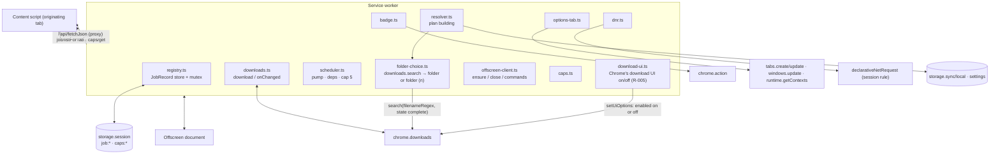
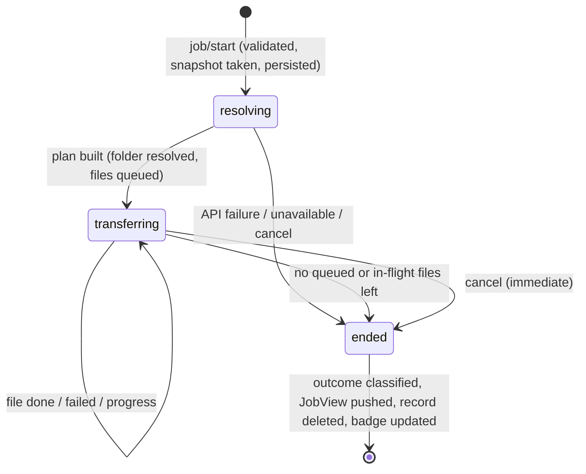
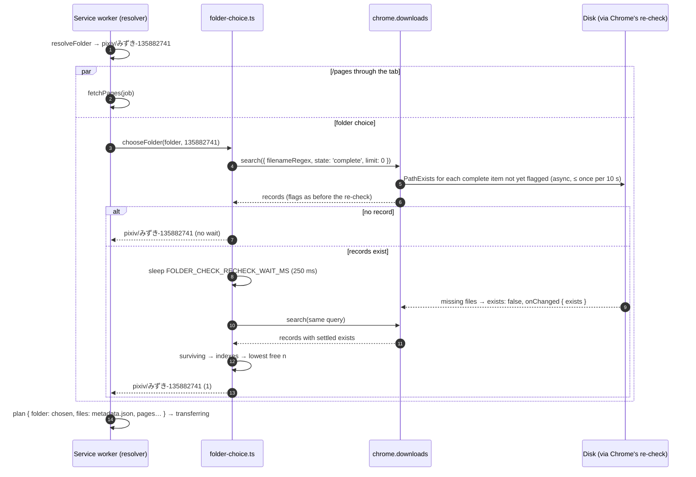
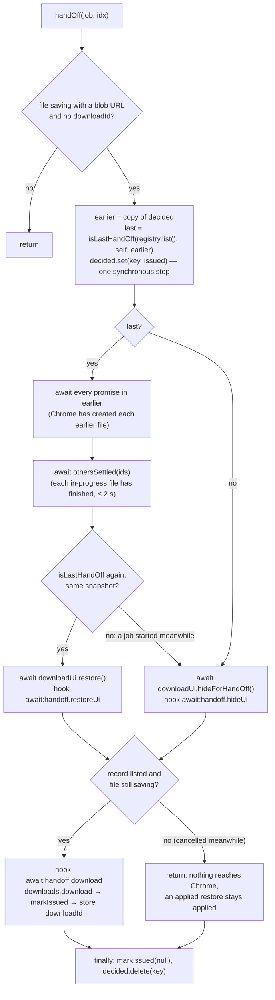
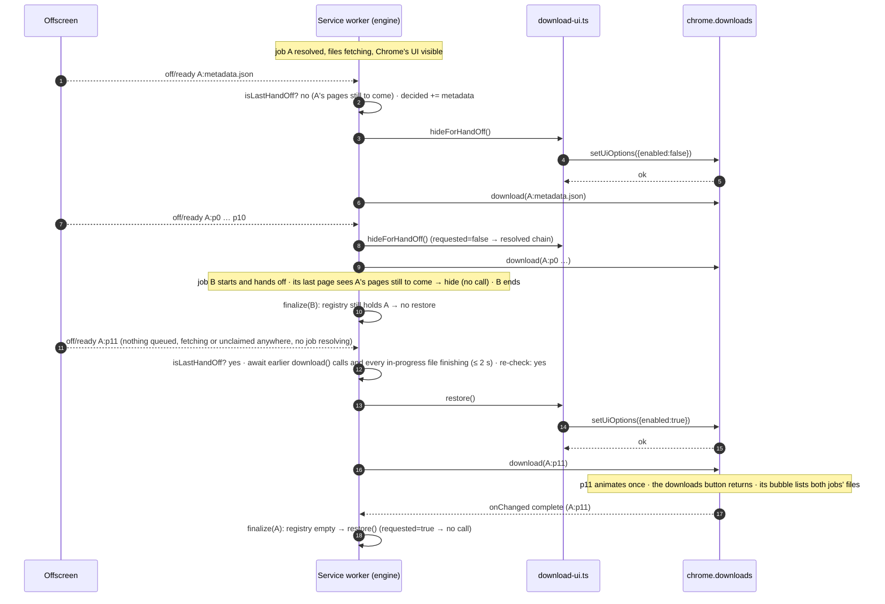
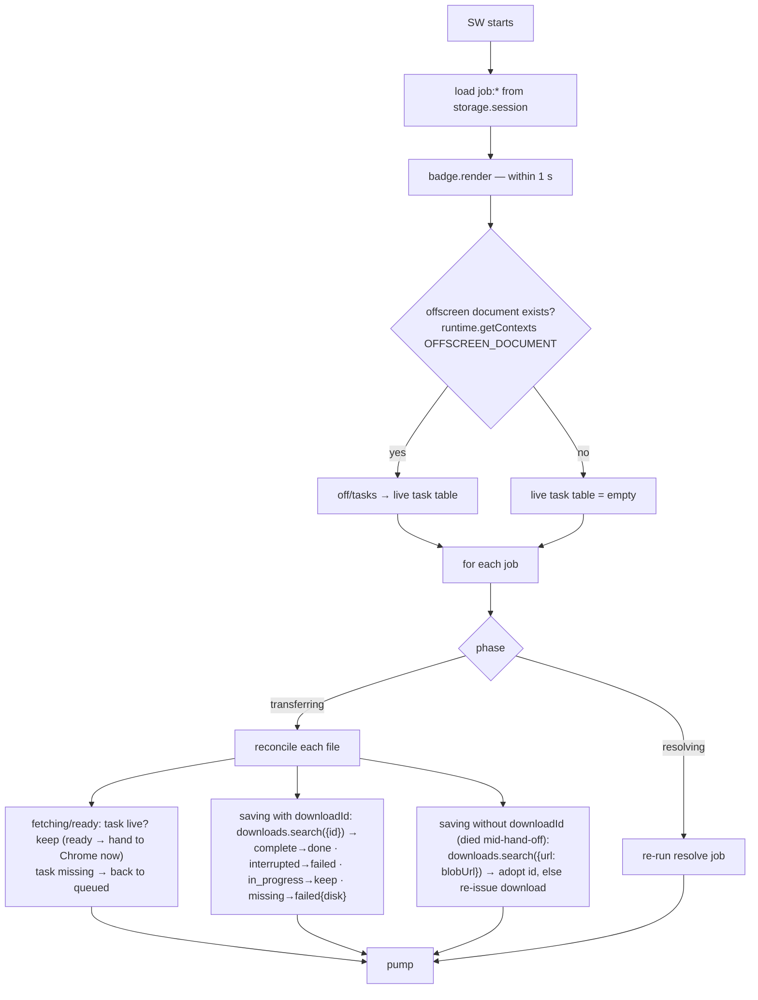
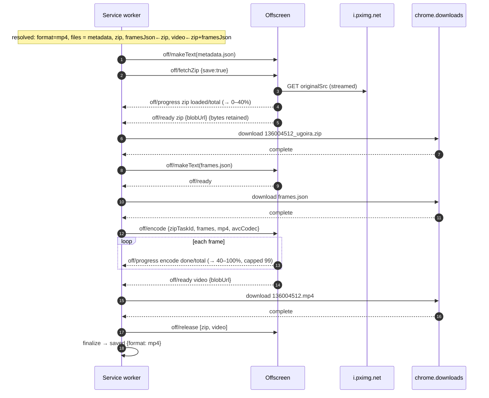
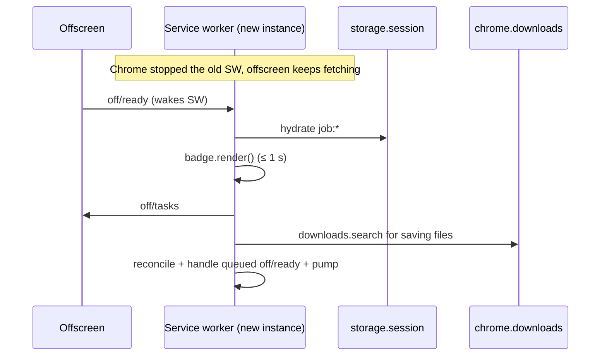

# Download Engine (service worker)

> Last updated: 2026-10-27 20:32:56 (UTC-7)
> Serves: prd-000 — CUJ-1 (pipeline, cancel, re-download into the sibling folder `<folder> (n)` chosen from Chrome's download history per §4.3 "Folder choice" and §4.5.1 step 4 as refined 2026-10-27 (Issue 2026-10-27-19-58-31), the `N / 12` counter that climbs to `11 / 12`), CUJ-2 (ugoira job orchestration), CUJ-3 (toolbar click → settings tab), CUJ-4 (badge/title), CUJ-5 (retry modes, incl. a `retryPages` that also re-writes a `metadata.json` that did not land per R-007 item 6; outcome classification incl. the job-level "No connection" rule per R-004 S3; login-wall check at resolve per R-003); PRD §4.1 #3 (Chrome's download UI hidden while a job runs, R-005; back on just before the last file of the last running job is handed to Chrome, R-006)

## Overview

The service worker (`src/background/`) is the system's **source of truth for jobs**. It:

- accepts start, cancel and attach requests from content scripts;
- snapshots settings and resolves a job's plan through pixiv's API (proxied through the originating tab, see [system.md §8.3](system.md));
- chooses the folder actually used: the resolved folder, or its sibling `<folder> (n)` when Chrome's download history shows this artwork's files still present there (PRD §4.3 "Folder choice", refined 2026-10-27; "Folder choice" below, D15);
- builds the file queue, schedules at most 5 files per artwork, and dispatches byte work to the offscreen document;
- hands finished bytes to `chrome.downloads` and observes completion;
- hides Chrome's download UI from a job's first hand-off and turns it back on just before the last file of the last running job is handed to Chrome, or when the last running job ends without such a hand-off (R-005, R-006);
- classifies the end state, pushes `JobView` snapshots to the originating tab, and keeps the toolbar badge and title correct;
- installs the DNR Referer rule;
- opens or focuses the settings tab on toolbar click.

Chrome may stop the SW after 30 s idle, and a fetch that takes more than 30 s to respond gets it terminated (Chrome docs, service worker lifecycle). The engine therefore treats every `await` as a possible death point. Job state is written through to `chrome.storage.session`, and a boot-time hydration reconciles it against `chrome.downloads` and the offscreen task table.

## Goals & Non-Goals

**Goals**
- Exact PRD semantics for the job pipeline (§4.5), concurrency (≤ 5 per artwork), badge accounting (§4.8) and outcome mapping (CUJ-5).
- Survive SW termination at any point with no lost or duplicated files and the badge correct within 1 s of restart (CUJ-4 AC).
- No persisted history: a job's record exists only while the job runs.
- Deterministic, unit-testable core: the scheduler, classifier and badge math are pure functions over `JobRecord`s.

**Non-Goals**
- Surviving a Chrome restart (PRD §4.1 #6: accepted loss).
- Global concurrency limits across artworks (PRD: artworks are not serialized).
- Owning file bytes: the SW never holds file contents ([system.md §2](system.md) principle 2).

## System Context



## Detailed Design

### Data Model

The job model and request protocol live in **`src/shared/job.ts`** (they were in `src/background/types.ts` in iteration 1). The pure shared modules (`outcome.ts`, `progress.ts`, `messages.ts`, `pixiv-api.ts`) and the content script's button model operate on them, and `src/shared` must not import the SW's directory ([system.md §4](system.md) layering rule, D11). The move is a pure refactor (ENG-008).

```ts
// src/shared/job.ts (extends src/shared/types.ts)
export type FileRole = 'metadata' | 'page' | 'zip' | 'framesJson' | 'video';
export type FileState =
  | 'queued'    // waiting for deps / a slot
  | 'fetching'  // offscreen task running (fetch, text blob, or encode)
  | 'ready'     // offscreen holds a blob: URL; not yet handed to Chrome
  | 'saving'    // chrome.downloads.download issued (downloadId may still be unknown)
  | 'done'      // Chrome reported state 'complete' (or zip retained, when save=false)
  | 'failed'
  | 'skipped';  // never attempted: cancel, 403 stop, or a failed dependency

export interface FileTask {
  idx: number;                    // queue order; dispatch is in ascending idx
  role: FileRole;
  page?: number;                  // 0-based page index (role 'page')
  name: string;                   // basename: '135882741_p0.jpg', 'metadata.json', '136004512_ugoira.zip', 'frames.json', '136004512.mp4'
  url?: string;                   // source URL (page, zip) — allowlisted i.pximg.net
  save: boolean;                  // false only for the retryEncode zip (fetched into memory, not written)
  dependsOn: number[];            // idx list that must be 'done' first
  state: FileState;
  taskId?: string;                // offscreen task id (uuid)
  blobUrl?: string;
  downloadId?: number;
  failure?: Failure;
  text?: string;                  // metadata.json text, built when the file is dispatched (the same mutation drops
                                  // job.metaBody); kept while in flight so a re-queue after a restart can dispatch again
}

export interface UgoiraState {
  frames: Array<{ file: string; delay: number }>;  // ugoira_meta.body.frames, unmodified
  format: UgoiraOutput;           // effective: 'mp4' | 'webm' | 'zip'
  avcCodec: string | null;        // chosen codec string when format === 'mp4'
  width: number; height: number;  // from /ajax/illust body (probe key); encoder uses decoded frame size
  zipLoaded: number; zipTotal: number | null;
  encDone: number;
  percent: number;                // last emitted, monotonic
}

export interface JobRecord {
  v: 1;
  jobId: string;                  // crypto.randomUUID()
  artworkId: string;              // /^\d{1,12}$/
  originTabId: number;            // MessageSender.tab.id (no "tabs" permission needed)
  createdAt: number;              // Date.now()
  mode: JobMode;                  // 'full' | 'retryPages' | 'retryEncode' | 'retryMetadata'
  request: StartRequest;          // the validated start payload (for re-running 'resolving' after a restart)
  kind: 'pages' | 'ugoira' | 'unknown';
  phase: 'resolving' | 'transferring' | 'ended';
  snapshot: SettingsSnapshot;     // taken at click (PRD §4.1 #8)
  expectedFiles: number;          // badge count while resolving — full: tab hint clamped 0..200; retryPages: pages.length; retryEncode: 1; retryMetadata: 0
  metaBody: Record<string, unknown> | null;  // raw /ajax/illust body, kept only until the metadata file is dispatched
  folder: string | null;          // the folder actually used: resolved from the pattern plus the folder-choice suffix ` (n)`
                                  // (full, "Folder choice"), or echoed suffix included (retries); validated by isSafeRelativeFolder
  pagesTotal: number;             // display total N in "k / N" (full page count, also for retries)
  pagesOffset: number;            // pages already saved before this run (retryPages: total − requested)
  files: FileTask[];
  ugoira: UgoiraState | null;
  stopReason: null | 'cancelled' | 'forbidden';   // forbidden: first byte 403, or the resolver's login-wall check (R-003)
  apiFailure: { endpoint: 'illust' | 'pages' | 'ugoira_meta'; failure: Failure } | null;
  answered?: true;                // pixiv answered at least one request of this job (any HTTP status); set by applyResolution,
                                  // never cleared; read by classifyOutcome row 8 (system.md §10, R-004 S3, D13)
}
```

**Persistence.** `storage.session` key `job:<jobId>` holds the full `JobRecord`. A 200-page job is ~35 KB, so even dozens of concurrent jobs stay far below the 10 MB quota. Records are written on every state transition (persist-then-act, below). Byte-progress fields (`zipLoaded`, `encDone`, `percent`) are persisted at most once per second, because they are display-only. Records are **deleted** in the same mutation that ends the job (no history).

**Indexes.** None are stored. Hydration loads `storage.session.get(null)` and filters the `job:` prefix. In-memory maps are rebuilt on boot: `byJobId`, `byTaskId → (jobId, idx)`, `byDownloadId → (jobId, idx)`.

### API / Interface Contract

All envelopes follow [system.md §7](system.md). `ErrorCode = 'BAD_REQUEST' | 'NOT_FOUND' | 'FORBIDDEN' | 'INTERNAL'`.

**Content script → SW** (`target: 'sw'`, sender must have `tab.id`)

| `type` | Payload | Response |
|---|---|---|
| `job/start` | `StartRequest` (below) | `{ ok: true, view: JobView }` once the job is created and persisted, before resolving |
| `job/cancel` | `{ jobId }` | `{ ok: true }`. `FORBIDDEN` if `sender.tab.id !== job.originTabId`. `NOT_FOUND` if already ended (the tab then waits for or has the final `job/update`). |
| `job/listForTab` | `{}` | `{ ok: true, views: JobView[] }`: running jobs whose `originTabId === sender.tab.id` (reload reattach, PRD §4.7.6) |
| `caps/get` | `{ width: number, height: number }` (1..16384) | `{ ok: true, caps: { avc: string \| null, vp9: boolean } }` |

```ts
export type StartRequest =
  | { mode: 'full'; artworkId: string; expectedFiles: number;                        // expectedFiles: pageCount, or 1 for ugoira
      loggedIn: boolean | null }                                                     // the page's login marker (R-003 check at resolve);
                                                                                     // the guard accepts exactly true | false | null, else BAD_REQUEST
  | { mode: 'retryPages'; artworkId: string; folder: string; pages: number[]; total: number;  // pages: 0-based, unique, < total ≤ 200
      withMetadata?: true }                                                          // also write metadata.json: the earlier run's did not land (R-007 item 6);
                                                                                     // the guard accepts only true (or the field absent), else BAD_REQUEST
  | { mode: 'retryEncode'; artworkId: string; folder: string; format: 'mp4' | 'webm' }
  | { mode: 'retryMetadata'; artworkId: string; folder: string };
```

**SW → content script** (`target: 'tab'`, `tabs.sendMessage(tabId, msg, { frameId: 0 })`)

| `type` | Payload | Response |
|---|---|---|
| `job/update` | `{ view: JobView }` | none (rejection ignored: tab closed or navigated off pixiv) |
| `api/fetchJson` | `{ url }` (allowlisted API URL) | `{ ok: true, result: RetryResult<unknown> }` |

**SW → offscreen** (`target: 'offscreen'`). Commands are acknowledged immediately with `{ ok: true }`; results arrive as events. The exceptions are `off/fetchJson`, `off/probe` and `off/tasks`, which are request/response.

| `type` | Payload | Result |
|---|---|---|
| `off/fetchBytes` | `{ taskId, url }` | event `off/ready { taskId, blobUrl, size }` or `off/failed { taskId, failure }` |
| `off/makeText` | `{ taskId, text, mime }` | event `off/ready` |
| `off/fetchZip` | `{ taskId, url, save: boolean }` | events `off/progress { taskId, phase: 'zip', loaded, total }` …, then `off/ready { taskId, blobUrl? }` (`blobUrl` only when `save`) or `off/failed`. Bytes are retained for a later `off/encode`. |
| `off/encode` | `{ taskId, zipTaskId, frames, format: 'mp4' \| 'webm', avcCodec: string \| null, artworkId }` | events `off/progress { taskId, phase: 'encode', done, total }` …, then `off/ready { taskId, blobUrl, size }` or `off/failed { failure: { kind: 'encode' } }` |
| `off/abort` | `{ taskIds: string[] }` | aborts; no further events for those tasks |
| `off/release` | `{ taskIds: string[], keepRetained?: boolean }` | revokes blob URLs and drops Blobs. Also drops retained zip bytes unless `keepRetained` (used when the zip has landed but the video is still to be encoded). |
| `off/fetchJson` | `{ url, credentials: 'include' }` | response `{ ok: true, result: RetryResult<unknown> }` (fallback API path) |
| `off/probe` | `{ width, height }` | response `{ ok: true, caps: { avc: string \| null, vp9: boolean } }` |
| `off/tasks` | `{}` | response `{ ok: true, tasks: Array<{ taskId, state: 'running' \| 'ready' \| 'retained', blobUrl?: string }> }` |

Details of each offscreen task are in [design-offscreen-worker.md](design-offscreen-worker.md).

### Logic & Behavior

#### Boot sequence (every SW start)

```ts
// src/background/sw.ts — listeners registered synchronously at top level (required for event wake-ups)
chrome.runtime.onMessage.addListener(router);           // routes by target/type; every handler awaits `ready`
chrome.downloads.onChanged.addListener(onDownloadChanged);
chrome.action.onClicked.addListener(openOrFocusOptions);
export const ready = (async () => {
  await installRefererRule();                           // system.md §8.2 (idempotent; a failure is logged, boot goes on)
  await chrome.action.setBadgeBackgroundColor({ color: '#1f1f1f' });
  await chrome.action.setBadgeTextColor({ color: '#FFFFFF' });
  await engine.hydrate();                               // load job:* into memory
  await engine.badge.render();                          // PRD: correct within 1 s of restart
  await engine.restoreDownloadUiIfIdle();               // R-005: no job running → Chrome's download UI on (never rejects)
  await engine.reconcile();                             // below; then pump every job
  await engine.badge.render();
})();
```

The download-UI step sits after `hydrate()` because it needs the registry, and before `reconcile()` so that a job reconcile finishes on the spot restores through `finalize` like any other (below, "Chrome's download UI").

#### Mutations: persist intent, then act

All changes to a `JobRecord` go through `registry.mutate(jobId, fn)`:
1. Mutations are serialized through one global promise chain, so concurrent event handlers can never interleave and lose an update.
2. `fn` mutates the in-memory record and returns a list of **effects** (`src/background/registry.ts`):

   ```ts
   export type Effect =
     | { type: 'dispatch'; idx: number }                              // send the file's offscreen command
     | { type: 'download'; idx: number }                              // hand the file's blob URL to chrome.downloads
     | { type: 'abort'; taskIds: string[] }                           // off/abort
     | { type: 'release'; taskIds: string[]; keepRetained?: boolean } // off/release
     | { type: 'cancelDownload'; downloadIds: number[] }              // chrome.downloads.cancel (Chrome removes the partial file)
     | { type: 'push'; throttle?: boolean }                           // job/update to the origin tab; throttle for byte progress
     | { type: 'badge' }                                              // re-render the toolbar badge and title
     | { type: 'finalize' };                                          // classify, push the final view, release the job's tasks
   ```
3. The record is written to `storage.session` (or deleted when ended).
4. Effects run only after the write resolves.

A crash between steps 3 and 4 leaves an intent recorded but not executed (e.g. a file in `saving` with no `downloadId`). Hydration detects and completes it.

#### Job lifecycle



#### Resolving (resolver.ts)

`resolve(job)` is idempotent. If the SW dies during `resolving`, hydration simply calls it again.

1. `snapshot = readSettings()` was taken at `job/start`, not here, so a re-run after restart still uses the click-time settings (PRD §4.1 #8).
2. API calls go through `apiFetchJson(job.originTabId, url)`: first `tabs.sendMessage(tab, api/fetchJson)`, and if that throws (no receiving end, tab closed) then `off/fetchJson`. If that also throws (the offscreen document did not answer), the call fails with `{ kind: 'internal', detail }`: no context could make the request, which says nothing about the user's connection ([system.md §10](system.md) "`internal` reads as `server`"). The `RetryResult` is parsed by `pixiv-api.ts`:
   - `parseIllust(body) → WorkInfo`, including `withheld` ([system.md §8.5](system.md)) (+ raw body kept for `metadata.json`);
   - `parsePages(body) → string[]` (`urls.original` per page, page order);
   - `parseUgoiraMeta(body) → { originalSrc, frames }`.

   A response whose JSON has `error: true` is a `pixivError` failure. A missing required field (`urls.original`, `originalSrc`, `frames` non-empty) is also treated as `pixivError`.
3. Per mode:

| Mode | API calls | Files queued (idx order) |
|---|---|---|
| `full`, illustType 0/1 | `/ajax/illust/{id}`, `/pages` | `metadata` (if `saveMetadata`), then `page` × N with names = URL basenames |
| `full`, illustType 2 | `/ajax/illust/{id}`, `/ugoira_meta`; `caps` for body width×height | `metadata` (if enabled), `zip` (`save: true`), `framesJson` (deps: zip), `video` (deps: zip, framesJson; only if effective format ≠ `zip`) |
| `retryPages` | `/pages`; with `withMetadata`, `/ajax/illust/{id}` first (R-007 item 6) | `metadata` (only with `withMetadata`, from that body as in `retryMetadata`), then `page` × requested indexes |
| `retryEncode` | `/ajax/illust/{id}` (frame size: the codec-probe key, so the encoder gets the same codec string as the first run), `/ugoira_meta`; `caps` | `zip` (`save: false`), `video` (deps: zip) |
| `retryMetadata` | `/ajax/illust/{id}` | `metadata` |

3a. **Login-wall check (R-003), `full` mode only.** Right after `/ajax/illust` parses, and before `/pages` or `ugoira_meta` is called: if `requiresLogin(work, request.loggedIn)` ([system.md §8.5](system.md)), the resolution is `{ ok: false, loginRequired: true }`; `applyResolution` sets `stopReason = 'forbidden'` and finalizes, and the classifier yields `needsLogin` (§10 row 4). No byte request is ever made. This is the same predicate the content script applies at render time; it matters when the user clicked before the render-time metadata arrived (`pending`), or after the render fetch failed. Retry modes skip the check: they exist only after a `full` job of the same document passed it.

   ```ts
   export type Resolution =
     | { ok: true; plan: Plan }
     | { ok: false; apiFailure: ApiFailure; answered: boolean }   // answered: some API call of this resolve got an HTTP response
     | { ok: false; loginRequired: true };   // R-003: page logged out and pixiv withholds the work
   ```
4. **Folder:** `full` mode calls `resolveFolder(snapshot.folderPattern, { artist: userName, id, title, userId })` ([design-settings-model.md](design-settings-model.md)), then **chooses the folder actually used** with `deps.chooseFolder(folder, artworkId)` ("Folder choice" below): the resolved folder, or `<folder> (n)` when Chrome's download history shows files of this artwork still present in it or in a lower-numbered sibling (PRD §4.3 "Folder choice", §4.5.1 step 4). The choice runs **concurrently with the mode's second API call** (`/pages`, or `ugoira_meta` plus the codec probe): `const [pages, chosen] = await Promise.all([fetchPages(job, deps), deps.chooseFolder(folder, job.artworkId)])`. Both must resolve before the plan exists, so nothing is queued, and `metadata.json` in particular is not dispatched, before the folder is chosen (PRD: "before its first write"). A failed API call discards the choice; a failed choice never fails the job (it returns the plain folder). Retry modes never run the check: they use `request.folder` after re-validating it with `isSafeRelativeFolder()`, so a retry writes into the original job's folder, suffix included (PRD CUJ-5 step 5 "the folder check is not run again", and its edge cases).
5. **Effective ugoira format:** `effectiveFormat(snapshot.ugoiraOutput, caps)` (shared, also used by the button):
   - `zip` → `zip`;
   - `mp4` → `caps.avc ? 'mp4' : caps.vp9 ? 'webm' : 'zip'`;
   - `webm` → `caps.vp9 ? 'webm' : caps.avc ? 'mp4' : 'zip'`.

   It is stored in `snapshot.effectiveFormat`.
6. Persist with `phase = 'transferring'`, then pump.

Failure in resolving → `apiFailure` is set and the job finalizes (classifier rows 2, 3 and 8 in [system.md §10](system.md)); a login-wall stop finalizes through row 4.

**`answered` (R-004 S3, D13).** `applyResolution` sets `job.answered = true` in the same mutation that applies the resolution when the resolution is `ok` (every mode's plan needs at least one API 2xx), is the login-wall stop (its `/ajax/illust` answered), or is a failure with `answered: true`. The resolver computes that flag per call: an API step whose `RetryResult` is `ok`, or whose failure `gotAnswer()` (system.md §10: `http`, `pixivError`, or `answered: true`), marks the resolve answered; the failure returned for a later step carries it. Examples: `full` with `/ajax/illust` 200 and `/pages` unanswered `network` → `answered: true` (server); `full` with `/ajax/illust` unanswered `network` → `false` (offline); `retryPages` whose `/pages` got 503, 503, then refused attempts → the failure has `answered: true` → `true` (server); a transport failure of both proxies (`internal`) → `false`, and row 8 reads `server` anyway because `internal` is not `network`. A re-run of `resolve` after a restart recomputes the flag from scratch.

#### Folder choice (folder-choice.ts; PRD §4.3 "Folder choice", §4.5.1 step 4, CUJ-1 step 8; refined 2026-10-27, D15)

**Rule (PRD, user-visible).** Every `full` job, after `resolveFolder` and before any file is queued, asks Chrome's download history whether files of **this artwork** are still present in the resolved folder or in a sibling `<folder> (n)`. A file of this artwork is one whose basename starts with `<id>_` or `<id>.` (pages, the frame zip, the video); `metadata.json` and `frames.json` are never consulted, because with a token-free pattern they could belong to any artwork. Records whose file Chrome can no longer find on disk do not count. The surviving records are grouped by the last segment's ` (n)` suffix (plain = 0) and the job uses the lowest free `n ≥ 0`, written `<folder>` for 0 and `<folder> (n)` otherwise; gaps are reused. Only the last path segment ever carries a suffix. Inside the chosen folder every name is clean; every hand-off keeps `conflictAction: 'uniquify'` as the safety net. Retry modes echo the earlier job's folder, suffix included. The Saved tooltip and `aria-label` name the folder actually used ([design-artwork-button.md](design-artwork-button.md) "Presentation"). The same-instant two-tab race is accepted and not guarded (CUJ-1 edge).

**Platform facts the design relies on.** Sources: Chromium `chrome/browser/extensions/api/downloads/downloads_api.cc`, `chrome/browser/download/download_query.cc`, `content/browser/download/download_manager_impl.cc`, and the Chrome docs for `chrome.downloads.search`, `DownloadQuery` and `DownloadItem.exists` (read 2026-10-27).
1. `DownloadQuery.filenameRegex` is matched with **RE2 `PartialMatch`** against `DownloadItem.GetTargetFilePath().LossyDisplayName()` as UTF-8: the **absolute** target path, with the OS separator (`/` on macOS, Linux and ChromeOS; `\` on Windows), case-sensitive, default RE2 options. So the regex is a path *suffix* match, accepts both separators, and stays inside the RE2 ∩ ECMAScript common subset, because the same source is compiled again in JS to read the index.
2. `search()` calls `CheckForHistoryFilesRemoval()`, which posts a `base::PathExists` for every **complete** history item not already flagged removed. The check is asynchronous and `search()` does not wait for it. A file found missing gets `OnDownloadedFileRemoved()`: `exists` turns `false`, an `onChanged` delta `{ exists: { previous: true, current: false } }` fires, and the flag is never cleared again in this browser session. `DownloadQuery.exists` filters on the same flag.
3. **The re-check runs at most once per 10 s per profile** (`kFileExistenceRateLimitSeconds`), shared by every extension's `search()` calls, our own `othersSettled` and reconcile searches included. A `search()` inside that window returns the flags as they were. PRD §4.2 records the asynchrony ("at most a few hundred ms") but not the rate limit; see "Open Questions & Risks".
4. `limit` defaults to 1000, and `0` returns every match. `state: 'complete'` excludes in-progress and interrupted records.
5. The `downloads` permission already covers `search`: no manifest change ([system.md §5](system.md)).

**Pure part: `src/shared/folder-choice.ts`** (principle 4, no `chrome.*`):

```ts
/** RE2 and ECMAScript metacharacters; both escape them with a backslash. */
const REGEX_SPECIALS = /[\\^$.|?*+()[\]{}]/g;
/** A path separator on any OS, as regex text: the class of backslash and slash. */
const SEP = '[\\\\/]';
export const escapeRegex = (s: string): string => s.replace(REGEX_SPECIALS, '\\$&');

/**
 * The filenameRegex for "a file of `artworkId` directly in `<Downloads>/<folder>/` or `<Downloads>/<folder> (n)/`":
 * a suffix match on the absolute target path, either OS separator, RE2 ∩ ECMAScript syntax only.
 * Capture group 1 is n; it is absent for the plain folder. Only the last segment gets the optional suffix.
 */
export function folderCheckRegex(folder: string, artworkId: string): string {
  const segments = folder.split('/').map(escapeRegex).join(SEP);
  return `(?:^|${SEP})${segments}(?: \\((\\d+)\\))?${SEP}${artworkId}[_.][^\\\\/]*$`;
}

/** n of the folder a matching record sits in (0 = plain), or null when `filename` does not match. */
export function folderIndexOf(filename: string, folder: string, artworkId: string): number | null {
  const m = new RegExp(folderCheckRegex(folder, artworkId)).exec(filename);
  if (!m) return null;
  return m[1] === undefined ? 0 : Number(m[1]);
}

/** The lowest n ≥ 0 not in `taken`: gaps are reused (PRD §4.3 "Index"). */
export function lowestFreeIndex(taken: Iterable<number>): number {
  const set = new Set(taken);
  let n = 0;
  while (set.has(n)) n++;
  return n;
}

export const withFolderIndex = (folder: string, n: number): string =>
  n === 0 ? folder : `${folder} (${n})`;
```

For `folderCheckRegex('pixiv/みずき-135882741', '135882741')` the regex text is
`(?:^|[\\/])pixiv[\\/]みずき-135882741(?: \((\d+)\))?[\\/]135882741[_.][^\\/]*$`
(every `\` is doubled again inside a TS string literal). It matches `/Users/aoi/Downloads/pixiv/みずき-135882741/135882741_p0.jpg` (n = 0), `C:\Users\aoi\Downloads\pixiv\みずき-135882741 (2)\135882741_p11.png` (n = 2), `…/135882741_ugoira.zip`, `…/135882741.mp4`, and a safety-net name such as `…/135882741_p0 (1).jpg` (still a file of this artwork). It does not match `…/pixiv/みずき-135882741/metadata.json` or `frames.json`, `…/1358827411_p0.jpg` (the `[_.]` after the id), `…/mypixiv/みずき-135882741/…` (the `(?:^|sep)` boundary), `…/pixiv (1)/みずき-135882741/…` (parents never carry a suffix: the optional group sits on the last segment only), or `…/pixiv/みずき-135882741/sub/135882741_p0.jpg` (`[^\\/]*$` allows no further separator).

**Orchestration: `src/background/folder-choice.ts`.**

```ts
export interface FolderChoiceDeps {
  search: (query: chrome.downloads.DownloadQuery) => Promise<chrome.downloads.DownloadItem[]>; // default: chrome.downloads.search
  sleep: (ms: number) => Promise<void>;                                                          // default: setTimeout
}

/** PRD §4.3 "Folder choice". Never rejects: on any failure it returns `folder`, the pre-refinement behaviour. */
export async function chooseFolder(folder: string, artworkId: string, deps: FolderChoiceDeps = DEFAULT_DEPS): Promise<string> {
  const query = { filenameRegex: folderCheckRegex(folder, artworkId), state: 'complete', limit: 0 } as const;
  try {
    const first = await deps.search(query);          // also triggers Chrome's existence re-check (fact 2)
    if (first.length === 0) return folder;            // the common case (a first run): no wait at all
    await deps.sleep(FOLDER_CHECK_RECHECK_WAIT_MS);   // 250 ms: let the asynchronous re-check land
    const settled = await deps.search(query);         // the same query; `exists` now reflects the re-check
    const taken = settled
      .filter((item) => item.exists !== false)
      .map((item) => folderIndexOf(item.filename, folder, artworkId))
      .filter((n): n is number => n !== null);
    const chosen = withFolderIndex(folder, lowestFreeIndex(taken));
    if (!isSafeRelativeFolder(chosen)) {              // belt only: cannot happen (design-settings-model.md "Folder-choice suffix")
      log.warn('chosen folder failed validation, using the plain folder', chosen);
      return folder;
    }
    log.debug('folder choice', { artworkId, records: settled.length, surviving: taken.length, chosen });
    return chosen;
  } catch (error) {
    log.warn('folder check failed, using the plain folder', error);
    return folder;
  }
}
```

- `FOLDER_CHECK_RECHECK_WAIT_MS = 250` lives in `src/shared/constants.ts` ("Timings"). It is the only new constant of the feature.
- **Two identical searches.** The first search is what makes Chrome start the re-check (fact 2); there is no completion signal, so the second search, after a fixed wait, is the only way to read the settled flags. The second result replaces the first: a record that completed during the wait (the other tab's job, CUJ-1 edge) counts, and a record flagged removed during it does not.
- **No wait on a first run.** An empty first result means no file of this artwork is in the history at all, so there is nothing to re-check. The first run of every artwork costs one search and no timer.
- **`exists !== false`**, not `exists === true`: the field is always present in Chrome; the loose test is for the fakes and for older typings.
- `state: 'complete'` makes a concurrent job's files count only once they have landed, which is exactly the PRD's "begun landing" wording for the two-tab case; a same-instant start sees none and both jobs use the plain folder with `uniquify` (accepted).
- `limit: 0` is safe: the result is bounded by the artwork's files times the number of runs (a 200-page manga downloaded ten times is 2000 small objects, once).
- The resolver gets `chooseFolder` through `ResolverDeps` (`chooseFolder: (folder: string, artworkId: string) => Promise<string>`), injected by `engine.ts` from this module, so resolver unit tests stub it and `folder-choice` unit tests use the fake `chrome.downloads`.

**Why the chosen folder is always a safe path.** `resolveFolder` already returns a folder every segment of which satisfies `chromeSafeSegment(seg) === seg` ([design-settings-model.md](design-settings-model.md) D8). Appending ` (n)` to the last segment keeps that invariant for every n: step a adds no illegal character; step b trims nothing, because the segment now ends in `)`; step d's reserved-name test reads the text before the first `.`, and `CON (1)` is not `con` (and `_CON` was already prefixed); step e's extension test reads the text after the last `.`, which now ends in `) `-style text that is not `local`, `lnk`, `scf`, `url` or `{…}`; step f's 8.3 test excludes any segment with a space. The length stays far below `MAX_FOLDER_CHARS` (1024) and the field's 200 characters plus token expansions. The check in `chooseFolder` is a belt; design-settings-model.md pins the invariant with unit tests over its Golden examples.

**Edge cases** (every PRD line, with what Chrome returns and what the job does):

| Case (PRD) | Records returned by the second search | Chosen folder |
|---|---|---|
| First run of the artwork (CUJ-1 step 2) | none (first search empty, no wait) | `pixiv/みずき-135882741` |
| Repeat run, first run's files present (CUJ-1 step 8) | n = 0 records, `exists: true` | `pixiv/みずき-135882741 (1)` |
| Third run | n ∈ {0, 1} | `(2)` |
| First folder moved, renamed or deleted; files renamed (CUJ-1 edge, AC) | the records, `exists: false` after the re-check | plain again, no `(1)` |
| Gap: plain deleted, `(1)` kept | surviving {1} | plain |
| Gap: plain and `(2)` kept, `(1)` deleted | surviving {0, 2} | `(1)` |
| Chrome's history cleared, files still on disk (edge, AC) | none | plain; Chrome's `uniquify` produces `135882741_p0 (1).jpg`, `metadata (1).json` (accepted limitation). The next run then finds those records and uses `(1)` |
| Files saved by another tool, no record | none | same as above |
| Token-free pattern `pixiv` (§4.4, edge) | only records of this artwork's files match (`<id>[_.]`); other artworks' files in `pixiv/` do not | `pixiv (1)` only for a repeat of the same artwork |
| Same artwork in two tabs, second click after the first job's originals began landing (edge, CUJ-4 edge) | the first job's completed pages (`state: 'complete'`) | `(1)` |
| Same artwork in two tabs, same instant | none complete yet | both plain; per-file `uniquify` (accepted, not guarded) |
| Partial failure, then reload and click (CUJ-5 edge) | the 9 landed pages | `(1)`; the partial folder is left as it is |
| 403 mid-job, log in, click (CUJ-5 step 9) | the landed files | `(1)` |
| Retry of any kind (CUJ-5 step 5) | not consulted | the job's own folder, suffix included |
| A safety-net name in the history (`135882741_p0 (1).jpg`) | matches (`<id>_`) | counts as present |
| The search throws, or returns something that is not an array | — | plain, `warn` log (the pre-refinement behaviour) |
| Second search throws | — | plain, `warn` log (simplest rule; a near-impossible case) |
| Re-check rate-limited: the click comes within 10 s of the previous `search()` (fact 3) after a folder was removed | stale `exists: true` | the next free n instead of the freed one (residual, Open Questions) |
| SW restart during the wait | — | `resolve` re-runs from scratch; the job's own files are not complete yet, so the re-run cannot count itself |

**Performance.** A first run: one search; Chrome filters its whole history with RE2, about a microsecond per record, so 10 000 records cost about 10 ms, and no timer. A repeat run: the 250 ms wait plus a second search, started together with `/pages` (typically 100–300 ms on live pixiv), so the net delay is `max(0, 250 ms − API round trip)` plus one search. Nothing changes on screen: the button shows the optimistic `0 / 12` within 100 ms as before, and the badge shows `expectedFiles` while resolving. The PRD's "at most a few hundred ms" is the worst case.

**Observability.** `debug` once per `full` job with the record count, the surviving count and the chosen folder; `warn` when a search fails. Never the absolute paths Chrome returns (they name the user's home directory): only the chosen relative folder.



**Testing.**
- Unit, pure (`test/unit/shared/folder-choice.test.ts`): `folderCheckRegex` matches and rejects every example above, including the Windows path, a folder with regex specials (`pixiv/(sora)+[x]-1`), a last segment that itself ends in ` (2)` (records in `… (2)/` are n = 0 and `… (2) (1)/` n = 1), a `{title}` segment with `.` and `$`; the regex source contains no construct outside RE2 (no lookaround, no backreference, no `\Q`); `folderIndexOf` reads n and returns `null` for `metadata.json`; `lowestFreeIndex` over `{}`, `{0}`, `{1}`, `{0, 2}`, `{0, 1, 2}`, duplicates and unsorted input; `withFolderIndex(f, 0) === f`.
- Unit, orchestration (`test/unit/background/folder-choice.test.ts`, fake `chrome.downloads`, fake timers): present → `(1)` with exactly two `search` calls carrying `state: 'complete'`, `limit: 0` and the regex; absent → plain with one call and no pending timer; `removeFile` on the earlier records before the call → plain (the fake's re-check runs on `search`); the two gap cases; in-progress and interrupted records ignored; another artwork's files in the same folder ignored; a record with `exists: false` ignored; `search` rejecting → plain and a `warn`; a re-check that lands after the wait (the fake's `existenceCheckDelay(400)`) → the stale `(2)`, pinning the residual as intended behaviour of the bound.
- Resolver unit (`engine-resolver.test.ts`): `full` passes the resolved folder and the artwork id to `chooseFolder` and uses its answer as `plan.folder`; it is called before `/pages` answers (concurrency); retry modes never call it; a `/pages` failure after an answered `chooseFolder` still fails the resolve; a rejecting `chooseFolder` stub is a programming error (the real one never rejects).
- Integration (`test/integration/sw-folder-choice.test.ts`, L2): two consecutive `full` jobs of one artwork → `pixiv/みずき-135882741/{metadata.json, 135882741_p0.jpg…}` then `pixiv/みずき-135882741 (1)/…` with clean names and the second ended view's `folder` ending in ` (1)`; `fake.downloads.removeFile` on the first run's files, then a third job → plain; a `retryPages` from a `(1)` job writes into `(1)`; two tabs, same artwork, the second `job/start` after the first job's first originals completed → `(1)`; the same with both starts in one tick → both plain and the second's names uniquified by the fake.
- E2E ([design-test-harness.md](design-test-harness.md) "Acceptance-criteria mapping"): CUJ-1 step 8 and its ACs on real Chrome, the tooltip and `aria-label` included; the moved-folder case waits out fact 3.

#### `metadata.json` construction (src/shared/metadata.ts)

This gives byte parity with `write_metadata` in `ref/pixiv-dl`, except where the PRD explicitly differs.

```ts
export function buildMetadata(body: Record<string, unknown>, artworkId: string): object {
  const id = str(body.illustId) || str(body.id) || null;     // Python `or` semantics: '' falls through
  return {
    id,
    title: body.illustTitle ?? null,
    description: body.description == null ? null : plainText(String(body.description)),   // PRD: missing → null (script wrote "")
    userName: body.userName ?? null,
    userId: body.userId ?? null,
    createDate: body.createDate ?? null,
    uploadDate: body.uploadDate ?? null,
    pageCount: body.pageCount ?? null,
    illustType: body.illustType ?? null,
    xRestrict: body.xRestrict ?? null,
    tags: Array.isArray(body.tags?.tags) ? body.tags.tags.map(t => t?.tag ?? null) : [],
    url: `https://www.pixiv.net/artworks/${id ?? artworkId}`,  // script would write ".../None"; not ported
  };
}
export const plainText = (s: string) =>
  unescapeHtml(s.replace(/<br\s*\/?>|<\/p>|<\/div>/gi, '\n').replace(/<[^>]+>/g, '')).trim();
export const serializeJson = (v: unknown) => JSON.stringify(v, null, 2);   // no trailing newline (parity)
```

- `JSON.stringify(v, null, 2)` produces the same bytes as Python's `json.dump(ensure_ascii=False, indent=2)`: `", "`/`": "` separators with indent, the same short escapes, `\u00xx` lowercase for other controls, and literal non-ASCII. The only difference is lone surrogates: JS escapes them, while Python would crash. Golden tests (ENG-003) pin this.
- `unescapeHtml` must match Python's `html.unescape`: all HTML5 named references (including the legacy names that match without a trailing `;`), decimal and hex numeric references, and Python's invalid-codepoint replacement table. `DOMParser` cannot be used because the SW has no DOM, and its behavior differs from Python's anyway. The function lives in `metadata.ts`. Its entity table is a generated constant (`src/shared/html-entities.ts`, emitted from Python's `html.entities.html5` by `scripts/gen-golden.py`), so behavior is identical and pinned by golden vectors.
- `Python str.strip()` (no args) strips Unicode whitespace per `str.isspace`. `trim()` in JS strips a slightly different set (JS includes U+FEFF; Python includes U+001C–U+001F and U+0085). Implemented as an explicit `stripPy()` with Python's set, pinned by golden vectors.
- `frames.json` = `serializeJson(ugoira_meta.body.frames)`. This is the parsed array re-serialized with 2-space indent and insertion-order keys preserved: "unmodified" per PRD §4.3. It is identical to the script's output for ASCII file names.

#### Scheduler (scheduler.ts)

```
pump(job):
  if job.phase !== 'transferring': return
  inFlight = count(files, state ∈ {fetching, ready, saving})
  for f in files ordered by idx, where f.state == 'queued':
     if job.stopReason != null: mark f 'skipped'; continue
     if any dep of f is failed|skipped: mark f 'skipped'; continue
     if not all deps 'done': continue                       // keep queued, keep scanning (later files may be eligible)
     if inFlight >= MAX_IN_FLIGHT_PER_JOB (5): break
     f.state = 'fetching'; f.taskId = uuid()                 // persisted before dispatch
     effects.push(dispatch(f)); inFlight++
  if no file is queued or in flight: effects.push(finalize)
```

- Dispatch by role: `page` → `off/fetchBytes`; `metadata` → `off/makeText(serializeJson(buildMetadata(body)), 'application/json')`; `framesJson` → `off/makeText(serializeJson(frames), 'application/json')`; `zip` → `off/fetchZip`; `video` → `off/encode`. `metadata` and `framesJson` text is built in the SW from data held in the record. `metaBody` is set to `null` in the same mutation that dispatches the metadata file. `ugoira.frames` stays until the job ends, because `off/encode` needs it.
- **Page order** (PRD §4.5.1 step 6): dispatch is strictly ascending `idx`, so `_p0`, `_p1`, … are requested in order. Completion order is free. The next queued file starts as soon as any slot frees (on `done`/`failed`).
- **Cap semantics:** a file holds a slot from `fetching` until terminal. This bounds both concurrent HTTP requests per artwork (parity with `-j 5`) and concurrent Chrome downloads (AC: never > 5 in `chrome://downloads`).

#### Offscreen events → file transitions

| Event | Transition | Effects |
|---|---|---|
| `off/ready { blobUrl }` (save) | `fetching → saving` (blobUrl stored, persisted **before** the call) | effect `download` → `handOff()`: decide whether this is the busy period's last hand-off, then `await downloadUi.restore()` if it is (R-006) or `await downloadUi.hideForHandOff()` if not (R-005; both below), stop if the job ended or the file left `saving` meanwhile, then `downloads.download({ url: blobUrl, filename: folder + '/' + name, conflictAction: 'uniquify', saveAs: false })` → store `downloadId` (persist). If the call throws ("Invalid filename" etc.) → `failed{disk}`. |
| `off/ready` (zip with `save: false`) | `fetching → done` | pump |
| `off/ready` without `blobUrl` for a file that must be saved | `fetching → failed{ internal, detail: 'no blob' }` | release, pump |
| Dispatch refused (`{ ok: false }` ack) or undeliverable (`sendMessage` still finds no listener after the bounded ready wait, `OFFSCREEN_READY_WAIT_MS`; [design-offscreen-worker.md](design-offscreen-worker.md) "Lifecycle", D16) | `fetching → failed{ internal }` for every role except `video`, which fails `{ encode }` (the zip landed, so `Retry · MP4` is the right next action, §10 row 5) | release, pump |
| `off/progress` | update `ugoira.zipLoaded/zipTotal/encDone`; recompute percent (monotonic) | throttled `job/update` push (≤ 4/s) |
| `off/failed { failure }` | `fetching → failed` | if `failure.status === 403` and role ∈ {page, zip}: `stopReason = 'forbidden'` (no new dispatches; in-flight files finish, PRD CUJ-5 step 9). Release task; pump. |
| `downloads.onChanged` `state: complete` | `saving → done` | `off/release` (with `keepRetained: true` for a `zip` file whose `video` is still pending), pump, badge, push. When pump returns `finalize`, `settle()` (`scheduler.ts`) adds neither `badge` nor a running `push`, because finalize sends both: the completion that ends a job reaches the tab only as the ended view ("Progress counter" below). |
| `downloads.onChanged` `state: interrupted` | `saving → failed{ disk \| dismissed }` (`USER_CANCELED` → `dismissed`; every `FILE_*`, `CRASH` and others → `disk`) | release, pump, badge, push |

Events for unknown task or download IDs (job already ended or cancelled) → `off/release` for the task and nothing else.

#### Cancel

`job/cancel` runs in one mutation:
- set `stopReason = 'cancelled'`;
- mark every `queued` file `skipped`;
- collect `taskIds` of `fetching`/`ready` files → effect `abort` (`off/abort`);
- `saving` files with a `downloadId` → effect `cancelDownload` (`chrome.downloads.cancel(id)`; Chrome removes the partial file). A download whose id arrives after the cancel (Chrome started it while the cancel mutation ran) is cancelled by the hand-off path itself, because `onDownloadStarted` finds the job ended;
- finalize immediately with outcome `cancelled`.

Already completed files stay on disk (PRD CUJ-1 step 5). An in-progress encode is aborted, and because the video is only handed to Chrome after `finalize()`, no partial video can exist (PRD §4.6). The button returns to idle within 300 ms because the push happens right after the persist, with no waiting for abort confirmations. Finalize then turns Chrome's download UI back on if no other job is running (PRD CUJ-1 step 5, R-005). A cancel has no final hand-off, so Chrome shows its downloads button again only with its next download (R-006; platform fact in "Chrome's download UI").

#### Finalize

1. `outcome = classifyOutcome(job, navigator.onLine)` ([system.md §10](system.md)). `partial.failedPages` = page indexes of failed pages; `saved = pagesTotal − failedPages.length`.
2. Push `job/update { view: toView(job, outcome) }` to `originTabId`.
3. Delete `job:<jobId>`; drop in-memory indexes; `off/release` all remaining task IDs of the job.
4. `badge.render()`.
5. If the registry is empty (no running job is left; a job still finalizing is still listed): `await downloadUi.restore()` (R-005, below; without a Chrome call when the job's last hand-off already restored the UI, R-006), then `offscreenClient.scheduleClose()` unless a codec probe is pending (5 s grace; cancelled by any new command).

#### Progress counter (pages jobs)

A pages job's `JobView.progress` is `{ kind: 'pages', done: pagesOffset + landed pages, total: pagesTotal }` (`pagesProgress()` in `src/shared/progress.ts`). Only `page` files count, so `metadata.json` never changes N (PRD CUJ-1 AC). Two rules decide its last running value:
- **The completion that ends the job pushes only the ended view.** `settle()` emits a running `push` only when pump does not finalize (the `complete` row above).
- **The busy period's last hand-off waits for every other in-progress file to finish**, capped at 2 s ("The last hand-off", step 3). So in a job of its own, the last file to complete is the one handed to Chrome last, and its completion ends the job. That file is a page: `metadata.json` is dispatched first and built in memory, so it is handed off long before the last page.

Together: in a job running on its own, the label climbs to `N−1 / N`, and the next view is the ended one, so the button turns `Saved · NP` directly. This is the PRD text since R-007: CUJ-1 AC 7 "tops out at `11 / 12` … When other files are still finishing at that moment (for example a second job's, CUJ-4), `12 / 12` may show for an instant first" (item 1), CUJ-5 step 5 "`9 / 12` → `11 / 12`" (item 1), and the 200-page edge "`0 / 200` … `199 / 200`, then `Saved · 200P`" (item 2). A `retryPages` job starts at `pagesOffset`, so its running values are `offset … N−1`; one with `withMetadata` counts the same, since `metadata.json` is not a page. A single page shows `0 / 1` and then `Saved`.

When `N / N` can still show:
- **An earlier completion's push runs after the last page landed** (measured, QA iteration 4).
  - **Mechanism.** A page completion's effects are `[release, badge, push]` (`settle()`), and `runEffects` awaits them in order (`src/background/engine.ts`). The `release` is an offscreen round trip. The `push` builds its view from the record when it runs (`src/background/pusher.ts`).
  - So if the job's last page completes during that round trip, the earlier completion's push sends a running view with `done = N`. The ended view (`Saved`) follows at once.
  - **Where it happens:** the job's last two pages must complete within a few ms.
    - Two jobs at once, on the job that ends first. Its last page is not the busy period's last hand-off, so it gets no settle wait. QA saw `N / N` in the DOM for 0–2 ms in 34 of 37 runs, and painted for one frame in 1 of 20 frame-sampled runs.
    - A single 200-page job: 2 of 13 runs in the DOM, 0 of 11 painted.
    - Never in a single 12-page job (0 of 55).
  - **No code change** (pm-review iteration 4; R-007 item 1 amended the AC instead). Suppressing that push would leave a stale `N−1 / N` while every page has landed, which is less truthful than the instant.
- **`metadata.json` is still in progress when the last page completes.** That needs `metadata.json` held past the 2 s cap, for example by a Save As dialog with "Ask where to save each file" on (a known v1 limitation, PRD CUJ-1 edge cases). The job cannot end yet, so `N / N` shows until `metadata.json` lands. A held *page* never causes it: that page is still missing from N. pm's pre-decided exit (pm-review iteration 3, priority 1) accepts a residual that occurs only at the cap.
- **A metadata-only retry shows `N / N` throughout, by design.** `resolveRetryMetadata` sets `pagesOffset` to the page count (`src/background/resolver.ts`), and the button's optimistic progress for it is `total / total` (`src/content/button/model.ts`). Every page is already on disk, so `12 / 12` is the honest face until `metadata.json` lands.

Ugoira jobs show a percentage instead. `ugoiraPercent` (`src/shared/progress.ts`) caps it at 99 even after the job's last file has landed, because the view pushed between that landing and the end is still a busy one. So `100%` never shows (PRD §4.7.5; design-artwork-button.md "Fixed width").

#### Chrome's download UI (download-ui.ts, R-005, R-006)

PRD §4.1 #3 (R-005, with the restore point set by R-006). From the moment a job hands its first file to Chrome, Chrome's download UI is off. The job's files play no per-file fly-to-toolbar animation, and Chrome shows no downloads button.

The UI comes back on **just before the last file of the last running job is handed to Chrome** (R-006). Chrome's own download of that file brings the downloads button back with one animation, which is the job's "done" signal. The bubble then lists every file of the job. This is CUJ-1 AC 14 as R-006 amends it: "at most one animation, at the end".

Sometimes the last running job ends without such a final hand-off: it is cancelled, fails, needs login, is Unavailable, or its last outstanding file fails. Then finalize turns the UI on instead. The worker also turns it on whenever it starts with no job running.

The hidden window never starts before a job's first file is handed to Chrome ("not even for the first file", CUJ-1 step 2).

A **busy period** is a span in which at least one job is running; overlapping jobs share one. Each busy period hides the UI at most once and restores it at most once. The one exception is a job that starts after the restore was requested (see "Races" below).

**Platform facts the design relies on.** Sources: Chromium `chrome/browser/extensions/api/downloads/downloads_api.cc`, `chrome/browser/download/download_ui_controller.cc`, `chrome/browser/download/bubble/download_display_controller.cc` and `chrome/browser/download/bubble/download_bubble_prefs.cc`; Chrome extension docs for `chrome.downloads.setUiOptions`.
- `setUiOptions({ enabled })` (Chrome 105+, permission `downloads.ui`) adds this extension to, or removes it from, a per-profile set of "UI-disabling extensions" held in the browser process. The UI is hidden while the set is non-empty. Disabling also closes a bubble that is open.
- The entry belongs to the extension, not to the SW instance. It outlives SW termination. Chrome removes it when the extension unloads (disabled, reloaded, updated, uninstalled), and it is gone after a browser restart.
- `enabled: true` first removes our entry, then rejects (`runtime.lastError`) if another extension still keeps the UI off. Removing an entry that is not there changes nothing, so a repeated enable is harmless. `enabled: false` rejects only without the permission.
- There is no getter.
- **Chrome reads the setting per download event, never when the setting changes** (R-006).
  - `ShouldShowDownloadBubble()` is false while any extension disables the UI.
  - The toolbar's controller checks it in its new-item and updated-item handlers. No code observes the setting itself.
  - A new download reaches the new-item handler once Chrome has determined its target path, a few milliseconds after `downloads.download()`. Only that handler plays the fly-to-toolbar animation, and each item reaches it once.
  - So `setUiOptions({ enabled: true })` alone does not bring the downloads button back. The button returns with Chrome's next download event, and its bubble then lists the recent downloads, including those made while the UI was hidden.
  - QA observed exactly this in iteration 3, in headed Chrome for Testing 156: no button after `Saved · 12P`, also at +15 s; the next download brought it back with the job's 13 files listed.
  - No extension API shows the button or opens the bubble.
- **Consequences:**
  - a file whose target path is determined while the UI is off never animates later;
  - a file handed to Chrome after the enable has been applied animates once and brings the button back.
- **Naming and the UI decision happen in one pass.** Chrome sets a download's target path and then notifies its item observers synchronously: the toolbar's controller, which makes the animate-or-not decision, and the extension API's event router, which sends `downloads.onChanged` with the new `filename`. So once the SW has received a `filename` delta for an item, or the item has left `in_progress`, Chrome has already decided that item's UI. This comes from reading the source (`download_ui_controller.cc`, `downloads_api.cc`). Rev. 3 waits for the earlier files to finish (not merely to be named): a file finishing after the enable opens the bubble before the last file exists. The 2 s cap in step 3 below bounds the wait; L5 confirms it.

```ts
// src/background/download-ui.ts
export interface DownloadUi {
  /** Before every hand-off but the busy period's last. Resolves once Chrome has applied the hide (or refused it); never rejects. */
  hideForHandOff(): Promise<void>;
  /**
   * Before the busy period's last hand-off (R-006), when the last running job ends, or when the SW starts with none
   * running. Resolves once Chrome has answered; never rejects. Makes no call when this instance last asked for `true`.
   */
  restore(): Promise<void>;
}
export function createDownloadUi(
  setUiOptions: (options: chrome.downloads.UiOptions) => Promise<void> = (o) => chrome.downloads.setUiOptions(o),
): DownloadUi;
```

R-006 changes nothing in `download-ui.ts` except these two doc comments. The module already makes the right calls for the new call site.

State, in memory only and per SW instance. Nothing is persisted, so the storage inventory (system.md §6) is unchanged. Chrome itself holds the real state, and a stored copy could go stale when Chrome clears the entry on unload.
- `requested: boolean | null`: the `enabled` value this instance last asked Chrome for. It is `null` until the first call, because a previous instance may have left the UI either way.
- `chain: Promise<void>`: every `setUiOptions` call is queued behind the previous one, so Chrome applies them in request order and its state is always the last request.
- `hideRefused: boolean`: a latch. Once a hide is refused, this instance stops trying, because the only documented refusal (missing permission) cannot be fixed by a retry.

| Call | State | Does |
|---|---|---|
| `hideForHandOff()` | `hideRefused` | resolves at once |
| `hideForHandOff()` | `requested === false` | returns `chain`: waits for the pending hide to settle, so no hand-off overtakes it |
| `hideForHandOff()` | `requested` is `true` or `null` | sets `requested = false` **synchronously**, enqueues `setUiOptions({ enabled: false })`, returns it |
| `restore()` | `requested === true` | returns `chain` |
| `restore()` | `requested` is `false` or `null` | sets `requested = true` synchronously, enqueues `setUiOptions({ enabled: true })`, returns it |

Updating `requested` before enqueueing is what keeps concurrent callers ordered:
- Up to five hand-offs per job, from any number of jobs, race into `hideForHandOff()`. One enqueues and the others await the same promise.
- Take a `restore()` before one busy period's last hand-off and the first hand-off of a job that starts right after it. They land in the queue in the order they were called.

##### The last hand-off (R-006)

**Rule.** The hand-off of file *F* of job *J* is the busy period's **last hand-off** when both hold:
- no other file of any running job will still be handed to Chrome. "Any running job" means every record in `registry.list()`, *J* included;
- no running job is still resolving.

`awaitsHandOff` decides whether a file **will still be handed to Chrome**:

| `FileState` | `save` | Still to be handed off? | Why |
|---|---|---|---|
| `queued` | `true` | **yes** | It will be dispatched. Pump marks queued files `skipped` in the same mutation that sets a stop reason or fails a dependency. So a `queued` file seen between mutations is one that will run: the ugoira video while its zip or `frames.json` hands off, for example. |
| `fetching` | `true` | **yes** | Its bytes are on the way. It reaches `saving` unless it fails. |
| `ready` | `true` | **yes** | The offscreen document holds its blob, and it has not been handed off yet. |
| `saving`, `downloadId` stored | `true` | no | Chrome has it. |
| `saving`, no `downloadId`, in `decided` | `true` | no | Its `handOff()` has passed the decision. Its `download()` call follows or is in flight. |
| `saving`, no `downloadId`, not in `decided` | `true` | **yes** | Its `download` effect has not run yet (it waits behind a mutation), or a restart interrupted it and reconcile will re-issue it. |
| `done`, `failed`, `skipped` | any | no | Terminal. |
| any | `false` | no | The `retryEncode` zip is fetched into memory and never handed to Chrome. |

A job is **still resolving** when `phase === 'resolving' && stopReason === null && apiFailure === null`. This is the same test `reconcile()` uses to re-run `resolve`:
- Such a job's plan, and so its files, are not known yet, and by R-006's "last running job" it is running.
- A resolving job with a stop reason (cancelled) or an API failure is about to finalize with no file.
- A job that is finalizing is still listed, but all its files are terminal, so it never holds back another job's last hand-off.

```ts
// src/background/scheduler.ts — pure, next to IN_FLIGHT and isTerminal
export const handOffKey = (jobId: string, idx: number): string => `${jobId}#${idx}`;

/** The file will still be handed to Chrome by a later handOff(), unless it fails first (R-006). */
export function awaitsHandOff(file: FileTask, decided: boolean): boolean {
  if (!file.save) return false;
  switch (file.state) {
    case 'queued':
    case 'fetching':
    case 'ready':
      return true;
    case 'saving':
      return file.downloadId === undefined && !decided;
    case 'done':
    case 'failed':
    case 'skipped':
      return false;
  }
}

/**
 * R-006: `self`'s hand-off is the busy period's last. `decided` holds the handOffKeys of hand-offs that passed this
 * decision before `self` did (a Set or the engine's Map both fit).
 */
export function isLastHandOff(
  jobs: readonly JobRecord[],
  self: FileRef,
  decided: { has(key: string): boolean },
): boolean {
  return jobs.every(
    (job) =>
      !(job.phase === 'resolving' && job.stopReason === null && job.apiFailure === null) &&
      job.files.every(
        (file) =>
          (job.jobId === self.jobId && file.idx === self.idx) ||
          !awaitsHandOff(file, decided.has(handOffKey(job.jobId, file.idx))),
      ),
  );
}
```

`decided` is an in-memory `Map<string, Promise<number | null>>` in `createEngine`. Like `pendingDownloads`, it is per SW instance and never persisted.
- **Entries.** There is one entry per hand-off that has passed the decision. Each holds a promise that settles with the download id once that hand-off's `downloads.download()` call has resolved, or with `null` once it threw or the hand-off gave up before making it.
- **Added** in the same synchronous step that evaluates the rule.
- **Removed** in `handOff()`'s `finally`. That runs only after one of three things:
  - the file's `downloadId` is stored (`onDownloadStarted`);
  - the file failed (`onHandOffFailed`);
  - the hand-off returned because the job ended or the file left `saving`.
- **Invariant.** At every moment, a `saving` file without a `downloadId` is either in `decided` or genuinely still to be handed off.
- **After a restart** the map is empty, and that is exact. Reconcile either adopts the dead instance's download (`downloadId` stored) or re-issues the hand-off through `handOff()`.

**The decision inside `handOff()`**, in this order:
1. **Decide and claim in one synchronous step, before the first `await`.** Snapshot `earlier = new Map(decided)`, evaluate `last = isLastHandOff(registry.list(), self, earlier)`, then add this file to `decided`.
   - Up to five hand-offs per job run concurrently, because each `off/ready` mutation runs its `download` effect outside the registry lock.
   - Without the claim, two files landing together as the job's last two would each see the other `saving` without a `downloadId`, and neither would restore.
   - With it, the later of any two racing hand-offs sees the earlier one as handed off, so exactly one is last.
   - Mutators change records synchronously, so the rule never sees a half-applied mutation.
2. **Last only: wait for the earlier hand-offs** with `earlierIds = await Promise.all(earlier.values())`.
   - This makes Chrome create every file decided before this one before the UI comes back, and yields their download ids.
   - It puts every earlier `download()` call before the enable, whatever the microtask interleaving. Without the wait the order is not guaranteed: the test builds' `await __testHook(...)` yields even with no handler installed, so a queued enable would overtake an earlier `download()`.
   - Only hand-offs decided earlier are awaited, so waits follow decision order and can never form a cycle.
3. **Last only: wait until every other in-progress file has finished** with `await othersSettled(ids)`.
   - `ids` = the non-null `earlierIds`, plus the `downloadId` of every other `saving` file of a running job.
   - Chrome makes its animate-or-not decision for a download when it determines the target path (platform facts), so being named protects against a second animation. It does not protect the bubble: a file that *finishes* after the enable makes Chrome open the bubble for it, before the last file exists, and the open bubble never adds the last file (QA iteration 3, retry 1: 5 of 8 bursts on the fake). So the wait is for the file to leave `in_progress`, not merely to be named. **Revision 3 (quick-fix after retry 1).**
   - `othersSettled` (below) resolves once each item has left `in_progress` (finished or interrupted) or Chrome no longer knows it, capped at `HANDOFF_SETTLE_WAIT_MS` = 2000 ms (`src/shared/constants.ts`). The cap bounds a file held by a Save As dialog or a danger prompt; past it the restore goes ahead and that file may animate or open the bubble early.
   - Steps 2 and 3 cost nothing in the usual case. There every earlier file has already landed: no promise is pending, no file is `saving`, and `ids` is empty.
   - When the last files land together, they add one `download()` round trip, one `downloads.search` per in-progress item, and the time Chrome needs to write the earlier blobs to disk: milliseconds for pixiv-sized files, never more than 2 s.
4. **Last only: re-check** `last = isLastHandOff(registry.list(), self, earlier)`. Use the same snapshot, immediately before the `restore()` call, with no `await` in between.
   - A job created during the waits is listed as resolving.
   - A hand-off decided during the waits is not in `earlier`.
   - Either one makes this file not last. It then takes the hide path, and the newer job's last hand-off restores.
5. **The UI call.**
   - **Last:** `await downloadUi.restore()`, then the new restart-test await point **`await:handoff.restoreUi`**.
   - **Otherwise:** `await downloadUi.hideForHandOff()`, then `await:handoff.hideUi` (unchanged).
   - The last hand-off never calls `hideForHandOff()`, and no other hand-off calls `restore()`.
6. **The live check and the download** (both unchanged).
   - Return unless the record is still listed and the file is still `saving`. Then `await:handoff.download` and `downloads.download()`.
   - The enable is applied before the call, so Chrome determines the last file's target path with the UI on. That file animates once and brings the button back.
   - The UI stays on for the rest of the job: the last file's own download, typically well under 1 s. A download the user starts in that tail shows Chrome's usual animation.

```ts
// src/background/engine.ts (inside createEngine)
/** Hand-offs past the last-hand-off decision, by handOffKey; each settles with its download id, or null (R-006). */
const decided = new Map<string, Promise<number | null>>();
/** Called with every downloads.onChanged delta, before onDownloadChanged filters it (R-006). */
const deltaWatchers = new Set<(delta: chrome.downloads.DownloadDelta) => void>();

/**
 * Resolves once each download in `ids` has left `in_progress` (finished or interrupted), or Chrome no
 * longer knows it, or after HANDOFF_SETTLE_WAIT_MS. Never rejects. Being named is not enough (rev. 3).
 */
async function othersSettled(ids: readonly number[]): Promise<void> {
  const pending = new Set(ids);
  if (pending.size === 0) return;
  let release!: () => void;
  const settled = new Promise<void>((resolve) => (release = resolve));
  const watch = (delta: chrome.downloads.DownloadDelta): void => {
    if (delta.state && delta.state.current !== 'in_progress') pending.delete(delta.id);
    if (pending.size === 0) release();
  };
  deltaWatchers.add(watch);                        // before the search, so no delta falls between the two
  const timer = setTimeout(release, HANDOFF_SETTLE_WAIT_MS);
  try {
    const found = await Promise.all([...pending].map(async (id) => [id, (await chrome.downloads.search({ id }))[0]] as const));
    for (const [id, item] of found) {
      if (!item || item.state !== 'in_progress') pending.delete(id);
    }
    if (pending.size > 0) await settled;
  } catch (error) {
    log.warn('downloads.search failed', error);    // go on: at worst one extra animation
  } finally {
    deltaWatchers.delete(watch);
    clearTimeout(timer);
  }
}

// Engine.onDownloadChanged(delta) gains a first line, before its `complete`/`interrupted` filter:
//   for (const watch of deltaWatchers) watch(delta);

/** downloadIds of the `saving` files of running jobs, other than `self`. */
function otherSavingIds(self: FileRef): number[] {
  return registry.list().flatMap((job) =>
    job.files.flatMap((file) =>
      file.state === 'saving' && file.downloadId !== undefined && !(job.jobId === self.jobId && file.idx === self.idx)
        ? [file.downloadId]
        : [],
    ),
  );
}

async function handOff(job: JobRecord, idx: number): Promise<void> {
  const file = fileAt(job, idx);
  if (file?.state !== 'saving' || file.blobUrl === undefined || file.downloadId !== undefined) return;
  const { blobUrl } = file;
  const self: FileRef = { jobId: job.jobId, idx };
  const key = handOffKey(job.jobId, idx);
  // Step 1: no await between the snapshot, the decision and the claim.
  const earlier = new Map(decided);
  let last = isLastHandOff(registry.list(), self, earlier);
  let markIssued!: (downloadId: number | null) => void;
  decided.set(key, new Promise<number | null>((resolve) => (markIssued = resolve)));
  try {
    if (last) {
      const earlierIds = await Promise.all(earlier.values());                    // step 2
      await othersSettled([...earlierIds.filter((id): id is number => id !== null), ...otherSavingIds(self)]); // step 3
      last = isLastHandOff(registry.list(), self, earlier);                       // step 4
    }
    if (last) {
      await downloadUi.restore();                                                 // step 5, R-006
      if (__TEST_HOOKS__) await __testHook('await:handoff.restoreUi');
    } else {
      await downloadUi.hideForHandOff();                                          // step 5, R-005
      if (__TEST_HOOKS__) await __testHook('await:handoff.hideUi');
    }
    const live = registry.get(job.jobId);                                         // step 6, unchanged from here
    if (!live || fileAt(live, idx)?.state !== 'saving') return;
    if (__TEST_HOOKS__) await __testHook('await:handoff.download');
    let downloadId: number;
    try {
      downloadId = await chrome.downloads.download(downloadOptions(job, file));
    } catch (error) {
      markIssued(null);
      await registry.mutate(job.jobId, (record) => onHandOffFailed(record, idx, blobUrl, errorMessage(error)));
      return;
    }
    markIssued(downloadId);
    // … pendingDownloads + onDownloadStarted + cancel-if-ended: unchanged
  } finally {
    markIssued(null);      // no-op once settled; covers the early return
    decided.delete(key);   // after the id is stored or the file failed
  }
}
```



**Restart at `await:handoff.restoreUi`.**
- At that point Chrome holds `enabled: true`, and the file is `saving` with no `downloadId`.
- The new instance finds the job running, so boot makes no call.
- Reconcile finds no Chrome download for the blob URL and re-issues the hand-off through `handOff()`. If the offscreen document lost the blob, reconcile re-fetches the file instead, and the file is handed off later.
- `handOff()` decides again: still last, since `decided` is empty. It calls `restore()`, which makes one `{ enabled: true }` call because `requested === null`, and downloads the file exactly once.
- **At boot, only the search or the cap can end the settle wait** (code review iteration 3 retry 1, Info 1).
  - Reconcile awaits the effects of its mutations, `ready` waits for reconcile, and `sw.ts` passes `downloads.onChanged` deltas to the engine only after `ready`.
  - So when a last hand-off that reconcile issued finds an earlier file still `in_progress`, no delta can reach `othersSettled`. Only its one `downloads.search` or `HANDOFF_SETTLE_WAIT_MS` ends the wait, and boot, with every message queued behind `ready`, waits up to 2 s longer.
  - Nothing the user sees depends on it. The badge is rendered before reconcile, so CUJ-4's 1 s budget holds. The UI is still off during the wait, so an earlier file that finishes in it opens no bubble.
  - It needs the worker to die inside the busy period's last hand-off while an earlier file is still being written, a window of milliseconds.
  - Not changed: feeding the watchers from the `sw.ts` listener before `ready` would need a new `Engine` method and gains nothing visible.

The waits in steps 2 and 3 have no hook of their own. Dying there leaves the same state as dying at `await:registry.effects` before the hand-off, which the restart test already covers.

**Examples** (one job unless stated; the instance booted idle, so `requested === true` at the start):

| Busy period | Hand-offs, in order | Its last hand-off | Chrome calls |
|---|---|---|---|
| 12 pages + `metadata.json` | `metadata.json` first, then the pages as they land | the 13th file handed off, whichever page lands last | `{false}` before `metadata.json`; `{true}` right before the 13th `download()` |
| 1 page + `metadata.json` | `metadata.json` (the page is still `fetching`), then the page | the page | `{false}`, then `{true}` |
| ugoira, MP4 or WebM | `metadata.json` and the zip; then `frames.json` (needs the zip `done`); then the video (needs both, then the encode) | the video: it is `queued` during every earlier hand-off, which counts | `{false}` before the first of `metadata.json`/zip; `{true}` right before the video |
| ugoira, ZIP only | `metadata.json`, zip, `frames.json` | whichever lands last, normally `frames.json` | `{false}` … `{true}` before it |
| `retryEncode` | the video only (its zip has `save: false`) | the video | none: nothing was hidden, and `restore()` finds `requested === true` |
| `retryMetadata`; `retryPages` with one page; one page with metadata off | the one file | that file | none: the file plays Chrome's usual animation, as before R-005 |
| resolve fails; needs login at resolve; Unavailable | none | none | none: nothing is hidden, and finalize's `restore()` finds `requested === true` |
| A (12P) and B (8P), B ends first | B's files, its last included, see A's files still `fetching`/`queued` | A's last file | one `{false}`; one `{true}` right before A's last `download()`; B's end makes no call |
| A's last file lands while B is still resolving | A's last sees B resolving, so it hides | B's last file, or none if B ends with no file | `{true}` before B's last file, or at B's finalize |
| Hydrated after a restart, one file left (`requested === null`) | the remaining file | that file | one `{true}` right before it |

Sometimes a file that counted as still to be handed off fails instead. Examples: a page that exhausts its four attempts after the others were saved, a `403` that stops a job with nothing left in flight, or a dismissed Save As. Then no hand-off of the busy period was the last. Finalize restores, and Chrome shows its button only with its next download. R-006 accepts this for every end without a final hand-off.

**Races**

| Race | What happens | Why it is right |
|---|---|---|
| Two files land together as the busy period's last two | The first `handOff()` to run sees the other still to be handed off, and hides. The second sees the first in `decided`, waits for its `download()` and for it to finish, then restores. Exactly one restore and one animation, and the bubble that opens with it lists both files. | Step 1 claims in the deciding step. Steps 2–3 make Chrome create, name and finish the earlier file with the UI still off, before the enable (rev. 3). |
| A job starts before the decision (it is listed, resolving) | The file is not last and hides. The new job's last hand-off restores, or its finalize does if it ends with no file. | R-006's "last running job": the new job is running. |
| A job starts during the waits (steps 2–3) | The step-4 re-check sees it resolving, so the file takes the hide path. | Same. |
| A job starts after the restore was requested | `restore()` set `requested = true` synchronously, so the new job's first `hideForHandOff()` enqueues `{ enabled: false }` behind the enable. Chrome applies enable, then disable. The new job's first `download()` waits for its own hide. The earlier job's last file animates unless Chrome determines its target path after the re-hide. The new job's last hand-off restores again. | The unchanged `chain` queue orders calls by request time. Two jobs started back to back can each end with one animation: each was the last running job when its last file was handed off. |
| Cancel between the restore and the download, or while the restore is in flight | The live check fails, so there is no `download()`: no "Canceled" entry and no animation. The UI stays on. The cancel's finalize calls `restore()`, which finds `requested === true` and makes no call. | No job is running, so the UI belongs on. The button returns with Chrome's next download, as after any cancel. |
| The last file's `download()` throws (`failed{disk}`) or Chrome interrupts it | The UI stays on, and finalize makes no further call. | The job is ending. |
| A file counted as still to be handed off fails instead | No hand-off was the last, so finalize restores. | R-006: an end without a final hand-off. |
| An earlier file is still `in_progress` after 2 s (held by a Save As dialog or a danger prompt, by another extension in `onDeterminingFilename`, or by a stalled disk) | The cap expires and the restore goes ahead. That file animates too if Chrome had not named it yet, and its completion can open the bubble before the last file exists. | A bounded delay of the last file is worth more than a guaranteed single animation and a complete bubble in a rare case (risk in "Open Questions & Risks"). A held ugoira zip is a different case: its dependants stay `queued`, so no hand-off is last at all ("Error handling"). |

**Call sites** (the only three):
1. **`handOff(job, idx)`** in `engine.ts`, after its `saving` guard and before `chrome.downloads.download`: steps 1–6 above.
   - **Live check.** After the UI call, `handOff` returns unless the record is still in the registry **and** the file is still `saving`. A job cancelled while the call was in flight never hands that file to Chrome, so it leaves no "Canceled" entry (PRD CUJ-1 step 5). Finalize already released the blob.
   - **Why the file check.** The cancel mutation fails the file at once, but its record stays listed until finalize has pushed the final view and deleted it. A hand-off resuming in that window would otherwise start a download that the started-after-cancel path then cancels, leaving exactly that entry. A unit test in `engine-download-ui.test.ts` pins this.
   - **Every hand-off goes through `handOff`:** a fresh `off/ready`, reconcile's `ready → saving`, and reconcile's re-issue of a hand-off a restart interrupted.
   - So in every multi-file busy period the hide comes before the first file and the restore before the last. Nothing before the first hand-off touches the UI: a job that only resolves, fetches or encodes never hides it.
2. **`finalize(job)`**: step 5 above, after the mutation that deletes the record, when `registry.list()` is empty. This is the safety net for a busy period that ends without a final hand-off.
   - It covers every end reason, because every job ends through `finalize`: Saved, partial and error, needs login (including a mid-job 403 and the resolver's login-wall stop), Unavailable, and cancel (whose mutation returns `finalize` at once).
   - After a final hand-off it is a no-op. `requested` is already `true`, so `restore()` returns the settled chain and Chrome gets no second call.
   - A job that is still finalizing is still listed, so when two jobs end together, only the last one calls `restore()`.
   - A job that is still resolving keeps the UI as it is until it ends too.
3. **Boot** (`sw.ts`, above): `engine.restoreDownloadUiIfIdle()` = `registry.list().length === 0 ? downloadUi.restore() : Promise.resolve()`.
   - With hydrated jobs, the UI stays as the previous instance left it. It is hidden if a job had handed off a file, and otherwise visible until the next hand-off.
   - With `requested === null`, that next hand-off calls Chrome once; repeating a disable or an enable is harmless.

`Engine` gains `restoreDownloadUiIfIdle(): Promise<void>`, used by boot; finalize uses the same check internally.

**Error handling.**
- **Hide refused:** `warn` once per SW instance ("could not hide Chrome's download UI"), set the latch, and let the hand-off proceed. Saving the file is the job; hiding the animation is cosmetic.
- **Restore refused:** `debug`. This is expected when another extension keeps the UI off, and Chrome has already removed our entry before refusing. `requested` stays `true`. At the last hand-off the download goes on and plays no animation, because the other extension keeps the UI off.
- Neither method ever rejects into the effect runner, `finalize` or boot.
- **SW killed between deleting the last record and the restore:** the next SW start finds no job and restores (call site 3). Chrome also clears the entry when the extension unloads. For a kill at `await:handoff.restoreUi`, see "Restart at `await:handoff.restoreUi`" above.
- **Chrome holds a job file for a user decision** (dangerous-file or deep-scan prompt) while the UI is hidden. The file stays `saving` with its `downloadId`, and Chrome reports it `in_progress`.
  - **A held page or `metadata.json`.** Chrome already has it, so it never makes another file's hand-off non-last. The last hand-off's settle wait (step 3) waits for it, at most 2 s. Then the UI returns with the last file, and the prompt should be reachable in the bubble; whether Chrome surfaces a prompt for an item created while the UI was off is unverified (L5). The job ends once the user decides. If the held file is itself the last hand-off, the UI is already on.
  - **A held ugoira zip keeps every later file of its job waiting, and so keeps the UI hidden.**
    - `frames.json` depends on the zip being `done`, and the video on both (Resolving, per-mode table). While Chrome holds the zip, they stay `queued`, which counts as still to be handed off.
    - So no hand-off of the busy period can be the last, for this job or for any other running job. The button stays busy, and Chrome's UI stays hidden.
    - This lasts until the user acts on the zip in `chrome://downloads`, which keeps listing it, or cancels the job; then finalize restores.
    - This is the realistic case: the risk table lists deep-scan prompts on blob-sourced `.zip`. It is a known v1 limitation in PRD CUJ-2's edge cases since R-007 item 5 (system.md §15 "Known limitation"; code review iteration 3 retry 1, Info 6).
  - The prompt is also out of reach while other files are still to be handed off, or when no hand-off follows because they all fail. The job then waits for the user in `chrome://downloads`.

**Performance.**
- Two IPC calls per busy period, about 1 ms each: the hide before its first hand-off, and the restore before its last hand-off (or at its end).
- The first hand-off waits one round trip for the hide. The last waits one for the restore. When earlier files are still in flight, it also waits for their `download()` calls and for them to finish. That is Chrome writing a blob that is already in memory: 0–7 ms in the bursts QA measured (iteration 3 retry 1), capped at 2 s (`HANDOFF_SETTLE_WAIT_MS`). The wait delays only the last file's hand-off. The PRD's 300 ms for `Saved` counts from the last file landing, and the wait comes before that.
- The rule scans every file of every running job: at most 201 files per job, about a microsecond per hand-off, under 1 ms over a 200-page job's life.

**Test API.**
- In `--e2e` builds (`__TEST_HOOKS__`), `self.__hfpTest.downloadUi()` returns `{ requested, calls }`.
- `calls` is `Array<{ enabled: boolean; ok: boolean; at: number }>`: the calls this SW instance made, with Chrome's result and `Date.now()` when each settled.
- It is merged into `self.__hfpTest` (shared with `clickAction`) through a new `exposeTestApi(api)` in `src/shared/test-hooks.ts`. `options-tab.ts` switches to the same helper, so neither installer overwrites the other.
- The installer is a function referenced only from `if (__TEST_HOOKS__)`, as in `options-tab.ts`. It wraps the injected `setUiOptions` to record each settled call. So prod bundles carry no trace (ENG-007 check), and the shipped module keeps no recording state.
- The last hand-off awaits the earlier `download()` calls, then the restore, before its own `download()`. So the `{ enabled: true }` call's `at` is ≥ the `startTime` of every file of the busy period handed to Chrome before it, and ≤ the last file's `startTime`.



#### Hydration and reconciliation (after a SW restart)



Re-queued fetches restart their attempt counter. This is acceptable: it only happens when the offscreen document itself died, which is outside PRD retry semantics.

#### Badge and action title (badge.ts)

```ts
remaining(job) =
  job.phase === 'resolving'        ? job.expectedFiles
: job.kind === 'pages'             ? count(files, role === 'page' && state ∈ {queued, fetching, ready, saving})
: job.kind === 'ugoira'            ? 1                                   // PRD §4.8: 1 for the whole job
: 0;
total = Σ remaining(job) over running jobs
jobs  = number of running jobs with remaining(job) > 0          // "across N downloads" counts only jobs with files left
badgeText  = total === 0 ? '' : total >= 1000 ? '999+' : String(total)
title      = total === 0 ? t('action_title_idle')               // nothing counted → idle title, never "0 files remaining"
           : jobs === 1 ? (total === 1 ? t('action_title_one_single') : t('action_title_one', total))
           :              t('action_title_many', total, jobs)
```

- **Zero counted files** (PRD §4.8, R-004 S11). A lone `retryMetadata` job, or a `full` job clicked before its metadata arrived (`expectedFiles` 0) while it resolves, is running but counts 0: the badge is hidden and the title is `action_title_idle`, and the job count in `action_title_many` counts only jobs that contribute files. The title and the badge therefore always tell the same story. (The first design titled the icon "Helper for Pixiv — 0 files remaining" here; code review W1.)

- `metadata.json`, `frames.json` and the zip never count separately (PRD §4.8). A `retryMetadata` job contributes 0, so the badge stays hidden unless another job runs.
- Failed and skipped files leave the count immediately (CUJ-4 "A job ends with failures").
- `render()` is coalesced (50 ms trailing) and called after every mutation that changes `remaining` or the job count, which meets the "≤ 1 s" requirement. `setBadgeText`/`setTitle` are skipped when unchanged.

#### Toolbar click → settings tab (options-tab.ts)

```ts
async function openOrFocusOptions(tab: chrome.tabs.Tab) {
  const url = chrome.runtime.getURL('options.html');
  const [ctx] = await chrome.runtime.getContexts({ contextTypes: ['TAB'], documentUrls: [url] });
  if (ctx && ctx.tabId !== -1) {
    await chrome.tabs.update(ctx.tabId, { active: true });
    await chrome.windows.update(ctx.windowId, { focused: true });   // PRD CUJ-3 step 1: "that tab and its window are focused"
  } else {
    await chrome.tabs.create({ url, index: tab.index + 1, windowId: tab.windowId, openerTabId: tab.id, active: true });
  }
}
```

`runtime.openOptionsPage()` is not used. Its tab placement and cross-window focus behavior are unspecified ("may depend on … what Chrome happens to support"), while the PRD requires both "to the right of the current tab" and cross-window focus. `getContexts` finds the extension's own tabs without the `tabs` permission.

#### Codec capabilities (caps.ts)

`caps/get` and resolver calls go through `getCaps(w, h)`:
1. key `caps:<evenW>x<evenH>`, where `even(n) = n - (n % 2)`;
2. `storage.session` hit → return;
3. otherwise `off/probe` (creating the offscreen document if needed) → store → return.

Concurrent misses for the same key share one in-flight promise. Caching for the browser session satisfies PRD §4.6 ("The answer is cached for the browser session"), and since the probe runs in the same context as the encoder, the hint shown and the format produced agree.

## Data Flow

### Illustration / manga job (happy path, CUJ-1)

```mermaid
sequenceDiagram
  autonumber
  participant CS as Content script
  participant SW as Service worker
  participant SS as storage.session
  participant OD as Offscreen
  participant PX as www.pixiv.net
  participant IMG as i.pximg.net
  participant DL as chrome.downloads
  CS->>CS: optimistic busy "0 / 12" (≤100 ms)
  CS->>SW: job/start {full, 135882741, expectedFiles:12}
  SW->>SW: readSettings() → snapshot
  SW->>SS: set job:{jobId} (resolving)
  SW-->>CS: {ok, view}
  SW->>SW: badge "12"
  SW->>CS: api/fetchJson /ajax/illust/135882741
  CS->>PX: fetch (first-party)
  CS-->>SW: body
  SW->>SW: resolveFolder → pixiv/みずき-135882741
  par
    SW->>CS: api/fetchJson /ajax/illust/135882741/pages
    CS->>PX: fetch
    CS-->>SW: 12 original URLs
  and folder choice (D15)
    SW->>DL: search({ filenameRegex, state: 'complete', limit: 0 })
    DL-->>SW: [] on a first run → folder stays; records → wait 250 ms, search again → folder (n)
  end
  SW->>SS: set job (transferring, folder chosen, files queued, answered)
  loop up to 5 in flight, ascending idx
    SW->>OD: off/makeText(metadata) / off/fetchBytes(p_k)
    OD->>IMG: fetch p_k (DNR adds Referer)
    IMG-->>OD: 200 bytes
    OD-->>SW: off/ready {blobUrl}
    SW->>SS: file saving (persist intent)
    alt first hand-off of the busy period
      SW->>DL: setUiOptions({enabled:false}) (R-005)
    else last hand-off: no file still to hand off, no job resolving
      SW->>DL: setUiOptions({enabled:true}) (R-006)
    end
    SW->>DL: download(blobUrl, folder/name, uniquify)
    DL-->>SW: onChanged complete
    SW->>OD: off/release
    SW->>CS: job/update "k / 12" (k ≤ 11: the completion that ends the job sends only the ended view)
    SW->>SW: badge 12−k
  end
  SW->>SW: classify → saved
  SW->>CS: job/update ended {saved, folder}
  SW->>SS: remove job:{jobId}
  SW->>SW: badge '' · title idle
  Note over SW,DL: finalize's restore(): already requested on by the last hand-off → no call (R-006)
```

### Ugoira job (CUJ-2)



### SW restart mid-job (CUJ-4)



## Alternatives Considered

**Where job state lives**

| Criteria | **storage.session write-through** | In-memory only + rebuild from `downloads.search` | IndexedDB | State owned by the offscreen document |
|---|---|---|---|---|
| Survives SW restart | Yes | Partly: queued (not-yet-handed) files are invisible to `downloads.search` | Yes | Yes, but the SW still needs it for every `chrome.*` call |
| Gone when Chrome quits (PRD: no history) | Yes, by construction | Yes | No: needs explicit cleanup and leaves history on crash | Yes |
| PRD/index mandate | Matches "session-scoped storage" | Fails §4.8 | Contradicts "gone when Chrome quits" | Contradicts §4.1 #6 (orchestration in SW) |
| Complexity | Low (one key per job) | High (reconstruction heuristics) | Medium | Medium (two-hop for every decision) |
| **Verdict** | **Selected** | Rejected | Rejected | Rejected |

**Progress transport (SW → tab)**

| Criteria | **`tabs.sendMessage` full snapshots** | Long-lived `runtime.connect` port | Content script polls the SW |
|---|---|---|---|
| Survives SW restart | Yes (stateless) | No: port dies, needs reconnect logic | Yes |
| Keeps the SW alive needlessly | No | Yes (Chrome 114+ ports extend lifetime) | Polling wakes it constantly |
| Lost-message tolerance | Full snapshot each time | Needs replay | n/a |
| **Verdict** | **Selected** | Rejected | Rejected |

**API call origin for jobs**: see [system.md §8.3](system.md) (tab proxy + offscreen fallback, selected over SW-only fetch).

**Where Chrome's download UI is toggled (R-005)**

| Criteria | **SW module: hide before each hand-off, restore at finalize/boot (the restore moved to just before the last hand-off with R-006, table below)** | Hide at `job/start`, restore at finalize | A registry `Effect` per job (`hideUi`/`restoreUi`) | Persist the UI state in `storage.session` |
|---|---|---|---|---|
| PRD "never starts before the job's first file is handed to Chrome" | Yes | **No**: hides during resolving and fetching (a long zip fetch), and for jobs that end needs-login or Unavailable without any file | Yes | Yes |
| First file covered ("not even for the first file") | Yes (awaited before `download`) | Yes | Needs ordering between two effects of different mutations | Yes |
| Browser-wide fact vs per-job state | Matches: one module for the browser-wide setting | Matches | Mismatch: effects belong to one job; the UI belongs to all of them | Duplicates a fact Chrome already holds; stale after Chrome clears it on unload |
| Survives SW restart | Chrome keeps the state; the boot rule covers a lost restore | Same | Same | Same, with more code |
| **Verdict** | **Selected** | Rejected | Rejected | Rejected |

**When Chrome's download UI comes back (R-006)**

| Criteria | **Restore just before the busy period's last hand-off, after the other in-progress files have finished (≤ 2 s); finalize and boot as safety nets** (rev. 3) | Restore at finalize only (iteration 3, R-005) | Finalize restore plus a marker download to wake the button | Hold the last file until every other file has landed, uncapped |
|---|---|---|---|---|
| Button back after a Saved job | Yes, through Chrome's own download of the last file | **No**: Chrome waits for its next download event (QA iteration 3) | Yes | Yes |
| Bubble lists the job's files | Yes | Only after the next download | Yes, plus the marker | Yes |
| Animations per job | One, at the end | None | One, for a file the user never asked for | Exactly one |
| Side effects | The last file waits for the others to finish, at most 2 s; past the cap one file may animate or open the bubble early | None | An extra file in Downloads and in `chrome://downloads`, which no CUJ allows (CUJ-1/CUJ-2 list each folder's exact contents) | A file held for a danger decision blocks the job's end indefinitely |
| Ends without a final hand-off | Finalize restores; the button returns with the next download (accepted by R-006) | Same | The marker wakes it | Same as the selected option |
| Code | One pure predicate in `scheduler.ts`, plus an in-memory map and two bounded waits in `handOff()` | Existing | A marker file, its cleanup (`removeFile`/`erase`), and PRD changes | A completion-keyed waiter, plus a timeout for held files |
| **Verdict** | **Selected (R-006 option B)** | Replaced | Rejected | Rejected |

**Reading Chrome's existence re-check (folder choice, D15)**

| Criteria | **Two identical searches, 250 ms apart** | One search, then watch `onChanged` `exists` deltas for the returned ids, bounded | One search, trust `exists` as returned | `search({ id })` per returned record after the wait |
|---|---|---|---|---|
| Correct after the folder was moved or deleted (PRD edge, AC) | Yes, whenever Chrome's re-check runs (fact 3) | Same | **No**: the flags are stale until a re-check completed, so the first run after a deletion would always take `(n + 1)` | Yes |
| Knows when the re-check is done | No signal exists; waits the full bound | No completion signal either: a delta comes only for a missing file, so the bound always elapses | — | No |
| Plumbing | Two calls through one injectable `search`; a pure resolver dependency | The engine's `deltaWatchers` would have to reach into the resolver, or a second subscription path | None | One call per record |
| Cost on a first run | One search, no wait | Same | One search | One search |
| **Verdict** | **Selected** | Rejected (same latency, more coupling) | Rejected (contradicts the PRD edge) | Rejected (N calls for nothing) |

**Anchoring the history regex (D15)**

| Criteria | **Suffix match from a path separator** | Anchor at the Downloads directory | Count only this extension's records (`byExtensionId`) |
|---|---|---|---|
| Needs the Downloads path | No | Yes, and no API exposes it; it could only be inferred from our own earlier records, which we keep nowhere (PRD §4.1 #1) | No |
| Over-match | A deeper folder with the same relative suffix, e.g. after the pattern changed from `a/pixiv/{artist}-{id}` to `pixiv/{artist}-{id}`, counts and costs one needless `(1)`; rare and harmless | None | — |
| Under-match | None | — | Files the user saved through Chrome by hand, or with another extension, would be ignored, and a run would write clean names next to them. The PRD counts "completed downloads whose path is …" whatever their origin |
| **Verdict** | **Selected** | Rejected (impossible) | Rejected (contradicts the PRD) |

**How "No connection" is judged (R-004 S3)**

| Criteria | **Job-level flag (`JobRecord.answered`) + request-level `Failure.answered`** | Per-request `lastStatus` (iteration 2) | Per-URL/host memory of recent 429/5xx in the SW |
|---|---|---|---|
| Matches PRD CUJ-5 step 6 (per click: no request of the job answered) | Exactly | No (misses a click whose every byte request Chromium refused) | No (a different rule: time-windowed) |
| Deterministic under Chromium throttling | Yes | No (1 of 7 Retries wrong in QA iteration 2) | Mostly, but depends on the window length |
| Survives SW restart | Yes: persisted in the record | Yes | Needs its own persisted store |
| Extra state | One optional field per record | None | A new storage key and expiry |
| **Verdict** | **Selected** | Replaced | Rejected (it was the fallback if R-004 had answered B) |

## Cross-Cutting Concerns

- **Error handling:** every failure becomes a `Failure` on a file or as `apiFailure`. The classifier ([system.md §10](system.md)) is the only place outcomes are decided. `chrome.*` call rejections inside effects are caught and logged at `warn`; a failed `tabs.sendMessage` push is expected (tab gone) and logged at `debug`.
- **Security:** inputs are validated per [system.md §7](system.md). Retry requests cannot point the engine at arbitrary URLs because URLs are always re-derived from pixiv's API, never accepted from the tab. Folders echoed by the tab are re-validated. Only the originating tab may cancel a job.
- **Performance:** per-file overhead is 2 messages + 1 `storage.session` write + 1 download call (~2–5 ms). A 200-page job therefore spends < 1 s of SW CPU in total. Badge rendering is O(jobs × files), recomputed ≤ 20×/s.
- **Observability:** `info` at job start/end with `jobId`, `artworkId`, `mode`, `kind`, outcome, counts, duration; `debug` per file transition. `chrome://extensions` → Errors shows `warn`/`error`.
- **Testing:**
  - Unit: scheduler pump (cap, order, deps, stop on 403, cancel), `classifyOutcome` (one case per row plus precedence conflicts; row 8 cases: a job without `answered` whose only failure is an unanswered `network` API failure → offline; a resolved job (`answered: true`) whose every original failed with unanswered `network` → server (the PRD's accepted cost); an API `network` failure with `answered: true` → server; any `internal` or `timeout` → server; `navigator.onLine === false` → offline even when answered; all `disk`/`dismissed` → disk; row 4 via `stopReason 'forbidden'` with no failed file), badge/title math including `999+`, singular, a lone 0-count job (idle title, empty badge) and "across N" counting only jobs with files left, `buildMetadata`/`serializeJson` against golden vectors, `effectiveFormat` truth table.
  - Folder choice (D15): the pure, orchestration, resolver and integration cases listed under "Folder choice", Testing.
  - Resolver: `full` with `loggedIn: false` on a withheld body → `loginRequired`, and the fake API saw no `/pages` or `ugoira_meta` call; `loggedIn: true` or `null` on the same body → proceeds; `retryEncode` calls `/ajax/illust` before `ugoira_meta`; `retryPages` with `withMetadata` calls `/ajax/illust` before `/pages`, queues `metadata` first with that body, and fails on a deleted work before `/pages`, while without it no `/ajax/illust` call is made and no body is kept (R-007 item 6); a transport error from both the tab and the offscreen fallback → `apiFailure` with `kind: 'internal'` and `answered: false`; `Resolution.answered` per the examples in "Resolving"; `applyResolution` sets `job.answered` for `ok`, the login-wall stop and an answered failure, and leaves it absent for an unanswered failure.
  - `download-ui.ts` (fake `setUiOptions`):
    - concurrent `hideForHandOff()` calls make one Chrome call and all resolve after it;
    - `restore()` then `hideForHandOff()` in the same tick apply in that order, and so do `hideForHandOff()` then `restore()` (R-006: the last hand-off of a busy period whose first hide is still in flight);
    - a second `restore()` makes no call;
    - a refused hide warns once, latches, and still resolves;
    - a refused restore resolves and logs at `debug`;
    - `requested === null` at start makes both methods call Chrome.
  - Last-hand-off rule (`awaitsHandOff`, `isLastHandOff` in `scheduler.ts`, pure unit tests):
    - every row of the state table: each `FileState` with `save` true and false, and `saving` with a `downloadId`, and without one both in and out of `decided`;
    - the file itself is ignored;
    - a resolving job blocks; one with a `stopReason` or an `apiFailure` does not;
    - another job's pending file blocks;
    - the examples table: 12 pages + metadata at several points, ugoira MP4 and ZIP only, `retryEncode`, `retryMetadata`, two jobs.
  - Engine (`engine-download-ui.test.ts`, injected `DownloadUi` spy):
    - the last hand-off calls `restore()` and never `hideForHandOff()`, and no `download()` is asked for until the restore resolves;
    - every other hand-off calls `hideForHandOff()` only;
    - the last two files' `off/ready` in one tick → exactly one `restore()`, from the second hand-off, called only after the first file's `download()` has resolved and the file has finished; the same with the first hand-off's hide still held (the claim is synchronous);
    - an earlier file still `in_progress` → no `restore()` until it leaves `in_progress`; its `filename` delta alone does not release it; leaving `in_progress` unnamed (interrupted) does; the restore goes ahead after 2000 ms regardless (fake timers);
    - with no other file in Chrome, the last hand-off makes no `downloads.search` call; once the earlier file finished, the wait leaves no timer behind; a `downloads.search` failure does not hold the restore back;
    - a cancel while the restore is in flight → no `download()` and no hide;
    - a job created while the last hand-off waits (steps 2–3) → the re-check takes the hide path;
    - a job listed as resolving makes another job's last file hide;
    - the `decided` entry is gone after the id is stored, after a throwing `download()`, and after a give-up. This is observable because a later hand-off can then be last.
  - Integration (Vitest + `test/fakes/chrome.ts`): full job runs with a fake offscreen; SW restart is simulated by discarding the module instance and re-importing with the same fake `storage.session`/`downloads` at every await point of a scripted job, including `await:handoff.hideUi` and `await:handoff.restoreUi` (R-006). Also concurrent jobs, and cancel races: `off/ready` after a cancel, and a cancel while the hide or the restore is in flight → no `download` call. The counter (`sw-pages.test.ts`): a 12-page job's running views never decrease and end at `11 / 12`, and the next view is the ended `saved` one ("Progress counter"). The Retry after a partial (`sw-pages.test.ts`, R-007 item 6): 3 pages and `metadata.json` fail, and the Retry writes both, counts `9 … 11 / 12`, badges 3 pages and ends `saved`; after only pages failed, the Retry does not write `metadata.json` again.
  - R-005/R-006 order, from the fake's combined call log (design-test-harness.md L2):
    - no `setUiOptions` while a job only resolves or fetches;
    - `{ enabled: false }` resolves before the first `download` of a multi-file busy period;
    - a Saved job logs `ui:false`, every other `download`, `ui:true`, then the last `download`, and nothing after its record is deleted;
    - only one `download` is ever called while the UI is on: the busy period's last;
    - with the fake's deferred naming on, two files landing together as the last two → no `ui:true` after the earlier one is named, only after it finishes; `fake.downloads.settledWhileShown` (files that finished while the UI was on) holds exactly the last file for a Saved job;
    - ends without a final hand-off (cancel; a partial job whose failing file settles last; needs login after a 403 with nothing left in flight; Unavailable as the last job to end) → one `{ enabled: true }` after the last record is deleted;
    - a partial job whose last-settling file succeeds restores before that file;
    - none when job B ends while job A runs, and A's `ui:true` sits right before A's last `download`;
    - a single-file job after an idle boot → no `ui` entry;
    - a zero-file job → none;
    - a job started after the restore → a fresh `ui:false` before its first `download`;
    - boot with no records → `{ enabled: true }`;
    - boot with a hydrated running job → no call until its next hand-off;
    - a refused `setUiOptions` never fails a job.
  - E2E: [design-test-harness.md](design-test-harness.md).

## Migration / Rollout

**Iteration 5 (folder choice, D15; offscreen readiness, D16). Version 1.0.0 is live on the Chrome Web Store since 2026-10-27, so this ships as an update to installed users.**
- **Persisted shape: unchanged.** `JobRecord` gains no field (`folder` simply carries the suffix), `StartRequest` is unchanged (retry requests already echo `folder`), `JobOutcome` is unchanged, and no storage key is added (system.md §6 inventory unchanged). `storage.session` is cleared on update anyway, so no hydrated record of 1.0.0 is ever read.
- **Permissions: unchanged.** `downloads` already covers `search`; no manifest edit and no re-approval prompt (system.md §5).
- **Behaviour change for existing users, by design (PRD):** a repeat download of an artwork whose files 1.0.0 saved goes to `<folder> (1)` instead of ` (1)`-suffixed file names, because 1.0.0's records are in Chrome's history and their files are present. 1.0.0's own safety-net names (`135882741_p0 (1).jpg`) match the regex and count as present, so such a folder also gets a sibling. Settings and their storage are untouched.
- **Rollback** is a plain revert: no state to migrate back. A reverted build writes clean names into the plain folder with `uniquify`, as before.
- **Constants added** (`src/shared/constants.ts`): `FOLDER_CHECK_RECHECK_WAIT_MS` (250), `OFFSCREEN_READY_WAIT_MS` (1000), `OFFSCREEN_RESEND_DELAY_MS` (25).

**Iteration 4 (R-007 item 6).**
- **Persisted shape.** `StartRequest.retryPages` gains `withMetadata?: true`, which rides in `JobRecord.request`, and `JobOutcome.partial` gains `metadataFailed?: true`. A record or message without either reads as before: no `metadata.json` in the Retry. The guards accept only `true`. No migration and no bump of `JobRecord.v`, for the reason under iteration 3 (`storage.session` is cleared on update).
- **Rollback** is a plain revert. The flag on a `partial` button state lives only in the content script's memory.

**Iteration 3.**
- **Persisted shape.** `Failure.lastStatus` is removed; `Failure.answered?: true` and `JobRecord.answered?: true` are added. `storage.session` is cleared when the extension is updated or reloaded, so no record of an earlier build is ever hydrated: no migration and no bump of `JobRecord.v`. A record without `answered` reads as "nothing answered yet", which is exactly what an absent field means. The `isFailure` guard in `messages.ts` accepts `answered: true` (and nothing else under that key) and drops `lastStatus`.
- **Permission.** `downloads.ui` joins the manifest. It carries no install warning (system.md §5), so an update to this build installs silently and is not disabled for re-approval. Chrome removes our UI-disable entry when the extension unloads for the update, so no build ever leaves Chrome's UI hidden across an update.
- **Rollback** is a plain revert. The previous build never calls `setUiOptions`; a rollback is itself an update, which unloads the extension and clears any disable this build left. Removing a permission never prompts.

**Iteration 2.**
- **Persisted shape.** `StartRequest.full` gains `loggedIn`, and `Failure` gains `kind: 'internal'`. The resolver reads `request.loggedIn ?? null`, so even a hydrated record without the field skips the check (never needs-login), the safe reading; incoming `job/start` messages are validated strictly (above).
- **Type move (ENG-008)** is compile-time only.

## Dependencies & Integration Points

- **Depends on:**
  - `src/shared/*` (types, messages, settings, pattern, metadata, retry, pixiv-api, outcome, progress, i18n);
  - the offscreen worker contract;
  - the content-script contract (`api/fetchJson`, `job/update`);
  - `chrome.downloads` (including `setUiOptions`, permission `downloads.ui`), `chrome.storage.session`/`sync`/`local`, `chrome.action`, `chrome.declarativeNetRequest`, `chrome.offscreen`, `chrome.runtime.getContexts`, `chrome.tabs.create/update/sendMessage`, `chrome.windows.update`.
- **Depended on by:** the content script (all job states), the options page (none directly), the e2e harness (evaluates `chrome.downloads.search`, `chrome.action.getBadgeText` and `__hfpTest.downloadUi()` in the SW).

## Open Questions & Risks

- **Byte path verified** (ENG-002): the DNR rule as written matches offscreen fetches and nothing else, and `chrome.downloads.download(blobUrl)` from the SW saves a blob created in the offscreen document ([system.md §8.2](system.md)). No fallback rule is implemented.
- **"Ask where to save each file" on:** `saveAs: false` may still prompt per file. A dismissed dialog → `dismissed` → counted as failed and not retried (PRD CUJ-1 edge). The Save As dialog is a separate window, not part of the download UI that R-005 hides, so it is expected to appear while the UI is hidden. Verify on branded Chrome (L5).
- **A Chrome prompt for a job file while the UI is hidden** (dangerous-file or deep-scan).
  - A held page or `metadata.json` delays the busy period's last hand-off by at most the 2 s cap. That hand-off then brings the UI, and so the prompt, back.
  - A held ugoira zip keeps `frames.json` and the video `queued`. The job stays busy and the UI hidden until the user acts in `chrome://downloads` ("Error handling").
  - Spec status: a known v1 limitation in PRD CUJ-2's edge cases since R-007 item 5. The pre-decided response is in [system.md §15](system.md) "Known limitation".
- **`N / N` can still show for an instant** ("Progress counter"). It happens when an earlier completion's push runs after the job's last page landed (two jobs at once, or a 200-page job), and while `metadata.json` is held past the settle cap. PRD CUJ-1 AC 7 allows the instant since R-007 item 1, so there is no code change.
- **A second animation, or an early bubble, after a settle stall** (platform timing, R-006 rev. 3).
  - Step 3 waits for every in-progress file of the busy period to finish before the enable, capped at 2 s.
  - If a file takes longer (a Save As dialog, a danger prompt, another extension's `onDeterminingFilename`, a stalled disk), the restore goes ahead; that file may then animate and open the bubble before the last file exists.
  - Likelihood is low: pixiv-sized blobs are written in milliseconds. The cap bounds the delay of the job's last file.
  - L5 watches a re-download served from the HTTP cache, where the last files land together, for exactly one animation and a bubble that lists every file.
- **An end without a final hand-off leaves the button away until Chrome's next download.** This covers cancel, failure, needs login, Unavailable, and a last outstanding file that fails. The UI is on, but Chrome shows the button only with its next download event, and no extension API can show it sooner. R-006 accepts this.
- **Folder choice (D15) residuals**, none a product change; the first is a PRD technical-fact gap for pm.
  - **Chrome re-checks file existence at most once per 10 s per profile** (platform fact 3). PRD §4.2 says the re-check "is asynchronous and takes at most a few hundred ms" and the CUJ-1 edge promises the plain name after the folder was moved away. Both hold except when the repeat click comes within 10 s of the previous `search()` (ours or any extension's) after the folder was removed: the records still read `exists: true`, and the run takes the next free `(n)` instead of the freed name. The result is one needless suffix, never a lost or overwritten file. No API forces an earlier check. Flagged for `/spec-sync`: add the 10 s qualifier to §4.2 and the edge (system.md §15). E2E tests of the moved-folder case wait the window out (design-test-harness.md).
  - **A folder moved back** after Chrome flagged its files removed stays flagged for the browser session (the flag is never cleared, fact 2), so the next run uses the plain name and Chrome's `uniquify` suffixes the files: the same class as the "history cleared" limitation the PRD accepts. After a browser restart the flags are re-derived.
  - **A folder pattern that is a suffix of an earlier one** (`a/pixiv/{artist}-{id}` → `pixiv/{artist}-{id}`) makes the old folder's records match the new folder's regex ("Anchoring"), costing one needless `(1)`.
  - **A uniquified video name** `135882741 (1).mp4` (history cleared, ugoira) does not start with `<id>_` or `<id>.`, so by the PRD's definition it does not count. Negligible; pm may extend the definition.
  - **Case and normalization.** The regex compares code points case-sensitively. The folder is produced deterministically by the same code from the same inputs, and Chrome writes the path exactly as given, so a record matches what the extension wrote. A changed artist name resolves to a different folder, which is not this feature's concern.
- **Stale logged-in page** (user logged out in another tab): the resolver does not treat a withheld body as a refusal while the page claims to be logged in, so a walled all-ages work downloads in that case. This is PRD text now (CUJ-5 edge, R-004 S12a), to be revisited after the release checklist's logged-in stale-page probe ([system.md §8.5](system.md) miss 2).
