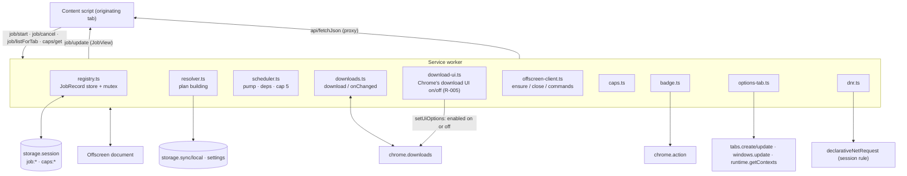
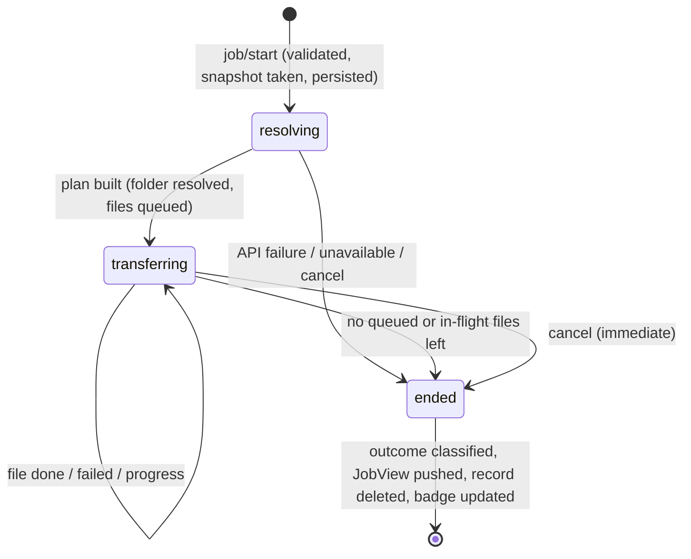
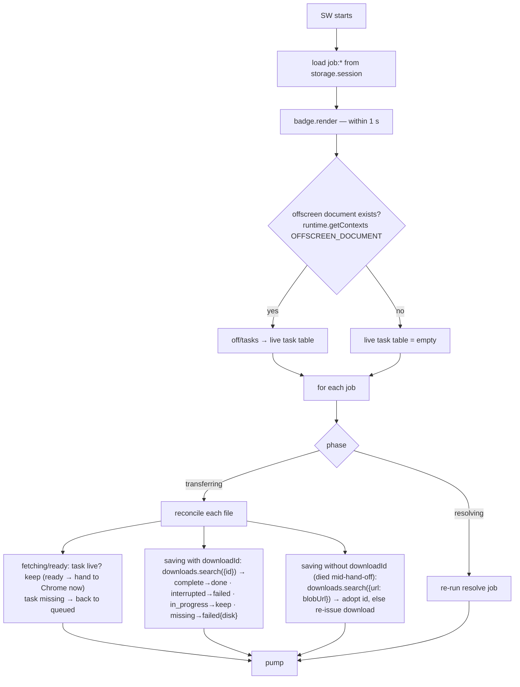
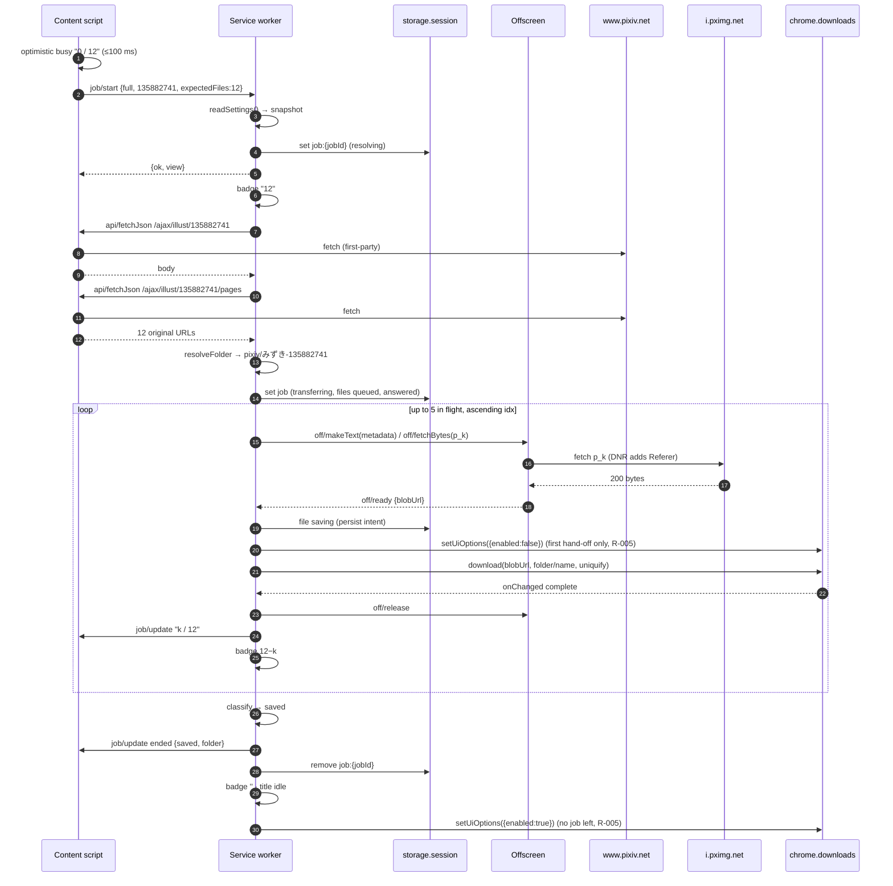
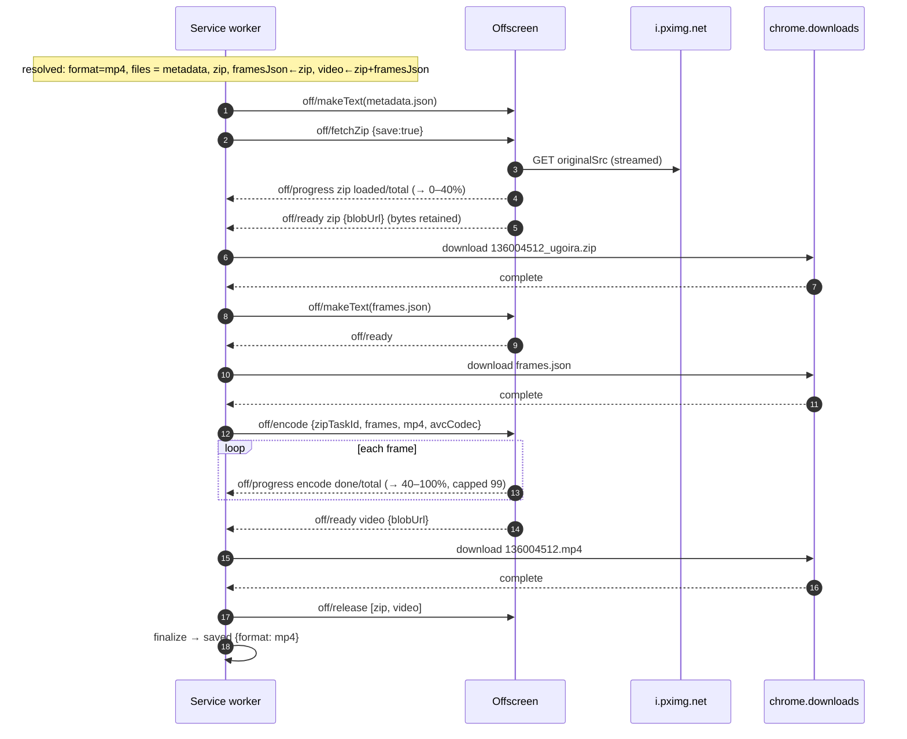
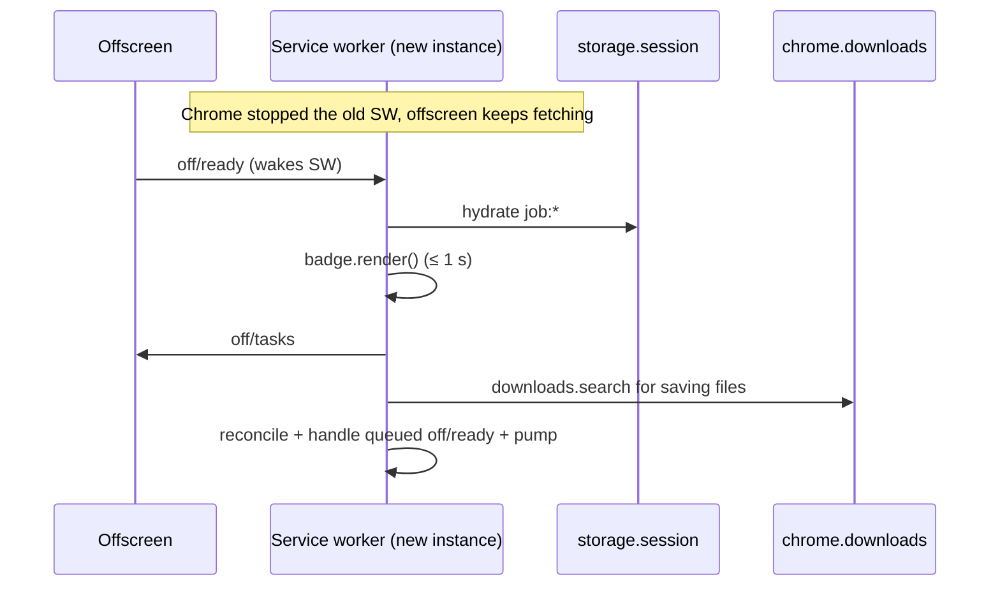

# Download Engine (service worker)

> Last updated: 2026-10-23 17:32:24 (UTC-7)
> Serves: prd-000 — CUJ-1 (pipeline, cancel, re-download), CUJ-2 (ugoira job orchestration), CUJ-3 (toolbar click → settings tab), CUJ-4 (badge/title), CUJ-5 (retry modes, outcome classification incl. the job-level "No connection" rule per R-004 S3, login-wall check at resolve per R-003); PRD §4.1 #3 (Chrome's download UI hidden while a job runs, R-005)

## Overview

The service worker (`src/background/`) is the system's **source of truth for jobs**. It:

- accepts start, cancel and attach requests from content scripts;
- snapshots settings and resolves a job's plan through pixiv's API (proxied through the originating tab, see [system.md §8.3](system.md));
- builds the file queue, schedules at most 5 files per artwork, and dispatches byte work to the offscreen document;
- hands finished bytes to `chrome.downloads` and observes completion;
- hides Chrome's download UI from a job's first hand-off until the last running job ends (R-005);
- classifies the end state, pushes `JobView` snapshots to the originating tab, and keeps the toolbar badge and title correct;
- installs the DNR Referer rule;
- opens or focuses the settings tab on toolbar click.

Chrome may stop the SW after 30 s idle, and a fetch that takes more than 30 s to respond gets it terminated (Chrome docs, service worker lifecycle). The engine therefore treats every `await` as a possible death point. Job state is written through to `chrome.storage.session`, and a boot-time hydration reconciles it against `chrome.downloads` and the offscreen task table.

## Goals & Non-Goals

**Goals**
- Exact PRD semantics for the job pipeline (§4.5), concurrency (≤ 5 per artwork), badge accounting (§4.8) and outcome mapping (CUJ-5).
- Survive SW termination at any point with no lost or duplicated files and the badge correct within 1 s of restart (CUJ-4 AC).
- No persisted history: a job's record exists only while the job runs.
- Deterministic, unit-testable core: the scheduler, classifier and badge math are pure functions over `JobRecord`s.

**Non-Goals**
- Surviving a Chrome restart (PRD §4.1 #6: accepted loss).
- Global concurrency limits across artworks (PRD: artworks are not serialized).
- Owning file bytes: the SW never holds file contents ([system.md §2](system.md) principle 2).

## System Context



## Detailed Design

### Data Model

The job model and request protocol live in **`src/shared/job.ts`** (they were in `src/background/types.ts` in iteration 1). The pure shared modules (`outcome.ts`, `progress.ts`, `messages.ts`, `pixiv-api.ts`) and the content script's button model operate on them, and `src/shared` must not import the SW's directory ([system.md §4](system.md) layering rule, D11). The move is a pure refactor (ENG-008).

```ts
// src/shared/job.ts (extends src/shared/types.ts)
export type FileRole = 'metadata' | 'page' | 'zip' | 'framesJson' | 'video';
export type FileState =
  | 'queued'    // waiting for deps / a slot
  | 'fetching'  // offscreen task running (fetch, text blob, or encode)
  | 'ready'     // offscreen holds a blob: URL; not yet handed to Chrome
  | 'saving'    // chrome.downloads.download issued (downloadId may still be unknown)
  | 'done'      // Chrome reported state 'complete' (or zip retained, when save=false)
  | 'failed'
  | 'skipped';  // never attempted: cancel, 403 stop, or a failed dependency

export interface FileTask {
  idx: number;                    // queue order; dispatch is in ascending idx
  role: FileRole;
  page?: number;                  // 0-based page index (role 'page')
  name: string;                   // basename: '135882741_p0.jpg', 'metadata.json', '136004512_ugoira.zip', 'frames.json', '136004512.mp4'
  url?: string;                   // source URL (page, zip) — allowlisted i.pximg.net
  save: boolean;                  // false only for the retryEncode zip (fetched into memory, not written)
  dependsOn: number[];            // idx list that must be 'done' first
  state: FileState;
  taskId?: string;                // offscreen task id (uuid)
  blobUrl?: string;
  downloadId?: number;
  failure?: Failure;
  text?: string;                  // metadata.json text, built when the file is dispatched (the same mutation drops
                                  // job.metaBody); kept while in flight so a re-queue after a restart can dispatch again
}

export interface UgoiraState {
  frames: Array<{ file: string; delay: number }>;  // ugoira_meta.body.frames, unmodified
  format: UgoiraOutput;           // effective: 'mp4' | 'webm' | 'zip'
  avcCodec: string | null;        // chosen codec string when format === 'mp4'
  width: number; height: number;  // from /ajax/illust body (probe key); encoder uses decoded frame size
  zipLoaded: number; zipTotal: number | null;
  encDone: number;
  percent: number;                // last emitted, monotonic
}

export interface JobRecord {
  v: 1;
  jobId: string;                  // crypto.randomUUID()
  artworkId: string;              // /^\d{1,12}$/
  originTabId: number;            // MessageSender.tab.id (no "tabs" permission needed)
  createdAt: number;              // Date.now()
  mode: JobMode;                  // 'full' | 'retryPages' | 'retryEncode' | 'retryMetadata'
  request: StartRequest;          // the validated start payload (for re-running 'resolving' after a restart)
  kind: 'pages' | 'ugoira' | 'unknown';
  phase: 'resolving' | 'transferring' | 'ended';
  snapshot: SettingsSnapshot;     // taken at click (PRD §4.1 #8)
  expectedFiles: number;          // badge count while resolving — full: tab hint clamped 0..200; retryPages: pages.length; retryEncode: 1; retryMetadata: 0
  metaBody: Record<string, unknown> | null;  // raw /ajax/illust body, kept only until the metadata file is dispatched
  folder: string | null;          // resolved (full) or echoed (retries); validated by isSafeRelativeFolder
  pagesTotal: number;             // display total N in "k / N" (full page count, also for retries)
  pagesOffset: number;            // pages already saved before this run (retryPages: total − requested)
  files: FileTask[];
  ugoira: UgoiraState | null;
  stopReason: null | 'cancelled' | 'forbidden';   // forbidden: first byte 403, or the resolver's login-wall check (R-003)
  apiFailure: { endpoint: 'illust' | 'pages' | 'ugoira_meta'; failure: Failure } | null;
  answered?: true;                // pixiv answered at least one request of this job (any HTTP status); set by applyResolution,
                                  // never cleared; read by classifyOutcome row 8 (system.md §10, R-004 S3, D13)
}
```

**Persistence.** `storage.session` key `job:<jobId>` holds the full `JobRecord`. A 200-page job is ~35 KB, so even dozens of concurrent jobs stay far below the 10 MB quota. Records are written on every state transition (persist-then-act, below). Byte-progress fields (`zipLoaded`, `encDone`, `percent`) are persisted at most once per second, because they are display-only. Records are **deleted** in the same mutation that ends the job (no history).

**Indexes.** None are stored. Hydration loads `storage.session.get(null)` and filters the `job:` prefix. In-memory maps are rebuilt on boot: `byJobId`, `byTaskId → (jobId, idx)`, `byDownloadId → (jobId, idx)`.

### API / Interface Contract

All envelopes follow [system.md §7](system.md). `ErrorCode = 'BAD_REQUEST' | 'NOT_FOUND' | 'FORBIDDEN' | 'INTERNAL'`.

**Content script → SW** (`target: 'sw'`, sender must have `tab.id`)

| `type` | Payload | Response |
|---|---|---|
| `job/start` | `StartRequest` (below) | `{ ok: true, view: JobView }` once the job is created and persisted, before resolving |
| `job/cancel` | `{ jobId }` | `{ ok: true }`. `FORBIDDEN` if `sender.tab.id !== job.originTabId`. `NOT_FOUND` if already ended (the tab then waits for or has the final `job/update`). |
| `job/listForTab` | `{}` | `{ ok: true, views: JobView[] }`: running jobs whose `originTabId === sender.tab.id` (reload reattach, PRD §4.7.6) |
| `caps/get` | `{ width: number, height: number }` (1..16384) | `{ ok: true, caps: { avc: string \| null, vp9: boolean } }` |

```ts
export type StartRequest =
  | { mode: 'full'; artworkId: string; expectedFiles: number;                        // expectedFiles: pageCount, or 1 for ugoira
      loggedIn: boolean | null }                                                     // the page's login marker (R-003 check at resolve);
                                                                                     // the guard accepts exactly true | false | null, else BAD_REQUEST
  | { mode: 'retryPages'; artworkId: string; folder: string; pages: number[]; total: number }  // pages: 0-based, unique, < total ≤ 200
  | { mode: 'retryEncode'; artworkId: string; folder: string; format: 'mp4' | 'webm' }
  | { mode: 'retryMetadata'; artworkId: string; folder: string };
```

**SW → content script** (`target: 'tab'`, `tabs.sendMessage(tabId, msg, { frameId: 0 })`)

| `type` | Payload | Response |
|---|---|---|
| `job/update` | `{ view: JobView }` | none (rejection ignored: tab closed or navigated off pixiv) |
| `api/fetchJson` | `{ url }` (allowlisted API URL) | `{ ok: true, result: RetryResult<unknown> }` |

**SW → offscreen** (`target: 'offscreen'`). Commands are acknowledged immediately with `{ ok: true }`; results arrive as events. The exceptions are `off/fetchJson`, `off/probe` and `off/tasks`, which are request/response.

| `type` | Payload | Result |
|---|---|---|
| `off/fetchBytes` | `{ taskId, url }` | event `off/ready { taskId, blobUrl, size }` or `off/failed { taskId, failure }` |
| `off/makeText` | `{ taskId, text, mime }` | event `off/ready` |
| `off/fetchZip` | `{ taskId, url, save: boolean }` | events `off/progress { taskId, phase: 'zip', loaded, total }` …, then `off/ready { taskId, blobUrl? }` (`blobUrl` only when `save`) or `off/failed`. Bytes are retained for a later `off/encode`. |
| `off/encode` | `{ taskId, zipTaskId, frames, format: 'mp4' \| 'webm', avcCodec: string \| null, artworkId }` | events `off/progress { taskId, phase: 'encode', done, total }` …, then `off/ready { taskId, blobUrl, size }` or `off/failed { failure: { kind: 'encode' } }` |
| `off/abort` | `{ taskIds: string[] }` | aborts; no further events for those tasks |
| `off/release` | `{ taskIds: string[], keepRetained?: boolean }` | revokes blob URLs and drops Blobs. Also drops retained zip bytes unless `keepRetained` (used when the zip has landed but the video is still to be encoded). |
| `off/fetchJson` | `{ url, credentials: 'include' }` | response `{ ok: true, result: RetryResult<unknown> }` (fallback API path) |
| `off/probe` | `{ width, height }` | response `{ ok: true, caps: { avc: string \| null, vp9: boolean } }` |
| `off/tasks` | `{}` | response `{ ok: true, tasks: Array<{ taskId, state: 'running' \| 'ready' \| 'retained', blobUrl?: string }> }` |

Details of each offscreen task are in [design-offscreen-worker.md](design-offscreen-worker.md).

### Logic & Behavior

#### Boot sequence (every SW start)

```ts
// src/background/sw.ts — listeners registered synchronously at top level (required for event wake-ups)
chrome.runtime.onMessage.addListener(router);           // routes by target/type; every handler awaits `ready`
chrome.downloads.onChanged.addListener(onDownloadChanged);
chrome.action.onClicked.addListener(openOrFocusOptions);
export const ready = (async () => {
  await installRefererRule();                           // system.md §8.2 (idempotent; a failure is logged, boot goes on)
  await chrome.action.setBadgeBackgroundColor({ color: '#1f1f1f' });
  await chrome.action.setBadgeTextColor({ color: '#FFFFFF' });
  await engine.hydrate();                               // load job:* into memory
  await engine.badge.render();                          // PRD: correct within 1 s of restart
  await engine.restoreDownloadUiIfIdle();               // R-005: no job running → Chrome's download UI on (never rejects)
  await engine.reconcile();                             // below; then pump every job
  await engine.badge.render();
})();
```

The download-UI step sits after `hydrate()` because it needs the registry, and before `reconcile()` so that a job reconcile finishes on the spot restores through `finalize` like any other (below, "Chrome's download UI").

#### Mutations: persist intent, then act

All changes to a `JobRecord` go through `registry.mutate(jobId, fn)`:
1. Mutations are serialized through one global promise chain, so concurrent event handlers can never interleave and lose an update.
2. `fn` mutates the in-memory record and returns a list of **effects** (`src/background/registry.ts`):

   ```ts
   export type Effect =
     | { type: 'dispatch'; idx: number }                              // send the file's offscreen command
     | { type: 'download'; idx: number }                              // hand the file's blob URL to chrome.downloads
     | { type: 'abort'; taskIds: string[] }                           // off/abort
     | { type: 'release'; taskIds: string[]; keepRetained?: boolean } // off/release
     | { type: 'cancelDownload'; downloadIds: number[] }              // chrome.downloads.cancel (Chrome removes the partial file)
     | { type: 'push'; throttle?: boolean }                           // job/update to the origin tab; throttle for byte progress
     | { type: 'badge' }                                              // re-render the toolbar badge and title
     | { type: 'finalize' };                                          // classify, push the final view, release the job's tasks
   ```
3. The record is written to `storage.session` (or deleted when ended).
4. Effects run only after the write resolves.

A crash between steps 3 and 4 leaves an intent recorded but not executed (e.g. a file in `saving` with no `downloadId`). Hydration detects and completes it.

#### Job lifecycle



#### Resolving (resolver.ts)

`resolve(job)` is idempotent. If the SW dies during `resolving`, hydration simply calls it again.

1. `snapshot = readSettings()` was taken at `job/start`, not here, so a re-run after restart still uses the click-time settings (PRD §4.1 #8).
2. API calls go through `apiFetchJson(job.originTabId, url)`: first `tabs.sendMessage(tab, api/fetchJson)`, and if that throws (no receiving end, tab closed) then `off/fetchJson`. If that also throws (the offscreen document did not answer), the call fails with `{ kind: 'internal', detail }`: no context could make the request, which says nothing about the user's connection ([system.md §10](system.md) "`internal` reads as `server`"). The `RetryResult` is parsed by `pixiv-api.ts`:
   - `parseIllust(body) → WorkInfo`, including `withheld` ([system.md §8.5](system.md)) (+ raw body kept for `metadata.json`);
   - `parsePages(body) → string[]` (`urls.original` per page, page order);
   - `parseUgoiraMeta(body) → { originalSrc, frames }`.

   A response whose JSON has `error: true` is a `pixivError` failure. A missing required field (`urls.original`, `originalSrc`, `frames` non-empty) is also treated as `pixivError`.
3. Per mode:

| Mode | API calls | Files queued (idx order) |
|---|---|---|
| `full`, illustType 0/1 | `/ajax/illust/{id}`, `/pages` | `metadata` (if `saveMetadata`), then `page` × N with names = URL basenames |
| `full`, illustType 2 | `/ajax/illust/{id}`, `/ugoira_meta`; `caps` for body width×height | `metadata` (if enabled), `zip` (`save: true`), `framesJson` (deps: zip), `video` (deps: zip, framesJson; only if effective format ≠ `zip`) |
| `retryPages` | `/pages` | `page` × requested indexes (no metadata) |
| `retryEncode` | `/ajax/illust/{id}` (frame size: the codec-probe key, so the encoder gets the same codec string as the first run), `/ugoira_meta`; `caps` | `zip` (`save: false`), `video` (deps: zip) |
| `retryMetadata` | `/ajax/illust/{id}` | `metadata` |

3a. **Login-wall check (R-003), `full` mode only.** Right after `/ajax/illust` parses, and before `/pages` or `ugoira_meta` is called: if `requiresLogin(work, request.loggedIn)` ([system.md §8.5](system.md)), the resolution is `{ ok: false, loginRequired: true }`; `applyResolution` sets `stopReason = 'forbidden'` and finalizes, and the classifier yields `needsLogin` (§10 row 4). No byte request is ever made. This is the same predicate the content script applies at render time; it matters when the user clicked before the render-time metadata arrived (`pending`), or after the render fetch failed. Retry modes skip the check: they exist only after a `full` job of the same document passed it.

   ```ts
   export type Resolution =
     | { ok: true; plan: Plan }
     | { ok: false; apiFailure: ApiFailure; answered: boolean }   // answered: some API call of this resolve got an HTTP response
     | { ok: false; loginRequired: true };   // R-003: page logged out and pixiv withholds the work
   ```
4. **Folder:** `full` mode calls `resolveFolder(snapshot.folderPattern, { artist: userName, id, title, userId })` ([design-settings-model.md](design-settings-model.md)). Retry modes use `request.folder` after re-validating it with `isSafeRelativeFolder()`, so a retry writes into the original job's folder (PRD CUJ-5 step 5 and edge case).
5. **Effective ugoira format:** `effectiveFormat(snapshot.ugoiraOutput, caps)` (shared, also used by the button):
   - `zip` → `zip`;
   - `mp4` → `caps.avc ? 'mp4' : caps.vp9 ? 'webm' : 'zip'`;
   - `webm` → `caps.vp9 ? 'webm' : caps.avc ? 'mp4' : 'zip'`.

   It is stored in `snapshot.effectiveFormat`.
6. Persist with `phase = 'transferring'`, then pump.

Failure in resolving → `apiFailure` is set and the job finalizes (classifier rows 2, 3 and 8 in [system.md §10](system.md)); a login-wall stop finalizes through row 4.

**`answered` (R-004 S3, D13).** `applyResolution` sets `job.answered = true` in the same mutation that applies the resolution when the resolution is `ok` (every mode's plan needs at least one API 2xx), is the login-wall stop (its `/ajax/illust` answered), or is a failure with `answered: true`. The resolver computes that flag per call: an API step whose `RetryResult` is `ok`, or whose failure `gotAnswer()` (system.md §10: `http`, `pixivError`, or `answered: true`), marks the resolve answered; the failure returned for a later step carries it. Examples: `full` with `/ajax/illust` 200 and `/pages` unanswered `network` → `answered: true` (server); `full` with `/ajax/illust` unanswered `network` → `false` (offline); `retryPages` whose `/pages` got 503, 503, then refused attempts → the failure has `answered: true` → `true` (server); a transport failure of both proxies (`internal`) → `false`, and row 8 reads `server` anyway because `internal` is not `network`. A re-run of `resolve` after a restart recomputes the flag from scratch.

#### `metadata.json` construction (src/shared/metadata.ts)

This gives byte parity with `write_metadata` in `ref/pixiv-dl`, except where the PRD explicitly differs.

```ts
export function buildMetadata(body: Record<string, unknown>, artworkId: string): object {
  const id = str(body.illustId) || str(body.id) || null;     // Python `or` semantics: '' falls through
  return {
    id,
    title: body.illustTitle ?? null,
    description: body.description == null ? null : plainText(String(body.description)),   // PRD: missing → null (script wrote "")
    userName: body.userName ?? null,
    userId: body.userId ?? null,
    createDate: body.createDate ?? null,
    uploadDate: body.uploadDate ?? null,
    pageCount: body.pageCount ?? null,
    illustType: body.illustType ?? null,
    xRestrict: body.xRestrict ?? null,
    tags: Array.isArray(body.tags?.tags) ? body.tags.tags.map(t => t?.tag ?? null) : [],
    url: `https://www.pixiv.net/artworks/${id ?? artworkId}`,  // script would write ".../None"; not ported
  };
}
export const plainText = (s: string) =>
  unescapeHtml(s.replace(/<br\s*\/?>|<\/p>|<\/div>/gi, '\n').replace(/<[^>]+>/g, '')).trim();
export const serializeJson = (v: unknown) => JSON.stringify(v, null, 2);   // no trailing newline (parity)
```

- `JSON.stringify(v, null, 2)` produces the same bytes as Python's `json.dump(ensure_ascii=False, indent=2)`: `", "`/`": "` separators with indent, the same short escapes, `\u00xx` lowercase for other controls, and literal non-ASCII. The only difference is lone surrogates: JS escapes them, while Python would crash. Golden tests (ENG-003) pin this.
- `unescapeHtml` must match Python's `html.unescape`: all HTML5 named references (including the legacy names that match without a trailing `;`), decimal and hex numeric references, and Python's invalid-codepoint replacement table. `DOMParser` cannot be used because the SW has no DOM, and its behavior differs from Python's anyway. The function lives in `metadata.ts`. Its entity table is a generated constant (`src/shared/html-entities.ts`, emitted from Python's `html.entities.html5` by `scripts/gen-golden.py`), so behavior is identical and pinned by golden vectors.
- `Python str.strip()` (no args) strips Unicode whitespace per `str.isspace`. `trim()` in JS strips a slightly different set (JS includes U+FEFF; Python includes U+001C–U+001F and U+0085). Implemented as an explicit `stripPy()` with Python's set, pinned by golden vectors.
- `frames.json` = `serializeJson(ugoira_meta.body.frames)`. This is the parsed array re-serialized with 2-space indent and insertion-order keys preserved: "unmodified" per PRD §4.3. It is identical to the script's output for ASCII file names.

#### Scheduler (scheduler.ts)

```
pump(job):
  if job.phase !== 'transferring': return
  inFlight = count(files, state ∈ {fetching, ready, saving})
  for f in files ordered by idx, where f.state == 'queued':
     if job.stopReason != null: mark f 'skipped'; continue
     if any dep of f is failed|skipped: mark f 'skipped'; continue
     if not all deps 'done': continue                       // keep queued, keep scanning (later files may be eligible)
     if inFlight >= MAX_IN_FLIGHT_PER_JOB (5): break
     f.state = 'fetching'; f.taskId = uuid()                 // persisted before dispatch
     effects.push(dispatch(f)); inFlight++
  if no file is queued or in flight: effects.push(finalize)
```

- Dispatch by role: `page` → `off/fetchBytes`; `metadata` → `off/makeText(serializeJson(buildMetadata(body)), 'application/json')`; `framesJson` → `off/makeText(serializeJson(frames), 'application/json')`; `zip` → `off/fetchZip`; `video` → `off/encode`. `metadata` and `framesJson` text is built in the SW from data held in the record. `metaBody` is set to `null` in the same mutation that dispatches the metadata file. `ugoira.frames` stays until the job ends, because `off/encode` needs it.
- **Page order** (PRD §4.5.1 step 6): dispatch is strictly ascending `idx`, so `_p0`, `_p1`, … are requested in order. Completion order is free. The next queued file starts as soon as any slot frees (on `done`/`failed`).
- **Cap semantics:** a file holds a slot from `fetching` until terminal. This bounds both concurrent HTTP requests per artwork (parity with `-j 5`) and concurrent Chrome downloads (AC: never > 5 in `chrome://downloads`).

#### Offscreen events → file transitions

| Event | Transition | Effects |
|---|---|---|
| `off/ready { blobUrl }` (save) | `fetching → saving` (blobUrl stored, persisted **before** the call) | effect `download` → `handOff()`: `await downloadUi.hideForHandOff()` (R-005, below), stop if the job ended or the file left `saving` meanwhile, then `downloads.download({ url: blobUrl, filename: folder + '/' + name, conflictAction: 'uniquify', saveAs: false })` → store `downloadId` (persist). If the call throws ("Invalid filename" etc.) → `failed{disk}`. |
| `off/ready` (zip with `save: false`) | `fetching → done` | pump |
| `off/ready` without `blobUrl` for a file that must be saved | `fetching → failed{ internal, detail: 'no blob' }` | release, pump |
| Dispatch refused (`{ ok: false }` ack) or undeliverable (`sendMessage` rejects after the one `ensureOffscreen` resend) | `fetching → failed{ internal }` for every role except `video`, which fails `{ encode }` (the zip landed, so `Retry · MP4` is the right next action, §10 row 5) | release, pump |
| `off/progress` | update `ugoira.zipLoaded/zipTotal/encDone`; recompute percent (monotonic) | throttled `job/update` push (≤ 4/s) |
| `off/failed { failure }` | `fetching → failed` | if `failure.status === 403` and role ∈ {page, zip}: `stopReason = 'forbidden'` (no new dispatches; in-flight files finish, PRD CUJ-5 step 9). Release task; pump. |
| `downloads.onChanged` `state: complete` | `saving → done` | `off/release` (with `keepRetained: true` for a `zip` file whose `video` is still pending), pump, badge, push |
| `downloads.onChanged` `state: interrupted` | `saving → failed{ disk \| dismissed }` (`USER_CANCELED` → `dismissed`; every `FILE_*`, `CRASH` and others → `disk`) | release, pump, badge, push |

Events for unknown task or download IDs (job already ended or cancelled) → `off/release` for the task and nothing else.

#### Cancel

`job/cancel` runs in one mutation:
- set `stopReason = 'cancelled'`;
- mark every `queued` file `skipped`;
- collect `taskIds` of `fetching`/`ready` files → effect `abort` (`off/abort`);
- `saving` files with a `downloadId` → effect `cancelDownload` (`chrome.downloads.cancel(id)`; Chrome removes the partial file). A download whose id arrives after the cancel (Chrome started it while the cancel mutation ran) is cancelled by the hand-off path itself, because `onDownloadStarted` finds the job ended;
- finalize immediately with outcome `cancelled`.

Already completed files stay on disk (PRD CUJ-1 step 5). An in-progress encode is aborted, and because the video is only handed to Chrome after `finalize()`, no partial video can exist (PRD §4.6). The button returns to idle within 300 ms because the push happens right after the persist, with no waiting for abort confirmations. Finalize then turns Chrome's download UI back on if no other job is running (PRD CUJ-1 step 5, R-005).

#### Finalize

1. `outcome = classifyOutcome(job, navigator.onLine)` ([system.md §10](system.md)). `partial.failedPages` = page indexes of failed pages; `saved = pagesTotal − failedPages.length`.
2. Push `job/update { view: toView(job, outcome) }` to `originTabId`.
3. Delete `job:<jobId>`; drop in-memory indexes; `off/release` all remaining task IDs of the job.
4. `badge.render()`.
5. If the registry is empty (no running job is left; a job still finalizing is still listed): `await downloadUi.restore()` (R-005, below), then `offscreenClient.scheduleClose()` unless a codec probe is pending (5 s grace; cancelled by any new command).

#### Chrome's download UI (download-ui.ts, R-005)

PRD §4.1 #3 (R-005): from the moment the first file of a job is handed to Chrome until the last running job ends, for any reason (Saved, cancelled, failed, needs login, Unavailable), Chrome's download UI is off, so there is no per-file fly-to-toolbar animation and no downloads button. It is turned on again when the last running job ends, and whenever the worker starts with no job running. The hidden window never starts before a job's first file is handed to Chrome. CUJ-1 step 2 and its AC require this "not even for the first file".

**Platform facts the design relies on** (Chromium `chrome/browser/extensions/api/downloads/downloads_api.cc`; Chrome extension docs, `chrome.downloads.setUiOptions`):
- `setUiOptions({ enabled })` (Chrome 105+, permission `downloads.ui`) adds this extension to, or removes it from, a per-profile set of "UI-disabling extensions" held in the browser process. The UI is hidden while the set is non-empty. Disabling also closes a bubble that is open.
- The entry belongs to the extension, not to the SW instance. It outlives SW termination; Chrome removes it when the extension unloads (disabled, reloaded, updated, uninstalled), and it is gone after a browser restart.
- `enabled: true` first removes our entry, then rejects (`runtime.lastError`) if another extension still keeps the UI off. `enabled: false` rejects only without the permission.
- There is no getter.

```ts
// src/background/download-ui.ts
export interface DownloadUi {
  /** Before a file is handed to Chrome. Resolves once Chrome has applied the hide (or refused it); never rejects. */
  hideForHandOff(): Promise<void>;
  /** The last running job ended, or the SW started with none running. Resolves once Chrome has answered; never rejects. */
  restore(): Promise<void>;
}
export function createDownloadUi(
  setUiOptions: (options: chrome.downloads.UiOptions) => Promise<void> = (o) => chrome.downloads.setUiOptions(o),
): DownloadUi;
```

State, in memory only and per SW instance. Nothing is persisted, so the storage inventory (system.md §6) is unchanged: Chrome itself holds the real state, and a stored copy could go stale when Chrome clears the entry on unload.
- `requested: boolean | null`: the `enabled` value this instance last asked Chrome for; `null` until its first call, because a previous instance may have left the UI either way.
- `chain: Promise<void>`: every `setUiOptions` call is queued behind the previous one, so Chrome applies them in request order and its state is always the last request.
- `hideRefused: boolean`: a latch. Once a hide is refused, this instance stops trying, because the only documented refusal (missing permission) cannot be fixed by a retry.

| Call | State | Does |
|---|---|---|
| `hideForHandOff()` | `hideRefused` | resolves at once |
| `hideForHandOff()` | `requested === false` | returns `chain`: waits for the pending hide to settle, so no hand-off overtakes it |
| `hideForHandOff()` | `requested` is `true` or `null` | sets `requested = false` **synchronously**, enqueues `setUiOptions({ enabled: false })`, returns it |
| `restore()` | `requested === true` | returns `chain` |
| `restore()` | `requested` is `false` or `null` | sets `requested = true` synchronously, enqueues `setUiOptions({ enabled: true })`, returns it |

Updating `requested` before enqueueing is what keeps concurrent callers ordered. Up to five hand-offs per job, from any number of jobs, race into `hideForHandOff()`: one enqueues and the others await the same promise. A `restore()` from one job's finalize and the first hand-off of a job that starts right after it land in the queue in the order they were called.

**Call sites** (the only three):
1. **`handOff(job, idx)`** in `engine.ts`, after its `saving` guard and before `chrome.downloads.download`: `await downloadUi.hideForHandOff()`, then the restart-test await point `await:handoff.hideUi`, then return unless the record is still in the registry **and** the file is still `saving`. A job cancelled while the call was in flight never hands that file to Chrome, so it leaves no "Canceled" entry (PRD CUJ-1 step 5); finalize already released the blob. The file check is needed because the cancel mutation fails the file at once, while its record stays listed until finalize has pushed the final view and deleted it: a hand-off resuming in that window would otherwise start a download that the started-after-cancel path then cancels, leaving exactly that entry (pinned by a unit test in `engine-download-ui.test.ts`). Every hand-off goes through `handOff`: a fresh `off/ready`, reconcile's `ready → saving`, and reconcile's re-issue of a hand-off a restart interrupted. So the first file of every job is preceded by the hide, and nothing earlier is: a job that only resolves, fetches or encodes never hides the UI.
2. **`finalize(job)`**: step 5 above, after the mutation that deletes the record, when `registry.list()` is empty. This covers every end reason, because every job ends through `finalize`: Saved, partial and error, needs login (including a mid-job 403 and the resolver's login-wall stop), Unavailable, and cancel (whose mutation returns `finalize` at once). A job that is still finalizing is still listed, so when two jobs end together only the last one restores. A job that is still resolving keeps the UI hidden until it ends too: the PRD's "until the last running job ends".
3. **Boot** (`sw.ts`, above): `engine.restoreDownloadUiIfIdle()` = `registry.list().length === 0 ? downloadUi.restore() : Promise.resolve()`. With hydrated jobs, the UI stays as the previous instance left it: hidden if a job had handed off a file, otherwise visible until the next hand-off (with `requested === null`, that hand-off calls Chrome once; repeating a disable is harmless).

`Engine` gains `restoreDownloadUiIfIdle(): Promise<void>`, used by boot; finalize uses the same check internally.

**Error handling.**
- **Hide refused:** `warn` once per SW instance ("could not hide Chrome's download UI"), set the latch, and the hand-off proceeds. Saving the file is the job; hiding the animation is cosmetic.
- **Restore refused:** `debug`. This is expected when another extension keeps the UI off, and Chrome has already removed our entry before refusing. `requested` stays `true`.
- Neither method ever rejects into the effect runner, `finalize` or boot.
- **SW killed between deleting the last record and the restore:** the next SW start finds no job and restores (call site 3). Chrome also clears the entry when the extension unloads.
- **Chrome holds a job file for a user decision** (dangerous-file or deep-scan prompt) while the UI is hidden: the job does not end, so the UI stays hidden until the user acts in `chrome://downloads`. This follows the PRD; the gap is with pm (system.md §15 gap 1).

**Performance.** Two IPC calls per busy period (the first hand-off and the last end), about 1 ms each. Only the first hand-off of a busy period waits for one round trip.

**Test API.** In `--e2e` builds (`__TEST_HOOKS__`), `self.__hfpTest.downloadUi()` returns `{ requested, calls }`, where `calls` is `Array<{ enabled: boolean; ok: boolean; at: number }>`: the calls this SW instance made, with Chrome's result and `Date.now()` when each settled. It is merged into `self.__hfpTest` (shared with `clickAction`) through a new `exposeTestApi(api)` in `src/shared/test-hooks.ts`, and `options-tab.ts` switches to the same helper, so neither installer overwrites the other. The installer is a function referenced only from `if (__TEST_HOOKS__)`, as in `options-tab.ts`; it wraps the injected `setUiOptions` to record each settled call, so prod bundles carry no trace (ENG-007 check) and the shipped module keeps no recording state.

```mermaid
sequenceDiagram
  autonumber
  participant OD as Offscreen
  participant SW as Service worker (engine)
  participant UI as download-ui.ts
  participant DL as chrome.downloads
  Note over SW: job A resolved, files fetching; Chrome's UI visible
  OD-->>SW: off/ready A:metadata.json
  SW->>UI: hideForHandOff()
  UI->>DL: setUiOptions({enabled:false})
  DL-->>UI: ok
  SW->>DL: download(A:metadata.json)
  OD-->>SW: off/ready A:p0 … p4
  SW->>UI: hideForHandOff() (requested=false → resolved chain)
  SW->>DL: download(A:p0 …)
  Note over SW: job B starts, hands off (no new call), ends Saved
  SW->>SW: finalize(B): registry still holds A → no restore
  DL-->>SW: onChanged complete (A's last page)
  SW->>SW: finalize(A): registry empty
  SW->>UI: restore()
  UI->>DL: setUiOptions({enabled:true})
  Note over DL: downloads button returns; bubble lists both jobs' files
```

#### Hydration and reconciliation (after a SW restart)



Re-queued fetches restart their attempt counter. This is acceptable: it only happens when the offscreen document itself died, which is outside PRD retry semantics.

#### Badge and action title (badge.ts)

```ts
remaining(job) =
  job.phase === 'resolving'        ? job.expectedFiles
: job.kind === 'pages'             ? count(files, role === 'page' && state ∈ {queued, fetching, ready, saving})
: job.kind === 'ugoira'            ? 1                                   // PRD §4.8: 1 for the whole job
: 0;
total = Σ remaining(job) over running jobs
jobs  = number of running jobs with remaining(job) > 0          // "across N downloads" counts only jobs with files left
badgeText  = total === 0 ? '' : total >= 1000 ? '999+' : String(total)
title      = total === 0 ? t('action_title_idle')               // nothing counted → idle title, never "0 files remaining"
           : jobs === 1 ? (total === 1 ? t('action_title_one_single') : t('action_title_one', total))
           :              t('action_title_many', total, jobs)
```

- **Zero counted files** (PRD §4.8, R-004 S11). A lone `retryMetadata` job, or a `full` job clicked before its metadata arrived (`expectedFiles` 0) while it resolves, is running but counts 0: the badge is hidden and the title is `action_title_idle`, and the job count in `action_title_many` counts only jobs that contribute files. The title and the badge therefore always tell the same story. (The first design titled the icon "Helper for Pixiv — 0 files remaining" here; code review W1.)

- `metadata.json`, `frames.json` and the zip never count separately (PRD §4.8). A `retryMetadata` job contributes 0, so the badge stays hidden unless another job runs.
- Failed and skipped files leave the count immediately (CUJ-4 "A job ends with failures").
- `render()` is coalesced (50 ms trailing) and called after every mutation that changes `remaining` or the job count, which meets the "≤ 1 s" requirement. `setBadgeText`/`setTitle` are skipped when unchanged.

#### Toolbar click → settings tab (options-tab.ts)

```ts
async function openOrFocusOptions(tab: chrome.tabs.Tab) {
  const url = chrome.runtime.getURL('options.html');
  const [ctx] = await chrome.runtime.getContexts({ contextTypes: ['TAB'], documentUrls: [url] });
  if (ctx && ctx.tabId !== -1) {
    await chrome.tabs.update(ctx.tabId, { active: true });
    await chrome.windows.update(ctx.windowId, { focused: true });   // PRD CUJ-3 step 1: "that tab and its window are focused"
  } else {
    await chrome.tabs.create({ url, index: tab.index + 1, windowId: tab.windowId, openerTabId: tab.id, active: true });
  }
}
```

`runtime.openOptionsPage()` is not used. Its tab placement and cross-window focus behavior are unspecified ("may depend on … what Chrome happens to support"), while the PRD requires both "to the right of the current tab" and cross-window focus. `getContexts` finds the extension's own tabs without the `tabs` permission.

#### Codec capabilities (caps.ts)

`caps/get` and resolver calls go through `getCaps(w, h)`:
1. key `caps:<evenW>x<evenH>`, where `even(n) = n - (n % 2)`;
2. `storage.session` hit → return;
3. otherwise `off/probe` (creating the offscreen document if needed) → store → return.

Concurrent misses for the same key share one in-flight promise. Caching for the browser session satisfies PRD §4.6 ("The answer is cached for the browser session"), and since the probe runs in the same context as the encoder, the hint shown and the format produced agree.

## Data Flow

### Illustration / manga job (happy path, CUJ-1)



### Ugoira job (CUJ-2)



### SW restart mid-job (CUJ-4)



## Alternatives Considered

**Where job state lives**

| Criteria | **storage.session write-through** | In-memory only + rebuild from `downloads.search` | IndexedDB | State owned by the offscreen document |
|---|---|---|---|---|
| Survives SW restart | Yes | Partly: queued (not-yet-handed) files are invisible to `downloads.search` | Yes | Yes, but the SW still needs it for every `chrome.*` call |
| Gone when Chrome quits (PRD: no history) | Yes, by construction | Yes | No: needs explicit cleanup and leaves history on crash | Yes |
| PRD/index mandate | Matches "session-scoped storage" | Fails §4.8 | Contradicts "gone when Chrome quits" | Contradicts §4.1 #6 (orchestration in SW) |
| Complexity | Low (one key per job) | High (reconstruction heuristics) | Medium | Medium (two-hop for every decision) |
| **Verdict** | **Selected** | Rejected | Rejected | Rejected |

**Progress transport (SW → tab)**

| Criteria | **`tabs.sendMessage` full snapshots** | Long-lived `runtime.connect` port | Content script polls the SW |
|---|---|---|---|
| Survives SW restart | Yes (stateless) | No: port dies, needs reconnect logic | Yes |
| Keeps the SW alive needlessly | No | Yes (Chrome 114+ ports extend lifetime) | Polling wakes it constantly |
| Lost-message tolerance | Full snapshot each time | Needs replay | n/a |
| **Verdict** | **Selected** | Rejected | Rejected |

**API call origin for jobs**: see [system.md §8.3](system.md) (tab proxy + offscreen fallback, selected over SW-only fetch).

**Where Chrome's download UI is toggled (R-005)**

| Criteria | **SW module: hide before each hand-off, restore at finalize/boot** | Hide at `job/start`, restore at finalize | A registry `Effect` per job (`hideUi`/`restoreUi`) | Persist the UI state in `storage.session` |
|---|---|---|---|---|
| PRD "never starts before the job's first file is handed to Chrome" | Yes | **No**: hides during resolving and fetching (a long zip fetch), and for jobs that end needs-login or Unavailable without any file | Yes | Yes |
| First file covered ("not even for the first file") | Yes (awaited before `download`) | Yes | Needs ordering between two effects of different mutations | Yes |
| Browser-wide fact vs per-job state | Matches: one module for the browser-wide setting | Matches | Mismatch: effects belong to one job; the UI belongs to all of them | Duplicates a fact Chrome already holds; stale after Chrome clears it on unload |
| Survives SW restart | Chrome keeps the state; the boot rule covers a lost restore | Same | Same | Same, with more code |
| **Verdict** | **Selected** | Rejected | Rejected | Rejected |

**How "No connection" is judged (R-004 S3)**

| Criteria | **Job-level flag (`JobRecord.answered`) + request-level `Failure.answered`** | Per-request `lastStatus` (iteration 2) | Per-URL/host memory of recent 429/5xx in the SW |
|---|---|---|---|
| Matches PRD CUJ-5 step 6 (per click: no request of the job answered) | Exactly | No (misses a click whose every byte request Chromium refused) | No (a different rule: time-windowed) |
| Deterministic under Chromium throttling | Yes | No (1 of 7 Retries wrong in QA iteration 2) | Mostly, but depends on the window length |
| Survives SW restart | Yes: persisted in the record | Yes | Needs its own persisted store |
| Extra state | One optional field per record | None | A new storage key and expiry |
| **Verdict** | **Selected** | Replaced | Rejected (it was the fallback if R-004 had answered B) |

## Cross-Cutting Concerns

- **Error handling:** every failure becomes a `Failure` on a file or as `apiFailure`. The classifier ([system.md §10](system.md)) is the only place outcomes are decided. `chrome.*` call rejections inside effects are caught and logged at `warn`; a failed `tabs.sendMessage` push is expected (tab gone) and logged at `debug`.
- **Security:** inputs are validated per [system.md §7](system.md). Retry requests cannot point the engine at arbitrary URLs because URLs are always re-derived from pixiv's API, never accepted from the tab. Folders echoed by the tab are re-validated. Only the originating tab may cancel a job.
- **Performance:** per-file overhead is 2 messages + 1 `storage.session` write + 1 download call (~2–5 ms). A 200-page job therefore spends < 1 s of SW CPU in total. Badge rendering is O(jobs × files), recomputed ≤ 20×/s.
- **Observability:** `info` at job start/end with `jobId`, `artworkId`, `mode`, `kind`, outcome, counts, duration; `debug` per file transition. `chrome://extensions` → Errors shows `warn`/`error`.
- **Testing:**
  - Unit: scheduler pump (cap, order, deps, stop on 403, cancel), `classifyOutcome` (one case per row plus precedence conflicts; row 8 cases: a job without `answered` whose only failure is an unanswered `network` API failure → offline; a resolved job (`answered: true`) whose every original failed with unanswered `network` → server (the PRD's accepted cost); an API `network` failure with `answered: true` → server; any `internal` or `timeout` → server; `navigator.onLine === false` → offline even when answered; all `disk`/`dismissed` → disk; row 4 via `stopReason 'forbidden'` with no failed file), badge/title math including `999+`, singular, a lone 0-count job (idle title, empty badge) and "across N" counting only jobs with files left, `buildMetadata`/`serializeJson` against golden vectors, `effectiveFormat` truth table.
  - Resolver: `full` with `loggedIn: false` on a withheld body → `loginRequired`, and the fake API saw no `/pages` or `ugoira_meta` call; `loggedIn: true` or `null` on the same body → proceeds; `retryEncode` calls `/ajax/illust` before `ugoira_meta`; a transport error from both the tab and the offscreen fallback → `apiFailure` with `kind: 'internal'` and `answered: false`; `Resolution.answered` per the examples in "Resolving"; `applyResolution` sets `job.answered` for `ok`, the login-wall stop and an answered failure, and leaves it absent for an unanswered failure.
  - `download-ui.ts` (fake `setUiOptions`): concurrent `hideForHandOff()` calls make one Chrome call and all resolve after it; `restore()` then `hideForHandOff()` in the same tick apply in that order; a refused hide warns once, latches, and still resolves; a refused restore resolves and logs at `debug`; `requested === null` at start makes both methods call Chrome.
  - Integration (Vitest + `test/fakes/chrome.ts`): full job runs with a fake offscreen; SW restart is simulated by discarding the module instance and re-importing with the same fake `storage.session`/`downloads` at every await point of a scripted job, including the new `await:handoff.hideUi`; concurrent jobs; cancel races (`off/ready` after cancel, and a cancel while the hide is in flight → no `download` call). R-005 order, from the fake's combined call log (design-test-harness.md L2): no `setUiOptions` while a job only resolves; `{ enabled: false }` resolves before the first `download`; exactly one `{ enabled: true }` after the last job's record is deleted, for each end reason (saved, partial, needs login, unavailable, cancel); none when job B ends while job A runs; boot with no records → `{ enabled: true }`; boot with a hydrated running job → no call until its next hand-off; a refused `setUiOptions` never fails a job.
  - E2E: [design-test-harness.md](design-test-harness.md).

## Migration / Rollout

**Iteration 3.**
- **Persisted shape.** `Failure.lastStatus` is removed; `Failure.answered?: true` and `JobRecord.answered?: true` are added. `storage.session` is cleared when the extension is updated or reloaded, so no record of an earlier build is ever hydrated: no migration and no bump of `JobRecord.v`. A record without `answered` reads as "nothing answered yet", which is exactly what an absent field means. The `isFailure` guard in `messages.ts` accepts `answered: true` (and nothing else under that key) and drops `lastStatus`.
- **Permission.** `downloads.ui` joins the manifest. It carries no install warning (system.md §5), so an update to this build installs silently and is not disabled for re-approval. Chrome removes our UI-disable entry when the extension unloads for the update, so no build ever leaves Chrome's UI hidden across an update.
- **Rollback** is a plain revert. The previous build never calls `setUiOptions`; a rollback is itself an update, which unloads the extension and clears any disable this build left. Removing a permission never prompts.

**Iteration 2.**
- **Persisted shape.** `StartRequest.full` gains `loggedIn`, and `Failure` gains `kind: 'internal'`. The resolver reads `request.loggedIn ?? null`, so even a hydrated record without the field skips the check (never needs-login), the safe reading; incoming `job/start` messages are validated strictly (above).
- **Type move (ENG-008)** is compile-time only.

## Dependencies & Integration Points

- **Depends on:**
  - `src/shared/*` (types, messages, settings, pattern, metadata, retry, pixiv-api, outcome, progress, i18n);
  - the offscreen worker contract;
  - the content-script contract (`api/fetchJson`, `job/update`);
  - `chrome.downloads` (including `setUiOptions`, permission `downloads.ui`), `chrome.storage.session`/`sync`/`local`, `chrome.action`, `chrome.declarativeNetRequest`, `chrome.offscreen`, `chrome.runtime.getContexts`, `chrome.tabs.create/update/sendMessage`, `chrome.windows.update`.
- **Depended on by:** the content script (all job states), the options page (none directly), the e2e harness (evaluates `chrome.downloads.search`, `chrome.action.getBadgeText` and `__hfpTest.downloadUi()` in the SW).

## Open Questions & Risks

- **Byte path verified** (ENG-002): the DNR rule as written matches offscreen fetches and nothing else, and `chrome.downloads.download(blobUrl)` from the SW saves a blob created in the offscreen document ([system.md §8.2](system.md)). No fallback rule is implemented.
- **"Ask where to save each file" on:** `saveAs: false` may still prompt per file. A dismissed dialog → `dismissed` → counted as failed and not retried (PRD CUJ-1 edge). The Save As dialog is a separate window, not part of the download UI that R-005 hides, so it is expected to appear while the UI is hidden. Verify on branded Chrome (L5).
- **A Chrome prompt for a job file while the UI is hidden** (dangerous-file or deep-scan): the job waits for the user in `chrome://downloads`, and the UI stays hidden until it ends ([system.md §15](system.md) gap 1, with pm).
- **Stale logged-in page** (user logged out in another tab): the resolver does not treat a withheld body as a refusal while the page claims to be logged in, so a walled all-ages work downloads in that case. This is PRD text now (CUJ-5 edge, R-004 S12a), to be revisited after the release checklist's logged-in stale-page probe ([system.md §8.5](system.md) miss 2).
