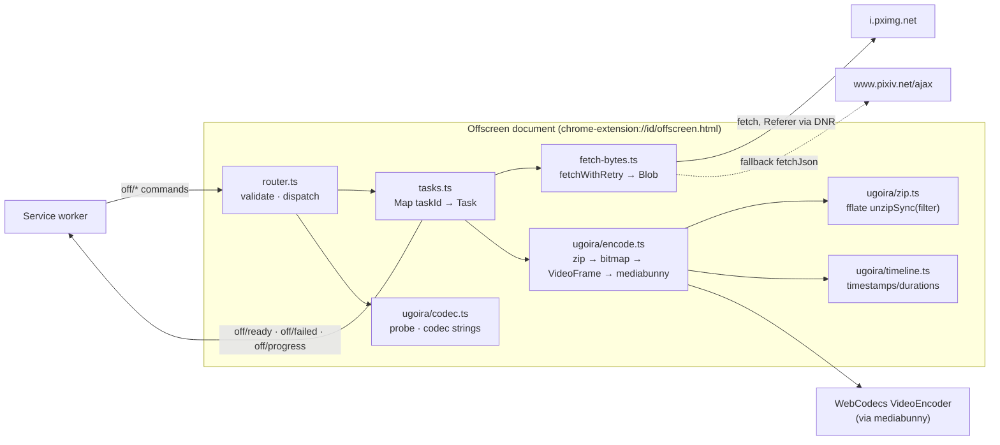
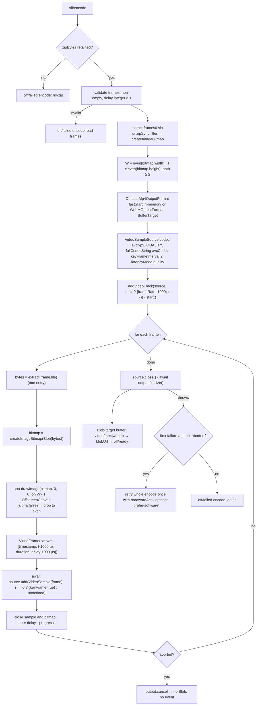
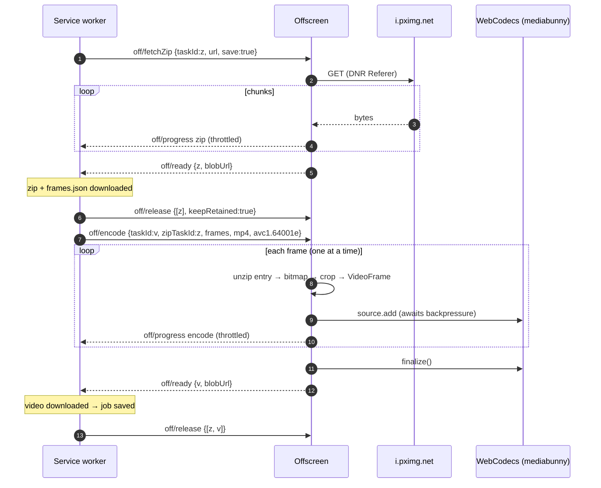

# Offscreen Worker (bytes & ugoira encoding)

> Last updated: 2026-10-22 18:08:04 (UTC+9)
> Serves: prd-000 — CUJ-1 (original bytes), CUJ-2 (zip, frames.json, in-browser video), CUJ-5 (encode-failure retry, byte-level failures)

## Overview

The offscreen document (`src/offscreen/offscreen.html` + `offscreen.ts`) is the extension's **data plane**. It exists because the service worker has neither `URL.createObjectURL` nor WebCodecs (PRD §4.2), and because a SW fetch slower than 30 s gets the worker terminated. It executes byte-level tasks on behalf of the SW:

- fetch originals and the ugoira frame zip from `i.pximg.net` with the shared retry policy (Referer added by the DNR rule, [system.md §8.2](system.md)), and expose them as `blob:` URLs;
- turn SW-built text (`metadata.json`, `frames.json`) into `blob:` URLs;
- probe WebCodecs encoder support for a given size;
- decode ugoira frames one at a time and encode MP4 (H.264) or WebM (VP9) with exact per-frame timing via mediabunny;
- serve as the fallback context for pixiv API calls when the originating tab is gone.

It makes **no policy decisions**. Which files, in what order, how many at once, and what a failure means are all decided by the SW ([design-download-engine.md](design-download-engine.md)). Offscreen documents can use only `chrome.runtime`, so it talks to the SW exclusively through messages.

## Goals & Non-Goals

**Goals**
- Byte-exact originals and zip (PRD §4.3): bytes go from the network into a Blob with no transformation.
- Video timing exact to the millisecond: frame *i* at Σ delay₀…delayᵢ₋₁, duration delayᵢ (PRD §4.6).
- Peak memory = zip bytes + one decoded frame + encoder buffers (PRD NFR "Memory").
- No partial videos: a video Blob exists only after `finalize()` succeeds (PRD §4.6).
- Independent of every tab and of SW lifetime.

**Non-Goals**
- Scheduling, retries across tasks, badge or button state (SW).
- Persisting anything: the document is memory-only, and if it dies its tasks are re-queued by the SW.
- Codec choices beyond H.264/VP9 (no HEVC/AV1 in v1; PRD §4.6 names exactly two).

## System Context



## Detailed Design

### Lifecycle (owned by `src/background/offscreen-client.ts`)

```ts
const OFFSCREEN_URL = 'offscreen.html';
let creating: Promise<void> | null = null;
export async function ensureOffscreen(): Promise<void> {
  cancelScheduledClose();
  const ctx = await chrome.runtime.getContexts({ contextTypes: ['OFFSCREEN_DOCUMENT'], documentUrls: [chrome.runtime.getURL(OFFSCREEN_URL)] });
  if (ctx.length) return;
  creating ??= chrome.offscreen.createDocument({
    url: OFFSCREEN_URL,
    reasons: [chrome.offscreen.Reason.BLOBS],
    justification: 'Fetch pixiv originals into Blob URLs for chrome.downloads and encode ugoira videos with WebCodecs.',
  }).finally(() => { creating = null; });
  await creating;
}
```

- **One document** per extension (Chrome limit). All concurrent jobs share it. Tasks are isolated by `taskId`.
- **Reason `BLOBS`.** No reason exists for WebCodecs, and `BLOBS` truthfully covers the Blob URL work. With this reason Chrome imposes no lifetime limit (only `AUDIO_PLAYBACK` auto-closes).
- **Close policy:** when the SW's job registry becomes empty and no `caps` probe is pending, the SW schedules `chrome.offscreen.closeDocument()` after a 5 s grace. Any `ensureOffscreen()` cancels it. Because a job only ends after all its downloads reached a terminal state, closing never revokes a `blob:` URL Chrome is still reading. Closing frees the retained zip and encoder memory (~10–100 MB) instead of holding it for the whole browser session. The 5 s timer runs inside the SW's guaranteed 30 s post-event window, so it is reliable.
- **Readiness:** `offscreen.ts` registers its `runtime.onMessage` listener synchronously at module top level. `createDocument` resolves after the document loads, so commands sent after `ensureOffscreen()` are never lost. If a command's `sendMessage` still rejects ("Receiving end does not exist"), the client re-runs `ensureOffscreen()` once and resends.

### Data Model

```ts
// src/offscreen/tasks.ts
type TaskKind = 'bytes' | 'text' | 'zip' | 'encode';
interface Task {
  taskId: string;
  kind: TaskKind;
  state: 'running' | 'ready' | 'retained' | 'failed';
  abort: AbortController;
  blob?: Blob;               // held until release (or keepRetained release for zip)
  blobUrl?: string;          // URL.createObjectURL(blob)
  zipBytes?: Uint8Array;     // kind 'zip' only; kept for a later encode until full release
}
const tasks = new Map<string, Task>();
```

The task table is memory-only. `off/tasks` exposes it to the SW for reconciliation after a SW restart ([design-download-engine.md](design-download-engine.md), Hydration).

### API / Interface Contract

Handled commands (`target: 'offscreen'`; sender must have **no** `tab`):

| Command | Behavior | Emits |
|---|---|---|
| `off/fetchBytes { taskId, url }` | Allowlist `https://i.pximg.net/`, then `fetchWithRetry(url, { responseType: 'bytes', init: { credentials: 'omit', cache: 'no-store' }, signal })`. The Blob keeps the response `Content-Type`. | `off/ready { taskId, blobUrl, size }` · `off/failed { taskId, failure }` |
| `off/makeText { taskId, text, mime }` | `new Blob([text], { type: mime + ';charset=utf-8' })` (UTF-8 by spec) | `off/ready` |
| `off/fetchZip { taskId, url, save }` | Streamed fetch with byte progress into `zipBytes` (below). If `save`, also a Blob for the download. | `off/progress { taskId, phase: 'zip', loaded, total \| null }` (≤ 4/s, plus a final one) · `off/ready { taskId, blobUrl? }` · `off/failed` |
| `off/encode { taskId, zipTaskId, frames, format, avcCodec, artworkId }` | Pipeline below; reads `tasks.get(zipTaskId).zipBytes` | `off/progress { taskId, phase: 'encode', done, total }` (≤ 4/s) · `off/ready { taskId, blobUrl, size }` · `off/failed { taskId, failure: { kind: 'encode', detail } }` |
| `off/abort { taskIds }` | `abort.abort()`; the task is deleted; late completions are swallowed | — |
| `off/release { taskIds, keepRetained? }` | Revoke `blobUrl`, drop `blob`. Unless `keepRetained`, also drop `zipBytes` and delete the task. | — |
| `off/fetchJson { url, credentials }` → response | Allowlisted API URL, `fetchWithRetry(..., { responseType: 'json', init: { credentials: 'include' } })` | response `{ ok: true, result }` |
| `off/probe { width, height }` → response | Codec probe (below) | response `{ ok: true, caps: { avc, vp9 } }` |
| `off/tasks {}` → response | Snapshot of the task table | response `{ ok: true, tasks }` |

The SW sends `off/release { taskIds: [zipTaskId], keepRetained: true }` when the zip's download completes. That frees the Blob copy while keeping `zipBytes` for the encode. At job end it sends a full release.

### Logic & Behavior

#### Byte fetch (fetch-bytes.ts)

`fetchWithRetry` implements [system.md §9](system.md) exactly. Body handling:

```ts
const reader = res.body!.getReader();
const total = parseContentLength(res.headers.get('content-length'));   // null if absent/invalid
// zip: preallocate when total is known, so the bytes are held once; otherwise collect chunks and concat once at the end
const buf = total != null ? new Uint8Array(total) : null; const chunks: Uint8Array[] = [];
let loaded = 0;
for (;;) {
  armStallTimer(30_000);                       // re-armed per chunk; fires abort → Failure{kind:'timeout'}
  const { done, value } = await reader.read();
  if (done) break;
  if (buf) { if (loaded + value.length > buf.length) throw lengthMismatch(); buf.set(value, loaded); } else chunks.push(value);
  loaded += value.length; onProgress?.(loaded, total);
}
if (total != null && loaded !== total) → Failure{kind:'network', detail:'short-body'}  (retried, like a dropped connection)
```

- **Originals** (`fetchBytes`) collect chunks into `new Blob(chunks, { type })`. They are never parsed and never re-encoded, so the bytes are byte-for-byte as served (PRD §4.3; AC: size equals `Content-Length`).
- `cache: 'no-store'` keeps a 200 MB manga from also filling the HTTP cache with bytes we hold anyway.
- **Concurrency** is bounded by the SW (≤ 5 per job), so peak original-bytes memory per job is ≤ 5 × the largest original (pixiv originals are typically ≤ 32 MB).

#### Codec probe (ugoira/codec.ts)

```ts
export const QUALITY = new Quality('very-high');   // see Quality below
export async function probe(width: number, height: number): Promise<{ avc: string | null; vp9: boolean }> {
  const w = even(width), h = even(height);
  let avc: string | null = null;
  for (const fullCodecString of avcCandidates(w, h)) {     // High → Main → Constrained Baseline
    if (await canEncodeVideo('avc', { width: w, height: h, quality: QUALITY, fullCodecString })) { avc = fullCodecString; break; }
  }
  const vp9 = await canEncodeVideo('vp9', { width: w, height: h, quality: QUALITY });
  return { avc, vp9 };
}
// avcCandidates: ['avc1.6400' + LL, 'avc1.4D00' + LL, 'avc1.42E0' + LL], LL = hex level from the smallest level whose
// MaxFS ≥ ceil(w/16)·ceil(h/16): 3.0→1620, 3.1→3600, 3.2→5120, 4.0→8192, 4.2→8704, 5.0→22080, 5.1→36864, 5.2→36864.
// Example: 600×600 → 1444 MBs → level 3.0 → 'avc1.64001e'; 1920×1080 → 8160 MBs → 4.0 → 'avc1.640028'.
```

The profile ladder matters. mediabunny's default codec string is always High profile, and some software paths (OpenH264 in Chrome builds without a hardware encoder) only accept Baseline. Probing just the default would wrongly report "no H.264" and silently downgrade users to WebM.

#### Ugoira encode (ugoira/encode.ts)



| Aspect | Decision | Why |
|---|---|---|
| Timeline | `timeline.ts`: `ts[i] = Σ_{j<i} delay_j` ms, `dur[i] = delay_i` ms, passed as integer **microseconds** to `VideoFrame` | Integer µs avoids float drift. PRD §4.6: no frame dropped, duplicated or re-timed. |
| MP4 timescale | `addVideoTrack(source, { frameRate: 1000 })` → mediabunny computes timescale 1000 and snaps to a 1 ms grid. Every ms delay is exact. | mediabunny's default timescale is 57600, where 1 ms = 57.6 ticks, so non-multiples of 5 ms would round (still within the ±1 ms AC, but exact is free). |
| WebM timescale | No `frameRate` (TimestampScale 1 ms natively). Setting it would also write a misleading `DefaultDuration` of 1 ms. | Exact without side effects. |
| Last frame duration | Comes from the last sample's `duration` (mediabunny writes per-sample durations), so total = Σ delays | Matches the script's concat list (which repeats the last file as an ffmpeg quirk). |
| Even dimensions | **Crop**: canvas W×H = floor-to-even of the decoded size; `drawImage` at (0,0) drops the last column/row | PRD: 601×451 → 600×450. The script scaled (`scale=trunc(iw/2)*2…`), which resamples the whole frame for a 1 px change and softens it. Cropping keeps every remaining pixel exact. Output dimensions are identical, which is what the PRD specifies. |
| Frame decode | `createImageBitmap(new Blob([bytes], { type: mimeFromExt(file) }))`, where `mimeFromExt` maps `.jpg/.jpeg` → `image/jpeg`, `.png` → `image/png`, `.gif` → `image/gif`, `.webp` → `image/webp`, else sniff | Off-main-thread decode; supports every format pixiv uses in ugoira zips. `ImageDecoder` adds nothing here. |
| Alpha | `OffscreenCanvas` 2D context `{ alpha: false }`; encoder `alpha: 'discard'` (default) | H.264/VP9 4:2:0 without alpha, the same visual result as the script's `yuv420p`. |
| Odd frame sizes mid-sequence | `drawImage` at (0,0) unscaled into the W×H canvas (crop/pad) | pixiv ugoira frames share one size; this is a safe no-crash path. |
| Keyframes | First frame forced key; `keyFrameInterval: 2` s of media time | Seekable, frame-steppable in VLC/QuickTime (AC: frame stepping). |
| Quality | `new Quality('very-high')`. With quantizer support (Chrome ≥ ~119 encoders), mediabunny encodes at QP 16 for H.264 (CRF-18-class) and its "best" VP9 quantizer, with the correct scale for the running Chromium version. Without it, mediabunny's very-high bitrate. | PRD §4.6 reference: libx264 `-crf 18`. Constant-quantizer encoding is the WebCodecs analogue. Acceptance proxy in [design-test-harness.md](design-test-harness.md) (SSIM ≥ 0.98 mean, ≥ 0.95 min vs source frames). |
| Container layout | MP4 `fastStart: 'in-memory'` (moov first) | QuickTime and Windows Photos play it without seeking to the end (PRD playback list). |
| Backpressure | `await source.add(...)` before decoding the next frame | Exactly one decoded frame in flight: PRD memory rule. |
| Encoder failure | One retry of the whole encode with `hardwareAcceleration: 'prefer-software'`, then `off/failed { kind: 'encode' }` | Hardware encoder session limits or driver faults are the most likely failures; software encoders (OpenH264/libvpx) are always present for these codecs. |
| Abort | Checked between frames; `output.cancel()`; the canvas and any open frame are closed | PRD §4.6: a cancelled encode writes nothing. |

**Progress:** `done` = frames whose `add()` resolved; `total = frames.length`. The SW maps it to 40–100% ([design-download-engine.md](design-download-engine.md), `progress.ts`): `percent = 40 + floor(60 × done / total)`, capped at 99 until the video file lands. ZIP-only and the zip phase use `floor(40 × loaded / total)` (or `floor(100 × …)` for ZIP only). An unknown total → `indeterminate: true` until the encode phase starts (PRD §4.7.5).

#### Zip extraction (ugoira/zip.ts)

```ts
import { unzipSync } from 'fflate';
export function extractEntry(zip: Uint8Array, name: string): Uint8Array | undefined {
  return unzipSync(zip, { filter: (f) => f.name === name })[name];
}
```

- Frames are looked up **by the names in `ugoira_meta.frames`**, not by zip order, so `frames.json` stays authoritative for order and timing.
- Each call re-reads the central directory: O(n) per frame and O(n²) total. For pixiv's frame counts (≤ ~500) that is under 50 ms in total and buys a one-entry-at-a-time memory profile. Only one frame's compressed bytes are copied at a time.
- A missing entry, an encrypted entry, or a parse error → `off/failed { kind: 'encode', detail: 'zip' }`. The zip and `frames.json` are already saved, and the button shows `Retry · MP4` (CUJ-5 step 8).

#### Memory budget (per concurrent ugoira job)

| Item | 600×600, 48 frames | 1920×1080, 300 frames |
|---|---|---|
| Retained zip bytes | ~2–5 MB | ~30–60 MB |
| Zip Blob copy (only until the zip download completes) | same as above, transient | same, transient |
| One `ImageBitmap` + canvas + `VideoFrame` | ~4.3 MB | ~25 MB |
| Encoder buffers (WebCodecs internal) | ~10 MB | ~30–60 MB |
| Output buffer (finished video) | ~1–3 MB | ~10–40 MB |
| **Peak** | **~25 MB** | **~150–200 MB** |

This is never proportional to the frame count, as PRD "Memory" requires.

## Data Flow



## Alternatives Considered

**Video pipeline**

| Criteria | **mediabunny + WebCodecs** | Raw WebCodecs + hand-written MP4/WebM muxer | `mp4-muxer` + `webm-muxer` | ffmpeg.wasm |
|---|---|---|---|---|
| PRD compliance | Yes | Yes | Yes | **No** (banned, §4.1 #4) |
| VFR ms-exact timing | Yes (`frameRate: 1000` / WebM ms) | Yes, if written correctly | Yes | Yes |
| Rate control incl. quantizer with fallback | Built in (`Quality`) | Manual | Manual | n/a |
| Encodability probe | `canEncodeVideo` with sizes and codec strings | Manual `isConfigSupported` | Manual | n/a |
| Maintenance | Active (successor of the two muxers) | Ours to maintain: boxes, avcC, EBML | Deprecated upstream | n/a |
| Bundle (offscreen only) | ~100–250 KB tree-shaken, no WASM | ~30 KB | ~60 KB | ~24 MB |
| **Verdict** | **Selected** | Rejected (risk, effort) | Rejected (deprecated) | Rejected (PRD) |

**Zip reading**

| Criteria | **fflate `unzipSync` + filter** | `@zip.js/zip.js` | JSZip | Hand-written central-directory reader |
|---|---|---|---|---|
| One entry in memory at a time | Yes (filter) | Yes (lazy entries) | No (loads all) | Yes |
| Size | ~8 KB | ~40 KB+ | ~100 KB | ~3 KB |
| CSP/worker concerns | None with sync API | Must disable web workers | None | None |
| Robustness (zip64, descriptors) | Good | Excellent | Good | Ours to get right |
| **Verdict** | **Selected** | Viable runner-up | Rejected | Rejected (needless risk) |

**Even-dimension method**

| Criteria | **Crop 1 px** | Scale (script's `scale=trunc(iw/2)*2`) |
|---|---|---|
| Output size per PRD | Yes | Yes |
| Sharpness | Untouched pixels | Whole frame resampled |
| Content loss | ≤ 1 column/row | None, but blurred |
| **Verdict** | **Selected** | Rejected |

## Cross-Cutting Concerns

- **Error handling:** every task ends in exactly one of `off/ready` or `off/failed` unless it was aborted. Exceptions inside a task are caught at the task boundary and converted to `Failure`, and the router never throws to Chrome.
- **Security:**
  - URL allowlists are re-checked here (defense in depth).
  - No `eval` and no workers from Blob URLs: fflate's sync API only, and mediabunny has no eval/WASM (verified in the 1.62.0 package).
  - The document is not web-accessible, and messages carrying a `sender.tab` are rejected.
- **Performance targets:**
  - 600×600 × 48 frames encodes in ≤ 2 s on hardware H.264 and ≤ 6 s in software.
  - 1080p × 300 frames encodes in ≤ 30 s software.
  - Progress events ≤ 4/s, and at least 1/s while frames are flowing.
- **Observability:** `info` per encode (codec string actually used, hardware/software, W×H, frames, ms elapsed, output bytes), `warn` on the software-retry path, `error` on final failure with the `detail` code.
- **Testing:**
  - Unit: `timeline.ts` (mixed delays 40/40/500/40 → ts 0/40/80/580, total 620), `avcCandidates` level table, `even()`, `extractEntry` against fflate-built fixture zips (stored and deflated), progress mapping.
  - Browser-level (Playwright, offscreen context): encode fixture ugoiras (48 frames 600×600; 601×451 odd; mixed delays; PNG frames) and verify with `ffprobe -show_frames` (frame count, `pkt_duration_time`, dimensions) plus SSIM ([design-test-harness.md](design-test-harness.md)).

## Dependencies & Integration Points

- **Depends on:** `mediabunny@^1.62` (`Output`, `Mp4OutputFormat`, `WebMOutputFormat`, `BufferTarget`, `VideoSampleSource`, `VideoSample`, `Quality`, `canEncodeVideo`), `fflate@^0.8.3`, `src/shared/retry.ts`, `src/shared/pixiv-api.ts` (allowlists), the DNR session rule installed by the SW.
- **Depended on by:** the download engine (every file's bytes, codec caps, fallback API calls).

## Open Questions & Risks

- **ENG-002** confirms the DNR rule applies to this document's `fetch()` and that `chrome.downloads.download(blobUrl)` from the SW reads Blob URLs created here.
- **H.264 availability in CI Chromium:** Chrome for Testing ships proprietary codecs, but a hardware or OpenH264 encoder may still be absent on Linux CI. The harness logs the probe result and runs MP4 assertions only where `avc` is supported. The WebM path is always tested.
- **Quality proxy thresholds** (SSIM 0.98/0.95) are engineering proxies for the PRD's visual criterion and may be tuned after the first fixtures run. That would change the test threshold, not the design.
