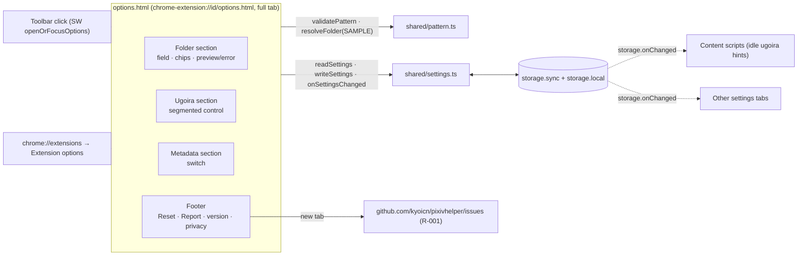
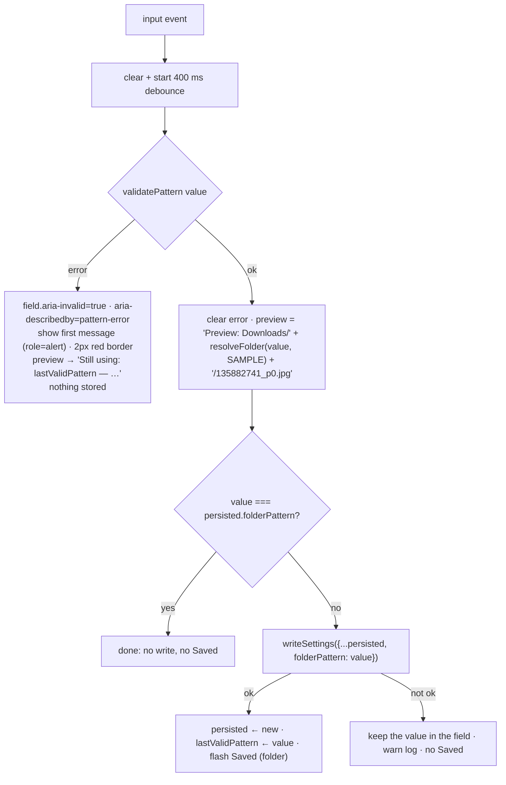
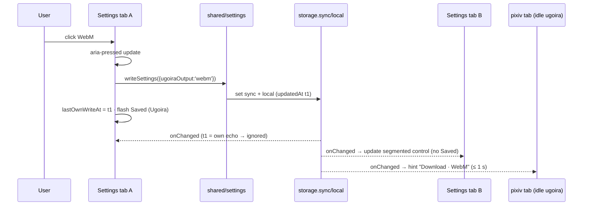

# Options Page

> Last updated: 2026-10-22 18:08:04 (UTC+9)
> Serves: prd-000 — CUJ-3 (all steps and edge cases), CUJ-2 step 1 / CUJ-3 step 7 (hint reactivity, via storage), R-001 (Report-an-issue URL), R-002 (product name)

## Overview

`options.html` + `options.ts` + `options.css` is the settings surface. It holds exactly three settings (folder pattern, ugoira output, save `metadata.json`) plus a footer. It always opens as a **full tab** (manifest `options_ui.open_in_tab: true`). The toolbar click opens or focuses it via `openOrFocusOptions()` ([design-download-engine.md](design-download-engine.md)). It is vanilla TypeScript over static semantic HTML. All rules (validation, resolution, storage) come from the shared modules in [design-settings-model.md](design-settings-model.md). This page only binds them to controls.

## Goals & Non-Goals

**Goals**
- Mock fidelity (`cuj-3-initial.html`, `cuj-3-error.html`, `cuj-3-saved.html`) in light and dark.
- Never lose a change, never store an invalid pattern, always show the last valid pattern's effect (CUJ-3 Context).
- Fully keyboard-operable in the PRD's tab order; correct ARIA for the field, chips, segmented control and switch.

**Non-Goals**
- Any setting beyond the three; any help text beyond the PRD copy; a Save button; confirmation dialogs (PRD CUJ-3 step 9).
- A popup (PRD §4.8: none).

## System Context



## Detailed Design

### Data Model (page state)

```ts
interface PageState {
  persisted: Settings & { updatedAt: number };   // last value known to be stored (own write or onChanged)
  lastValidPattern: string;                       // = persisted.folderPattern; shown in "Still using"
  error: PatternError | null;                     // current field validation result
  debounce: number | null;                        // setTimeout id (400 ms)
  caret: { start: number; end: number } | null;   // last known selection in the field; null until first focus
  lastOwnWriteAt: number;                         // updatedAt of this tab's most recent write (echo suppression)
}
```

### Markup (semantic skeleton; all text from `chrome.i18n`)

```html
<body hidden>                                   <!-- unhidden after i18n strings are applied (no flash of empty labels) -->
<main class="col">                              <!-- 640px column, 56px top, 24px sides -->
  <header> <div class="app-icon" aria-hidden="true">…</div> <h1 data-i18n="opt_title"></h1> <p data-i18n="opt_subtitle"></p> </header>
  <section id="folder" aria-labelledby="folder-h">
    <div class="head"><h2 id="folder-h" data-i18n="opt_folder_heading"></h2><span class="saved" aria-live="polite"></span></div>
    <p class="help" data-i18n="opt_folder_help"></p>
    <input id="pattern" type="text" class="field mono" maxlength="200" spellcheck="false" autocomplete="off" autocapitalize="off">
    <p id="pattern-error" class="error" role="alert" hidden></p>
    <div class="chips"><span data-i18n="opt_insert"></span> <button type="button" class="chip mono" data-token="{artist}">{artist}</button> … </div>
    <p id="preview" class="preview"></p>         <!-- "Preview: <mono>Downloads/…/135882741_p0.jpg</mono>" or the "Still using" line -->
  </section>
  <section id="ugoira" aria-labelledby="ugoira-h">
    <div class="head"><h2 id="ugoira-h" data-i18n="opt_ugoira_heading"></h2><span class="saved" aria-live="polite"></span></div>
    <p class="help" data-i18n="opt_ugoira_help"></p>
    <div class="seg" role="group"> <button type="button" data-value="mp4" aria-pressed="true"></button> <button … data-value="webm"> <button … data-value="zip"> </div>
  </section>
  <section id="metadata" aria-labelledby="meta-h">
    <div class="row"><div><h2 id="meta-h"></h2><p class="help" data-i18n="opt_meta_help"></p></div>
      <button type="button" id="meta" class="switch" role="switch" aria-checked="true"></button></div>
    <span class="saved" aria-live="polite"></span>
  </section>
  <footer>
    <button type="button" id="reset" class="link" data-i18n="opt_reset"></button>
    <a id="report" class="link" href="https://github.com/kyoicn/pixivhelper/issues" target="_blank" rel="noopener noreferrer" data-i18n="opt_report"></a>
    <span id="version"></span>
    <p data-i18n="opt_privacy"></p>
  </footer>
</main>
```

- `Reset to defaults` is a `<button>` styled as a link, because it performs an action. `Report an issue` is a real link (R-001). This follows the index rule "nothing is a clickable `<div>`".
- `document.title = t('opt_tab_title')` ("Helper for Pixiv — Settings", R-002); `<html lang>` = `localeTag()` (CJK glyph selection).
- The `metadata.json` part of the heading `opt_meta_heading` is wrapped in a mono span by splitting on the literal `metadata.json`, which is identical in every locale. The same technique wraps `{artist}`/`{id}`/`{title}`/`{userId}` and `frames.json` in help and error text.

### Styles (`options.css`; values from PRD CUJ-3 and mocks)

| Token | Light | Dark (`prefers-color-scheme: dark`) |
|---|---|---|
| page bg / text | `#f6f7f9` / `#1f1f1f` | `#121212` / `#e8eaed` |
| help text | `#5c6166` | `#9aa0a6` |
| field bg / border | `#fff` / 1px `#d0d5db` | `#1f1f1f` / `#3a3f45` |
| field invalid | 2px `#d93025` | same |
| chip bg / border / hover | `#fff` / `#d0d5db` / border+text `#0096FA`, fill `#f0f8ff` | `#1f1f1f` / `#3a3f45` / fill `#102a3f` |
| segment bg / border / hover / selected | `#fff` / `#d0d5db` / `#f5f7f9` / `#0096FA` + white 600 | `#1f1f1f` / `#3a3f45` / `#2a2f35` / same |
| switch on / off | `#0096FA` knob right / `#bdc1c6` knob left | same / `#5f6368` |
| saved | `#1a9f5a`, 12.5 px, check icon | same |
| error text | `#d93025`, 13 px, info icon | same |
| links, focus ring | `#0096FA`; focus 2 px `#0096FA` on `:focus-visible` | same |
| footer rule | `#e3e6ea` | `#2a2f35` |

Geometry:
- Column 640 px; header icon 48×48 radius 12; h1 22/700; h2 16/600; help 14; sections 48 px apart.
- Field 44 px tall, radius 8, mono 14.
- Chips 28 px pills, mono 12.5; segmented 36 px, radius 10; switch 44×26.
- Footer 13 px.

Fonts: system stack (as the mocks), mono `ui-monospace, SFMono-Regular, Menlo, Consolas, monospace`.

`@media (prefers-reduced-motion: reduce)` removes the `Saved` fade and the switch knob transition.

### Logic & Behavior

#### Load
1. `readSettings()` → `persisted`.
2. Fill the controls; apply i18n; set the version (`'v' + chrome.runtime.getManifest().version`, CUJ-3 step 10).
3. Render the preview for `persisted.folderPattern`.
4. `body.hidden = false`.
5. Subscribe `onSettingsChanged`.

#### Pattern field (CUJ-3 steps 3, 5, 6)



- **Messages** come from the PRD keys `err_empty`, `err_absolute`, `err_backslash`, `err_dotdot`, `err_unknown_token` (placeholder = the offending token, rendered mono semibold) and `err_illegal_chars`, in the validator's order ([design-settings-model.md](design-settings-model.md)).
- **Preview** always uses the fixed sample `SAMPLE` through the real `resolveFolder` (PRD CUJ-3 step 2 Details). The word `Downloads` comes from the message (`opt_preview` + literal path). It is not localized in the path, because the PRD shows `Downloads/…` as a generic label.
- **Paste:** `<input type="text">` strips CR/LF by HTML value sanitization (CUJ-3 edge "drops newlines on paste"). `maxlength=200` truncates typing and paste (CUJ-3 edge).
- **Closing the tab with an invalid edit** loses only the draft. Storage still holds the last valid pattern, and reopening shows it with no error (CUJ-3 edge).

#### Chips (CUJ-3 step 4)
- `caret` is tracked from the field's `select`, `keyup`, `mouseup`, `input` and `blur` events. It stays `null` until the field first receives focus.
- On chip activation (click, Enter or Space; native button):
  - `caret == null` → append the token at the end;
  - otherwise `field.setRangeText(token, start, end, 'end')`, which replaces the selection.

  Then `field.focus()`, the caret lands right after the token, and the same `input` path (debounce → validate → save) runs.
- If the insertion would exceed 200 characters, the chip does nothing (a token is never truncated into an unknown token).
- `title` = `tok_artist_tip` / `tok_id_tip` / `tok_title_tip` / `tok_userid_tip` (exact PRD copy).
- `mousedown` calls `preventDefault()`, so clicking a chip does not blur the field and lose the selection highlight. Focus is still restored explicitly.

#### Ugoira output and metadata switch (CUJ-3 steps 7, 8)
- **Segmented control:** clicking a non-selected segment sets `aria-pressed` on all three, then `writeSettings` immediately (no debounce), then flashes `Saved` on the Ugoira heading. Clicking the selected segment does nothing. Group label: `opt_ugoira_aria`.
- **Switch:** click (or Space/Enter, native) toggles `aria-checked`, writes immediately, and flashes `Saved` (metadata section). `aria-label` = `opt_meta_heading` text ("Save metadata.json").

#### `Saved` indicator
`flashSaved(section)`:
1. set content (check icon + `opt_saved`), `opacity: 1`;
2. after 2000 ms, `opacity: 0` with a 300 ms transition (instant under reduced motion);
3. then clear the text.

Re-flashing resets both timers. Each indicator is `aria-live="polite"`, so screen readers hear "Saved" (index a11y).

#### Reset to defaults (CUJ-3 step 9)
1. Compute the sections whose value differs from `DEFAULT_SETTINGS`.
2. Cancel any pending debounce; clear any validation error.
3. `writeSettings(DEFAULT_SETTINGS)` (one write).
4. Update all controls and the preview.
5. Flash `Saved` only on the changed sections.

There is no confirmation (PRD).

#### Two settings tabs (CUJ-3 edge)
`onSettingsChanged` fires in every tab within milliseconds, well inside the 1 s requirement.
- If `updatedAt === lastOwnWriteAt`, it is this tab's own echo: ignore it.
- Otherwise:
  - update `persisted`, the segmented control and the switch;
  - update the pattern field **unless** the field holds an invalid draft (PRD: "the edit is left alone"), or the field is focused with a pending debounce (the user is typing, and their save will be the newest);
  - refresh the preview or the "Still using" line;
  - **no** `Saved` flash (that is reserved for this tab's own saves).

### Accessibility (index "Accessibility")
- The field has `aria-label` = `opt_folder_aria` ("Folder pattern"). When invalid: `aria-invalid="true"` and `aria-describedby="pattern-error"` (`role="alert"`).
- Chips are `<button type="button">`. The segmented control is `role="group"` with `aria-pressed` buttons. The switch is `role="switch"` + `aria-checked`. Reset is a `<button>`; Report is an `<a>`.
- The DOM order equals the PRD tab order: field → 4 chips → MP4 → WebM → ZIP only → switch → Reset to defaults → Report an issue.
- Every control shows a 2 px `#0096FA` `:focus-visible` ring. Help text is linked via `aria-describedby` on each section's primary control.
- Contrast: all pairs in the token table meet 4.5:1 except selected-segment white on `#0096FA` (3.1:1), which the PRD accepts (index "Contrast").

## Data Flow



## Alternatives Considered

| Criteria | **Debounced autosave (400 ms), immediate for discrete controls** | Save on blur | Explicit Save button |
|---|---|---|---|
| PRD CUJ-3 steps 3/7/8 | Matches exactly | Contradicts | Contradicts ("no Save button") |
| Never stores invalid | Yes (validate before write) | Yes | Yes |
| Sync write quota | ≤ 2.5 writes/s worst case; local mirror covers quota errors | Lower | Lowest |
| **Verdict** | **Selected** | Rejected | Rejected |

| Criteria | **`options_ui.open_in_tab: true` + custom open/focus** | Embedded options (`open_in_tab: false`) | `runtime.openOptionsPage()` only |
|---|---|---|---|
| Full tab (PRD) | Yes | No (dialog in chrome://extensions) | Yes |
| Opens to the right of the current tab; focuses an existing tab and its window | Yes (`tabs.create` index; `getContexts` + `windows.update`) | — | Unspecified by Chrome docs |
| **Verdict** | **Selected** | Rejected | Rejected |

## Cross-Cutting Concerns

- **Error handling:** a storage failure on both areas means no `Saved` and a `warn` log; the value stays in the UI for the next attempt. There is no user-facing error copy for this case in the PRD (it is near-impossible: `storage.local` failing). Flagged as an open question.
- **Security:** static HTML. Dynamic text is set via `textContent` only. The Report link is a constant URL with `rel="noopener noreferrer"`. No remote resources: no web fonts, and Tailwind (used in the mocks) is not used.
- **Performance:** the page is static; validation and preview take < 1 ms per debounce. Bundle < 15 KB.
- **i18n:** every string comes from `_locales` (keys in PRD Appendix A "Settings page"). Placeholder parts are styled via `splitOnPlaceholder` ([system.md §11.4](system.md)). The layout must not clip in any locale: the segmented control widths are intrinsic, and the column wraps.
- **Testing:**
  - Unit (happy-dom, fake timers): debounce timing; each validation message rendered with the right ARIA; "Still using" shows the last valid pattern; chip insertion at caret, with a selection, never-focused append and the 200-char guard; reset's changed-section detection; cross-tab update rules (invalid-draft and typing exemptions; own-echo suppression).
  - E2E: real page in Chromium in light and dark (`emulateMedia`) × 4 locales (launch flag `--lang`), keyboard-only walkthrough in PRD tab order, reload persistence, two-tab sync ([design-test-harness.md](design-test-harness.md)).

## Dependencies & Integration Points

- **Depends on:** `src/shared/{settings, pattern, i18n, dom}`; `chrome.storage`; `chrome.runtime.getManifest`.
- **Depended on by:** the SW toolbar handler (opens it); content scripts and the SW consume the settings it writes.

## Open Questions & Risks

- **No PRD copy for a total storage failure** (both areas reject). The design shows no `Saved` and keeps the value. pm may want a message. Low priority.
- `err_illegal_chars` and the D8 normalization of literal text ([design-settings-model.md](design-settings-model.md)) overlap. If pm prefers rejecting unsafe literal text (e.g. a trailing space in a segment) over normalizing it, that adds validation rule(s) and copy here.
