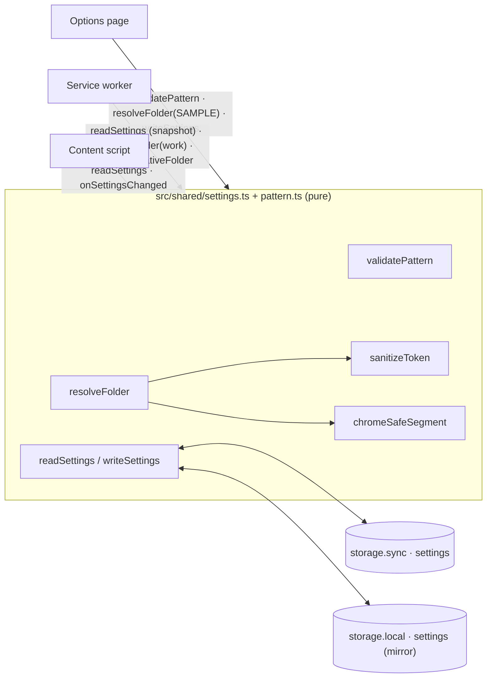
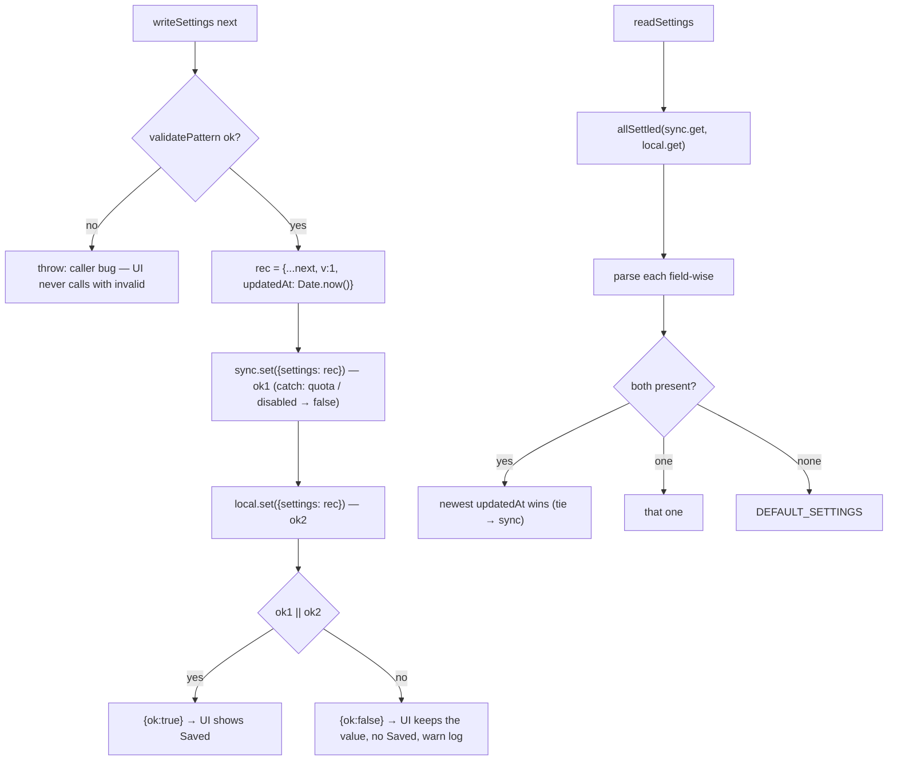
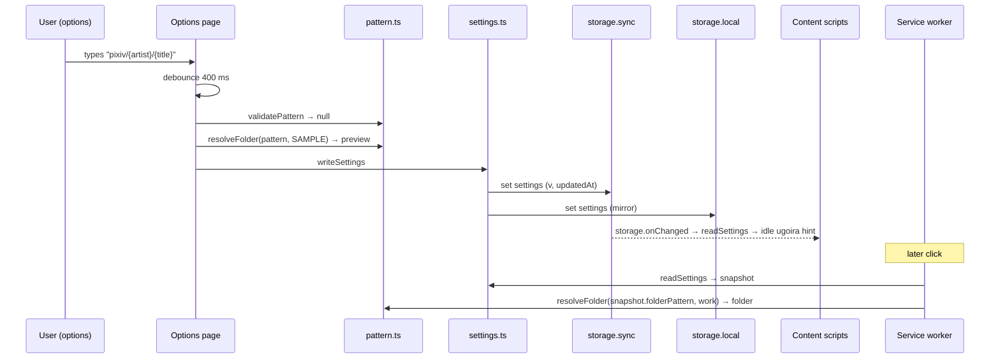

# Settings Model & Folder Paths (shared domain logic)

> Last updated: 2026-10-22 18:08:04 (UTC+9)
> Serves: prd-000 — §4.4 (folder pattern & sanitization), §4.9 (settings model), CUJ-1 (folder resolution), CUJ-3 (validation, preview, persistence), CUJ-5 (retry into the same folder)

## Overview

This chapter specifies the pure, shared modules every context uses:

- `src/shared/settings.ts`: settings schema, defaults, read/merge/write across `storage.sync` and `storage.local`, and change observation;
- `src/shared/pattern.ts`: folder-pattern validation (CUJ-3 messages), resolution with token sanitization (script parity + PRD extension), and the Chrome path-safety pass that guarantees `chrome.downloads` accepts the result.

Users are the options page ([design-options-page.md](design-options-page.md)): editing, preview, validation. The download engine ([design-download-engine.md](design-download-engine.md)) uses it for the snapshot and resolution. The content script ([design-artwork-button.md](design-artwork-button.md)) uses it for the ugoira hint. The rules live here once, so the preview, the job and the hint can never disagree (PRD CUJ-3 step 2: "run through the real resolution rules").

## Goals & Non-Goals

**Goals**
- **Parity:** token sanitization reproduces `safe_component` in `ref/pixiv-dl` exactly, before the PRD's and Chrome's additions. This is proven by golden vectors generated from the script (ENG-003).
- **Totality:** for any valid pattern and any pixiv data, `resolveFolder` returns a path that Chrome's `IsSafePortableRelativePath` accepts. A download must never fail with "Invalid filename".
- **Persistence:** an invalid pattern is never stored. The newest valid save wins across `sync`/`local` (PRD §4.9, CUJ-3 edges).

**Non-Goals**
- Filesystem length limits beyond the PRD's bounds (60-byte tokens, 200-character field). Longer real paths surface as a `disk` error ([system.md §15](system.md) risks).
- More than the three settings (PRD Goal 3).

## System Context



## Detailed Design

### Data Model

```ts
export interface Settings { folderPattern: string; ugoiraOutput: 'mp4' | 'webm' | 'zip'; saveMetadata: boolean; }
export const DEFAULT_SETTINGS: Settings = { folderPattern: 'pixiv/{artist}-{id}', ugoiraOutput: 'mp4', saveMetadata: true };
export const PATTERN_MAX_CHARS = 200;                 // PRD §4.9 (UTF-16 code units, as <input maxlength> counts)

interface StoredSettings extends Settings { v: 1; updatedAt: number }   // key 'settings' in storage.sync AND storage.local
```

- **One key per area.** One write operation per change keeps well inside `storage.sync` limits (`QUOTA_BYTES_PER_ITEM` 8192, `MAX_WRITE_OPERATIONS_PER_MINUTE` 120). The record is < 400 bytes.
- **Field-wise parsing on read.** Each field is validated independently. An invalid or unknown-type field takes its default, so a corrupt or future-version record degrades per field instead of resetting everything. A stored pattern that fails `validatePattern` (impossible through the UI, but defensive) is treated as absent.

### API / Interface Contract

```ts
// settings.ts
export function readSettings(): Promise<Settings & { updatedAt: number }>;
export function writeSettings(next: Settings): Promise<{ ok: boolean }>;   // rejects (programming error) if next.folderPattern is invalid
export function onSettingsChanged(cb: (s: Settings) => void): () => void;   // storage.onChanged for 'settings' in sync|local → re-read merged
export function effectiveFormat(setting: Settings['ugoiraOutput'], caps: { avc: string | null; vp9: boolean }): 'mp4' | 'webm' | 'zip';

// pattern.ts
export type PatternError =
  | { code: 'empty' } | { code: 'absolute' } | { code: 'backslash' } | { code: 'dotdot' }
  | { code: 'unknownToken'; token: string } | { code: 'illegalChars' };
export function validatePattern(p: string): PatternError | null;
export interface TokenValues { artist: string | null; id: string; title: string | null; userId: string | null; }
export function resolveFolder(pattern: string, v: TokenValues): string;     // precondition: validatePattern(pattern) === null
export function sanitizeToken(s: string, opts?: { parityOnly?: boolean }): string;
export function chromeSafeSegment(seg: string): string;                     // '' means "drop this segment"
export function isSafeRelativeFolder(folder: string): boolean;
export const SAMPLE: TokenValues = { artist: 'みずき', id: '135882741', title: '雨上がりの渋谷', userId: '40285173' };  // PRD CUJ-3 step 2
```

### Logic & Behavior

#### Read / write algorithm



- **Why dual-write + newest-wins.** The PRD says "falls back to `chrome.storage.local` if sync is unavailable or over quota" and "Reads prefer sync and fall back to local" (CUJ-3 edge). A literal "read sync first" would return a **stale** sync value after a write that only reached local (e.g. the per-minute write quota was hit), which breaks "Reloading the settings page shows the most recently saved values" (CUJ-3 AC). Newest-wins with a sync tie-break keeps sync preferred and is always current. Values synced from another device arrive in sync with a newer `updatedAt` and win, as intended.
- **The user sees `Saved` whenever at least one area stored the value** (PRD CUJ-3 edge: "the user still sees Saved").
- **Snapshot:** the SW calls `readSettings()` once at `job/start` and stores the result in `JobRecord.snapshot` (PRD §4.1 #8).

#### Pattern validation (CUJ-3 step 5; first failing rule wins, in this order)

| # | Rule | Implementation | Message key |
|---|---|---|---|
| 1 | Empty after trimming whitespace | `p.trim() === ''` | `err_empty` |
| 2 | Absolute / not inside Downloads | `p.startsWith('/') \|\| /^[A-Za-z]:/.test(p) \|\| /^~(\/\|$)/.test(p) \|\| p.startsWith('\\\\')` | `err_absolute` |
| 3 | Contains `\` | `p.includes('\\')` | `err_backslash` |
| 4 | A `..` segment | `p.split('/').some(s => s.trim() === '..')` | `err_dotdot` |
| 5 | Unknown `{…}` token | first match of `/\{[^{}]*\}/g` not in `{artist}`, `{id}`, `{title}`, `{userId}` (case-sensitive) | `err_unknown_token` with that token text |
| 6 | Literal text contains `: * ? " < > \|` | test `p` with the known tokens removed against `/[:*?"<>\|]/` | `err_illegal_chars` |

- A stray `{` or `}` without a matching pair is literal (rule 5 regex requires a pair).
- Length is enforced by the field (`maxlength=200`), not by the validator. The validator additionally rejects `> 200` for defense against programmatic writes.

#### Resolution (PRD §4.4 "Resolution at job start")

```
resolveFolder(pattern, v):
  s = pattern with each known token replaced by sanitizeToken(value ?? '')    // id is digits; null fields sanitize to 'unknown'
  segs = s.split('/').map(chromeSafeSegment).filter(seg => seg !== '')         // empty segments and trailing '/' dropped (PRD §4.4.3)
  return segs.length ? segs.join('/') : 'unknown'
```

#### Token sanitization: `sanitizeToken(s)`

Steps 1–6 are `safe_component` in `ref/pixiv-dl`. The marked steps are additions.

| Step | Operation | Source |
|---|---|---|
| 1 | `s.normalize('NFC')` | script |
| 2 | Remove `[\x00-\x1f\x7f/:\\]` | script |
| 2+ | Also remove `[*?"<>\|]` | **PRD §4.4.2 extension** |
| 3 | Replace runs of Python-`str.isspace` characters with one `_`: `/[\t\n\v\f\r\x1c-\x1f \x85\xa0  - 

  　]+/g` (not JS `\s`, which differs: it includes U+FEFF and lacks U+0085/U+001C–1F) | script (Python `re` `\s` semantics) |
| 3+ | Remove the remaining Chrome-illegal characters: Unicode general categories **Cc** and **Cf** (e.g. U+0080–U+009F, U+200B–U+200F, U+200D ZWJ, U+2060–U+2064, U+FEFF, U+E0001–U+E007F) and **noncharacters**. Implemented per code point: drop if `/[\p{Cc}\p{Cf}]/u` matches, or `(cp >= 0xFDD0 && cp <= 0xFDEF) || (cp & 0xFFFE) === 0xFFFE` (U+FDD0–U+FDEF and U+nFFFE/U+nFFFF in every plane) | **Chrome extension (D8)** |
| 4 | Strip leading/trailing `.`, `_`, space (`/^[._ ]+\|[._ ]+$/g`) | script |
| 5 | Truncate to ≤ 60 UTF-8 bytes on a code-point boundary (accumulate per code point: 1/2/3/4 bytes; lone surrogates count as U+FFFD = 3, matching `TextEncoder`), then strip `._ ` again | script |
| 6 | Empty → `'unknown'` | script |

- Step 3+ runs **after** step 3, so whitespace-class controls such as U+0085 still become `_` exactly as in the script. Only non-whitespace format/control characters are removed.
- `{ parityOnly: true }` skips the PRD and Chrome steps, giving a byte-for-byte reimplementation of `safe_component`. It is used only by the golden parity test.

#### Chrome path-safety pass: `chromeSafeSegment(seg)` (D8)

Chrome's `chrome.downloads.download` rejects a `filename` unless every path component passes `net::IsSafePortablePathComponent`. Per Chromium source (`net/base/filename_util_icu.cc`, `base/i18n/file_util_icu.cc`, `base/files/file_util.cc`), a component must:
- contain no `"*/:<>?\|`, Cc, Cf or noncharacters;
- not begin or end with White_Space, `.` or `~`;
- not be a Windows reserved name, even on macOS/Linux;
- not end in a shell-integrated extension;
- on Windows only, not be a short-name-shaped string containing `~`.

PRD §4.4 covers only part of this. The pass is applied to every **whole segment** (literal text + resolved tokens):

| Step | Operation | Example |
|---|---|---|
| a | Remove `["*:<>?\|]`, Cc, Cf, noncharacters (literal text could still carry e.g. a pasted TAB or ZWJ) | `pixiv\t` → `pixiv` |
| b | Repeatedly trim leading/trailing ICU White_Space (same set as step 3 plus U+0085/U+00A0 …), `.` and `~` | `~sora~-123` → `sora~-123`; `pixiv ` → `pixiv`; `...` → `` (dropped) |
| c | Empty → `''` (segment dropped) | |
| d | Windows reserved name → **prefix** `_`, as Chrome's own `GenerateSafeFileName` does. Test: lowercase, trim trailing ` .`, take the part before the first `.`, check against `con prn aux nul com1–com9 lpt1–lpt9 clock$`; or the whole lowercase name against `desktop.ini thumbs.db conin$ conout$` | `CON` → `_CON`; `nul.txt` → `_nul.txt` |
| e | Shell-integrated extension (text after the last `.`, lowercase, ∈ {`local`, `lnk`, `scf`, `url`} or wrapped in `{}`) → **append** `_` | `My.url` → `My.url_` |
| f | Windows 8.3-shaped segment containing `~` (≤ 12 UTF-16 units, none of White_Space `"\/[]:+\|<>=;?,*`, valid 8.3 dot position) → replace `~` with `_`. Applied on **every** platform, so a synced archive gets identical folder names on Mac and Windows. | `ab~c` → `ab_c` |

`isSafeRelativeFolder(f)`:
- `f` is non-empty and ≤ 1024 chars;
- `!f.startsWith('/')`;
- every `/`-separated segment is non-empty, not `.`/`..`, and satisfies `chromeSafeSegment(seg) === seg`.

The SW uses it to re-validate folders echoed back by the tab in retry requests.

Golden examples (unit-tested):

| Input | Result |
|---|---|
| pattern `pixiv/{artist}-{id}`, artist `みずき`, id `135882741` | `pixiv/みずき-135882741` (PRD) |
| artist `  Sora / 空 :: 2nd  ` | `{artist}` → `Sora_空_2nd` (PRD) |
| artist `...` | `unknown` (PRD) |
| artist `👩‍🎨Mika` (with ZWJ) | `👩🎨Mika` (ZWJ removed; Chrome would refuse it) |
| artist `~sora~` | `{artist}` → `~sora~` (parity), segment `~sora~-1` → `sora~-1` |
| pattern `pixiv` | `pixiv` (all works in one folder; PRD example) |
| pattern `a//b/` | `a/b` (PRD §4.4.3) |
| pattern `{title}`, title `CON` | `_CON` |

## Data Flow



## Alternatives Considered

| Criteria | **Dual-write, newest-wins** | Sync-only, local on error, read sync-then-local | Local only |
|---|---|---|---|
| PRD: sync with local fallback | Yes | Yes | No |
| Always returns the most recent save (CUJ-3 AC) | Yes | **No** (stale sync after a quota-hit local write) | Yes |
| Cross-device sync | Yes | Yes | No |
| Complexity | Low (+ `updatedAt`) | Low | Lowest |
| **Verdict** | **Selected** | Rejected | Rejected |

| Criteria | **Silent Chrome-safety pass (D8)** | New validation messages for unsafe literal text | Do nothing beyond PRD §4.4 |
|---|---|---|---|
| Artist names with ZWJ / `~` / reserved words download | Yes | Only literal text is covered, so artist data still fails | **No** (every file fails "Invalid filename") |
| Needs new PRD copy | No (flag for spec-sync) | Yes (pm, 4 locales) | No |
| User sees the effect | Yes, in the preview | Yes | — |
| **Verdict** | **Selected** | Possible later for literal text if pm prefers (would shrink step a/b's scope) | Rejected |

## Cross-Cutting Concerns

- **Error handling:** `writeSettings` never throws for storage errors; it reports `{ ok }`. It throws only on a precondition violation (an invalid pattern is a caller bug). `readSettings` never throws (missing or invalid → defaults per field).
- **Security:**
  - Resolution output is passed to `chrome.downloads` only as `folder + '/' + basename`, where `basename` is allowlisted ([system.md §11.1](system.md)).
  - Traversal is impossible: `..` is rejected by validation, every segment is re-checked by `chromeSafeSegment`, and `isSafeRelativeFolder` guards echoed folders.
- **Performance:** resolution is O(pattern length), < 0.1 ms. Validation runs once per debounce.
- **Observability:** `debug` log of the resolved folder per job (local only).
- **Testing:**
  - Golden parity: `sanitizeToken(s, { parityOnly: true }) === safe_component(s)` for every vector in `test/golden/safe_component.json`. ENG-003 generates ≥ 200 vectors: all PRD examples, every Python whitespace char, controls, emoji/ZWJ, NFC/NFD pairs, 59/60/61-byte CJK boundaries, 4-byte characters at the boundary, `.`/`_`/space edges, empty strings.
  - Unit: each validation rule and its precedence (e.g. `/a\..` → rule 2 wins), each D8 step with the table above, `isSafeRelativeFolder`, newest-wins merging (sync newer, local newer, tie, one missing, corrupt fields), `effectiveFormat` truth table.
  - Property test (fast-check is optional; a seeded random generator is enough): for 10 000 random Unicode strings, every segment of `resolveFolder('{artist}/{title}', …)` satisfies a JS port of Chrome's `IsSafePortablePathComponent` predicate.

## Dependencies & Integration Points

- **Depends on:** `chrome.storage.sync`, `chrome.storage.local`, `chrome.storage.onChanged` (settings.ts only; pattern.ts is fully pure).
- **Depended on by:** options page, service worker (snapshot, resolution, retry folder validation), content script (hint, reactivity), golden tests.

## Open Questions & Risks

- **PRD spec-sync (pm):** D8's additions (Cc/Cf/noncharacter removal in tokens; segment trimming of White_Space/`.`/`~`; reserved names; shell extensions; `~` short names) extend PRD §4.4 step 2. Applying them to literal text is a narrow exception to "literal text is used as typed". See [system.md §15](system.md) item 3.
- The ICU White_Space set used in step b must match Chrome's exactly. It is pinned as a constant with a unit test listing every code point (U+0009–U+000D, U+0020, U+0085, U+00A0, U+1680, U+2000–U+200A, U+2028, U+2029, U+202F, U+205F, U+3000).
