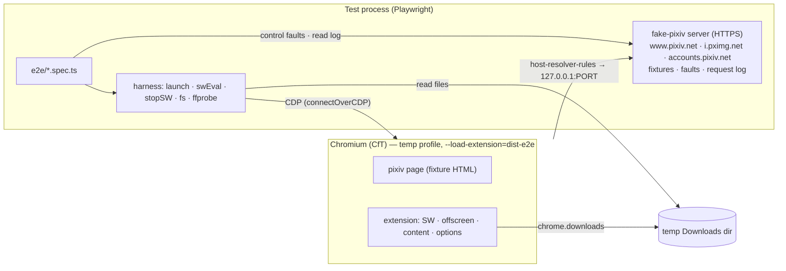
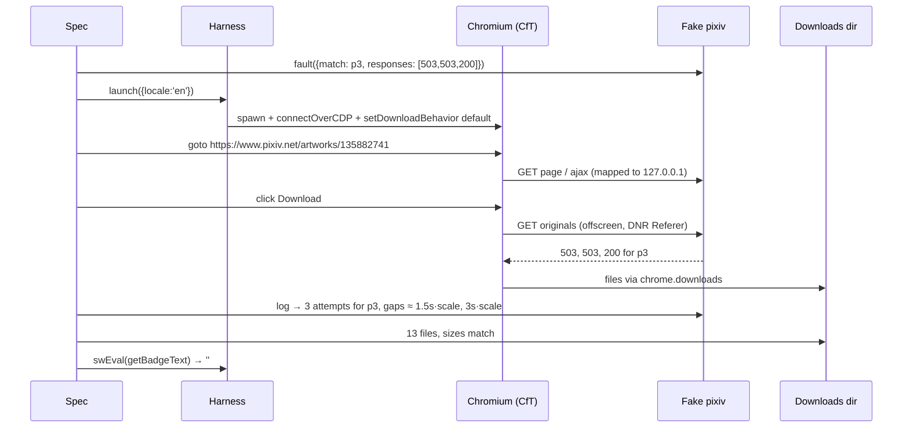

# Test Strategy & QA Harness

> Last updated: 2026-10-27 20:32:56 (UTC-7)
> Serves: prd-000 — every CUJ's acceptance criteria (CUJ-1 … CUJ-5), including the R-004, R-005, R-006 and R-007 amendments and the 2026-10-27 CUJ-1 refinement (repeat downloads go to a sibling folder chosen from Chrome's download history); PRD Goal 2 (parity with `ref/pixiv-dl`)

## Overview

This chapter defines how the extension is verified, from pure functions up to real Chromium against a deterministic fake pixiv, and how the QA role exercises it. It covers five layers:

| Layer | Tool | Scope | Runs |
|---|---|---|---|
| L1 Unit + golden | Vitest 5 (+ happy-dom for DOM modules) | `src/shared/*`, button model/labels/width, options logic, scheduler/classifier/badge | `npm test` (every commit) |
| L2 SW integration | Vitest + `test/fakes/chrome.ts` | Whole SW with fake `chrome.*` and a fake offscreen: job runs, restarts at every await, concurrency, cancel races | `npm test` |
| L3 E2E (deterministic) | Playwright 1.64 + bundled Chromium (Chrome for Testing) + **fake-pixiv HTTPS server** | The built extension, unmodified manifest, real `chrome.downloads`, DNR, offscreen, WebCodecs; all CUJ acceptance criteria incl. CUJ-5 faults | `npm run test:e2e` |
| L4 Live smoke | Playwright, real pixiv | Selectors on live DOM, DNR Referer against the real `i.pximg.net`, real download of an all-ages work | `HFP_LIVE=1 npm run test:e2e -- --grep @live` (opt-in, pre-release) |
| L5 Manual release checks | Branded Chrome (Load unpacked) | Hardware H.264 on macOS/Windows; playback in QuickTime/Photos/VLC; "Ask where to save"; store zip install | Release checklist |

## Goals & Non-Goals

**Goals**
- Every PRD acceptance criterion maps to an automated check (L1–L3), except those that inherently need branded Chrome or OS players (L5).
- Each CUJ-5 failure mode is reproducible on demand: 403, 429 with `Retry-After`, 5xx, resets, stalls, missing `Content-Length`, deleted works, refused works, corrupt frames, missing action row.
- The QA role can drive the real extension with Playwright without a pixiv account.

**Non-Goals**
- Load or performance benchmarking beyond the PRD latency budgets.
- Testing Chrome's own downloader beyond our contract (uniquify naming, interrupt reasons).

## System Context

## Detailed Design

### L1: Unit and golden tests

- Location `test/unit/**/*.test.ts`. DOM-dependent files start with `// @vitest-environment happy-dom`.
- **Golden parity** (`test/golden/*.json`, generated by `scripts/gen-golden.py`, ENG-003):
  - The generator runs `python3 -I scripts/gen-golden.py`. It inserts a stub `browser_cookie3` module into `sys.modules` (the script exits at import without it) and loads `ref/pixiv-dl` with `importlib.machinery.SourceFileLoader` (the file has no `.py` suffix).
  - Outputs:
    - `safe_component.json`: ≥ 200 `{ in, out }` vectors (categories listed in [design-settings-model.md](design-settings-model.md));
    - `plain_text.json`: HTML descriptions with ` ` variants, `
`, `
`, nested tags, every entity class, surrounding Unicode whitespace;
    - `write_metadata.json`: `{ body, fileText }`, produced by calling `write_metadata` into a temp dir and reading the bytes back;
    - `src/shared/html-entities.ts`: the `html.entities.html5` table, so `unescapeHtml` matches `html.unescape`.
  - `--check` regenerates in memory and diffs against the committed files (exit 1 on drift).
  - Tests:
    - `sanitizeToken(s, { parityOnly: true })` equals `safe_component`;
    - `plainText` equals `plain_text`;
    - `serializeJson(buildMetadata(body))` equals `fileText` byte for byte. The one documented exception is a missing `description`: PRD says `null`, the script wrote `""`, and the test asserts the PRD.
- **Manifest test:** the manifest has exactly the five approved permissions in the PRD index's order, `["downloads", "storage", "offscreen", "declarativeNetRequestWithHostAccess", "downloads.ui"]` (R-005), exactly the two hosts, `minimum_chrome_version: "116"`, no `default_popup`, and no `web_accessible_resources`, and the whole manifest equals system.md §5 ([system.md §5](system.md)). The iteration-2 case name "requests exactly the four approved permissions" and its literal change with the manifest.
- **Locale test:** all four `messages.json` files have identical key sets and the same placeholder count per key, and `locale_tag` values are correct.

### L2: SW integration with chrome fakes

`test/fakes/chrome.ts` provides in-memory fakes for exactly the APIs the extension uses:
- `storage.{sync, local, session}` with `onChanged`, and injectable quota errors for sync;
- `downloads.{download, search, cancel, onChanged, setUiOptions}` with a controllable completion queue and interrupt reasons. `search` filters by every scalar query field (`state`, `exists`, `id`, …), by `urlRegex` and `filenameRegex` (JS `RegExp` over the fake's absolute `DOWNLOADS_DIR/<path>` filename; the production regex stays inside the RE2 ∩ ECMAScript subset, so the fake and Chrome agree), and honours `limit` (`0` = all). **Existence re-check (D15, folder choice):** the fake keeps a disk model. `removeFile(id)` (or `removeFiles(predicate)`) marks a completed download's file as gone, as a user moving or deleting the folder would, **without** touching the record: `exists` stays `true` until the next `search()`, which, like Chrome, schedules a re-check of every complete, not-yet-flagged item: after `existenceCheckDelay` (default 0: the next macrotask, so a `vi.advanceTimersByTimeAsync(0)` or the resolver's own 250 ms wait sees it) each gone item gets `exists: false` and fires `onChanged({ id, exists: { previous: true, current: false } })`, once, never to be cleared again. `existenceCheckDelay(ms)` lets a test make the re-check land after `FOLDER_CHECK_RECHECK_WAIT_MS`, pinning the stale-flag residual. Chrome's 10 s rate limit is **not** modelled (it would only slow tests; the residual it causes is documented in design-download-engine.md and exercised in e2e). The disk model also feeds `uniquify`: a removed file no longer blocks its name, so a job into a folder whose files were removed gets clean names. `addCompleted(relativePath, { exists?, byExtensionId? })` seeds a finished record directly (an earlier browser session's download, or another extension's), for tests of a history that predates the test; `setUiOptions({ enabled })` (R-005) keeps the current `uiEnabled` (initially `true`), rejects like Chrome when the manifest the fake loads (`src/manifest.json`) lacks `downloads.ui`, accepts an injected failure (`failNextSetUiOptions(message)`), and appends to an ordered **call log shared with `download()`**: `Array<{ op: 'ui'; enabled: boolean } | { op: 'download'; filename: string }>`. Ordering assertions read that log, because Chrome offers no getter for the UI state;
- `action.{setBadgeText, setTitle, getBadgeText, …}`;
- `runtime.{sendMessage, onMessage, getContexts, getURL, id, getManifest}`, a router between registered fake contexts;
- `tabs.{sendMessage, create, update}`, `windows.update`, `offscreen.{createDocument, closeDocument}`, `declarativeNetRequest.updateSessionRules`, `i18n.getMessage` (loads `src/_locales/en/messages.json`).
- **Offscreen lifecycle holds (D16).** `offscreen.holdCreation()` returns `{ release }`: while held, `createDocument` creates a document that `runtime.getContexts` lists but that has **no listener** (sends reject with `RECEIVING_END_ERROR`), exactly Chrome's window between creating the context and running its script; `release()` installs the scripted handler and resolves the `createDocument` promise. `offscreen.holdClose()` returns `{ release }`: while held, `closeDocument()` drops the document's listeners at once but keeps it listed, and resolves at `release()`. Without a hold, both behave as before (one tick), so every existing test is unchanged. The holds are what makes the iteration-4 creation race reproducible at L2 (design-offscreen-worker.md "Lifecycle", Testing).

A **fake offscreen** context answers `off/*` commands from a scripted table.

**Restart simulation:** the test drives a job, and at the chosen await point (instrumented by a `__testHook('await:<name>')` call compiled out of non-test builds) calls `vi.resetModules()` and re-imports `sw.ts` against the same fake state. It then asserts:
- no duplicated `downloads.download` call for any file;
- no lost file;
- `getBadgeText` is correct right after `ready` resolves.

Every await point in `registry.mutate`, the resolver and the hand-off is enumerated, including `await:handoff.hideUi` between the download-UI hide and `downloads.download`, and `await:handoff.restoreUi` between the restore before the busy period's last hand-off and `downloads.download` (R-006).

**R-005/R-006 assertions (L2)**, from the fake's call log:
- no `ui` entry while a job only resolves or fetches;
- `{ op: 'ui', enabled: false }` precedes the first `download` of every multi-file busy period;
- `{ op: 'ui', enabled: true }` sits immediately before the busy period's last `download` and after every other `download` of it, and no `ui` entry follows the last record's deletion;
- exactly one `download` per busy period is called while `uiEnabled` is `true`: the last;
- for a Saved job, `settledWhileShown` holds exactly that last file: no earlier file finishes while the UI is on (rev. 3, below);
- a busy period without a final hand-off gets exactly one `{ enabled: true }`, after the last record is deleted. The cases: cancel; a partial job whose failing file settles last; needs login after a 403 with nothing left in flight; Unavailable as the last job to end, while another job's last file hid because this one was still resolving;
- none when job B ends while job A runs;
- a single-file job after an idle boot → no `ui` entry, so the file plays Chrome's usual animation as before R-005;
- a zero-file job → none;
- a job started after the restore was requested → a fresh `{ enabled: false }` precedes its first `download`;
- boot with no `job:*` records → `{ enabled: true }` first;
- boot with a hydrated running job → no `ui` entry until its next hand-off;
- a restart at `await:handoff.hideUi` or `await:handoff.restoreUi` → the file is still handed over exactly once, and the UI ends on;
- an injected `setUiOptions` failure never fails a job or a hand-off.

`test/fakes/chrome.ts` gains one feature for R-006: **deferred naming**, which models Chrome determining a download's target path after it creates the item.
- `deferNaming(on: boolean)`, off by default. While it is on, `download()` creates the item with `filename: ''` and reserves its target for the `uniquify` check.
- `name(id)` sets the item's `filename` and fires `onChanged({ id, filename: { previous: '', current } })`.
- `complete(id)` and `interrupt(id)` name an unnamed item first.

With naming off, items are named at creation, as now, so every existing test is unchanged. The combined call log already records each applied `setUiOptions` and each `download()` call in order. The fake also records `settledWhileShown`: the files that finished or were interrupted while the UI was on. For a Saved job it must hold exactly the busy period's last file (R-006 rev. 3: an earlier file finishing after the enable opens the bubble before the last file exists). For a single busy period this also pins the single animation, so the separate `animated` flag that code review iteration 3 retry 1 proposed (Info 3) is not needed. Chrome names an item before it settles, and nothing turns the UI off again inside one busy period. So a file that settled while the UI was off was also named while it was off, and only the last file can have been named with the UI on.

### L3: E2E harness

#### Build variant
`npm run build:e2e` writes `dist-e2e/`, which is identical to the dev build except for compile-time defines:
- `__RETRY_TIME_SCALE__ = 0.01`: backoff, `Retry-After` cap and the 30 s stall timeout are multiplied, so 1.5 s → 15 ms and 30 s → 300 ms;
- `__TEST_HOOKS__ = true`.

`scripts/build.mjs` refuses to set either define for `build`/`build:prod`. The prod bundle must contain no hook code at all: `build:prod` uses esbuild `minifySyntax` so dead `if (false)` hook branches are dropped, and CI greps `dist/*.js` for `testHook`, `__hfpTest` and hook names (ENG-007; in iteration 1 the guard passed only because the hook was imported under an alias, and 8 dead calls remained). Ratios between attempts stay exactly the PRD's, so backoff is asserted as ratios.

**Bundle budget.** `npm run size` (ENG-010) minifies `src/content/content.ts` with the prod defines and fails above 40 KB minified or 15 KB gzip ([system.md §11.6](system.md)). It runs in CI after `npm run check`.

#### Fake pixiv server (`e2e/server/`)
- Node `https` server on an ephemeral port, with a certificate generated at startup by **`selfsigned` ^5.5** (devDependency), so no keys are committed. Requests are routed by `Host`.
- **`www.pixiv.net`**:
  - `/artworks/:id` and `/en/artworks/:id`: fixture page HTML;
  - `/ajax/illust/:id`, `/:id/pages`, `/:id/ugoira_meta`: JSON shaped like pixiv's (fields used by `pixiv-api.ts`);
  - `/` and `/users/:id`: non-artwork pages.

  `/pages` and `ugoira_meta` for `xRestrict ≥ 1` require the cookie `PHPSESSID=fake-session` and return `{ error: true }` otherwise. A per-work flag `r18Hidden` returns `{ error: true }` even when logged in (CUJ-5 "R-18 display off").

  **Login walls mirror live pixiv (R-003, [system.md §8.5](system.md)).** `/ajax/illust` sends `sl` 6 for `xRestrict ≥ 1`, 4 for a work flagged `sensitiveWall`, else 2. For a logged-out request it sends every `urls` key as `null` when the work is R-18/R-18G **or** `sensitiveWall`; logged in, the URLs are present. `/pages` and `ugoira_meta` of a `sensitiveWall` work answer normally while logged out, exactly as pixiv does, so a test proves the extension, not the server, withholds the download. The artwork page of a `sensitiveWall` work, logged out, replaces the image with pixiv's wall text (`This work may contain sensitive content.` … `Please log in to view this work.`); the action row stays.
- **`i.pximg.net`**: `/img-original/…` and `/img-zip-ugoira/…`. It **returns 403 unless `Referer` is exactly `https://www.pixiv.net/`**, which proves the DNR rule end to end, and serves `Content-Length` unless the fixture disables it.
- **`accounts.pixiv.net`**: `/login?return_to=…`: a button that sets `PHPSESSID=fake-session` on `.pixiv.net` and redirects to `return_to` (CUJ-5 steps 2–3).
- **Fixture page HTML:**
  - It is derived from the live DOM capture committed by ENG-002 (`test/fixtures/pixiv/artwork-*.html`), reduced to the structure `pixiv-dom.ts` relies on: action row with share/more/like/bookmark controls, artwork area, theme marker, inline data script carrying `"isLoggedIn":true|false` per the cookie.
  - A ~60-line SPA script: in-page links call `history.pushState` and re-render `main`.
  - Test controls exposed as `window.__fake.rerenderRow()` (replaces the row's nodes, simulating React), `__fake.removeRow()` (redesign fallback) and `__fake.setTheme('dark')`.
- **Fixtures** (`e2e/fixtures/works.ts`):

| ID | Kind | Purpose |
|---|---|---|
| 135882741 | 12-page illust, JPG+PNG, artist みずき, userId 40285173 | CUJ-1 example, CUJ-5 partial/403 |
| 135882742 | 1-page illust | single-page labels |
| 135882743 | 200-page manga (tiny images) | badge 200, cap 5, 3-digit width |
| 135882744 | artist `  Sora / 空 :: 2nd  ` and an artist with ZWJ emoji | sanitization + Chrome-safety on disk |
| 145892669 | 68 pages, `xRestrict` 1 | needs-login, login round-trip |
| 135882745 | 4-page illust, `xRestrict` 0, `sensitiveWall: true` (`sl` 4) | R-003: logged-out needs-login on an all-ages walled work, pending-click resolver stop, login round-trip → `Download · 4P` |
| 136004512 | ugoira 600×600, 48 frames, JPEG | CUJ-2 example |
| 136004513 | ugoira delays 40,40,500,40 | timing exactness |
| 136004514 | ugoira 601×451 | even-dimension crop |
| 136004515 | ugoira, no `Content-Length` | indeterminate arc |
| 136004516 | ugoira with a corrupt frame | encode failure → `Retry · MP4` |
| 136004517 | ugoira 1920×1080, 300 frames | long encode, ≥ 1 progress/s, tab close mid-encode |
| 136120877 | 8 pages, artist そら | CUJ-4 tab B |
| 199999999 | deleted (404) | Unavailable |

- **Zip prebuild (ENG-009).** `FakePixiv.start()` builds every ugoira fixture's frame zip before it listens. In iteration 1 the zip was built synchronously on its first request; for 136004517 (1920×1080, 300 frames) that took ~1.5 s, longer than the e2e build's 300 ms stall timeout, so specs had to call `warmZip()` first. Prebuilding costs the same ~2 s once per server start and removes the trap for every new spec.
- **Holding a response:** `server.hold(match)` returns a handle; matching requests wait until `release()`. Specs use it to keep files in flight (cancel, concurrency, SW restart) and to delay `/ajax/illust` (late-metadata width, pending-click login check).
- **Fault injection:** the server object is in-process, so specs call `server.fault({ match, responses })`. Supported responses:
  - `{ status }`, `{ status: 429, retryAfter }`, `{ delayHeadersMs }`, `{ stallAfterBytes }`, `{ reset: true }` (socket destroy → network error);
  - sequences such as `[503, 503, 200]`, consumed per attempt.
- **Instrumentation:**
  - `server.log` is every request with timestamp, path, `Referer` and cookie presence;
  - `server.maxInFlight(artworkId)` is the peak concurrent byte requests per artwork (AC "≤ 5").

#### Launcher (`e2e/harness/launch.ts`)

1. Create a temp profile dir and write `Default/Preferences`:
   `{"download":{"default_directory":D,"prompt_for_download":false,"directory_upgrade":true},"savefile":{"default_directory":D}}`.
2. Spawn Playwright's bundled Chromium (`chromium.executablePath()`) with:
   - `--user-data-dir`, `--remote-debugging-port=0`;
   - `--disable-extensions-except=dist-e2e` and `--load-extension=dist-e2e`. Chrome for Testing still honors these; branded Chrome ≥ 137 does not;
   - `--host-resolver-rules="MAP www.pixiv.net 127.0.0.1:P, MAP i.pximg.net 127.0.0.1:P, MAP accounts.pixiv.net 127.0.0.1:P"` and `--ignore-certificate-errors`;
   - locale: on Linux `--lang=<l>` + env `LANGUAGE=<l>`; on macOS the args `-AppleLanguages (<l>)`;
   - `--headless=new` in CI, headed locally.
3. `chromium.connectOverCDP(wsEndpoint)`. Then `browser.newBrowserCDPSession().send('Browser.setDownloadBehavior', { behavior: 'default' })`, so the profile's directory and Chrome's real filenames apply. Playwright's own download handling would otherwise rename files to GUIDs.
4. Find the extension ID from the `service_worker` target URL.

Helpers:
- `swEval(fn)`: Playwright `Worker.evaluate` in the extension SW, e.g. `chrome.downloads.search({})`, `chrome.action.getBadgeText({})`, `chrome.action.getTitle({})`, `chrome.storage.session.get(null)`;
- `downloads.remove(relativePath)` and `downloads.move(from, to)` (D15): `fs.rm` / `fs.rename` inside the downloads dir, the user moving or deleting a folder. **They do not make Chrome notice**: Chrome re-checks file existence only on a `downloads.search()` and at most once per 10 s per profile (design-download-engine.md "Folder choice", platform fact 3), and the extension's own searches (`othersSettled`, reconcile, the folder choice) reset that clock. So a spec that removes a folder and expects the plain name again must call `downloads.expireExistenceCheck()`, which waits `EXISTENCE_RECHECK_RATE_LIMIT_MS + 500` = 10 500 ms (a harness constant with this comment), before the next click. Only the moved-folder and gap cases pay it; every other folder-choice case needs no wait. A fresh browser per test (the `harness` fixture) resets the clock too, so the first search of a test always re-checks;
- `downloads.eraseHistory()` (D15): `swEval(() => chrome.downloads.erase({}))`, the user's `chrome://downloads` "Clear all" (`erase` is covered by the `downloads` permission); the files stay on disk;
- `stopServiceWorker()`: CDP `Target.closeTarget` on the SW target, falling back to `ServiceWorker.stopAllWorkers`. This reproduces "stop from chrome://serviceworker-internals" (CUJ-4 AC);
- `downloads.files()`: recursive listing of `D` with sizes;
- `ffprobe(file)`: `ffprobe -v error -show_frames -show_streams -of json`. Specs tagged `@ffprobe` are skipped with a warning if it is absent;
- `ssim(video, frames)`: ffmpeg per-frame SSIM against the source frames cropped to even size;
- `consoleErrors()`: collected from SW, offscreen and page targets; any unexpected `error` fails the test;
- `downloadUi()`: `swEval(() => self.__hfpTest.downloadUi())` → `{ requested, calls: [{ enabled, ok, at }] }`, the download-UI calls the current SW instance made and how Chrome answered (design-download-engine.md "Chrome's download UI"). It reports what the extension asked for and that the real Chrome, with the real manifest, accepted it; Chrome has no getter for the UI state itself, and Playwright cannot capture the toolbar, so the visual effect is an L5 check.

#### Acceptance-criteria mapping (excerpt; the full table lives in `e2e/README.md`)

| PRD AC | Check |
|---|---|
| CUJ-1: one button, left of like, ≤ 500 ms after the row renders | Fixture renders the row 300 ms after load, as `flex-direction: row-reverse` like live pixiv. Assert one `hfp-download`, its `previousElementSibling` is the like wrapper (row-reverse: DOM after = screen left), the host's right edge is left of Like's left edge, and the time from the row's `performance.mark` to the host connecting is ≤ 500 ms. |
| CUJ-1: 164 px when metadata is late | `server.hold('/ajax/illust/135882741')`; the row renders first; width 164 px before and after release (`candidates(null)` = 99-page faces) |
| CUJ-1: 164 px in idle/busy/cancel-hover/saved (en, ≤ 99 pages) | `getBoundingClientRect().width` of the host in each state, including after `hover` |
| CUJ-1 (R-005, R-006) re-download checks (`race12`, the headed "re-download" toolbar test, L5 §2) | They now expect the new job's files in `pixiv/みずき-135882741 (1)/` with clean names, not ` (1)`-suffixed names in the plain folder (D15). |
| CUJ-1 (R-005, R-006): Chrome's download UI is off from before the job's first file is handed to Chrome, and back on just before its last file is | `e2e/cuj1.spec.ts`. Hold the last original, p11 (`server.hold`). Once the 12 other files are complete, `downloadUi()` shows `requested: false` and one `{ enabled: false, ok: true }`, whose `at` is ≤ the earliest `startTime` among the job's `chrome.downloads.search` items (`metadata.json` first). Release p11 and wait for `Saved · 12P`. The calls are then `{ enabled: false }` and `{ enabled: true }`, both `ok`. The `{ enabled: true }` call's `at` is ≥ the `startTime` of every item but p11, and ≤ p11's `startTime`. A cancel, and a job whose every original answers 504, end with `{ enabled: true, ok: true }` after the job's end (no final hand-off). Headed only (`HFP_HEADLESS=0`): "toolbar: hidden" finds no downloads button mid-job, and "toolbar: back after Saved" finds it in Chrome's native-UI tree after `Saved · 12P`. |
| CUJ-2 (R-004 S1): 176 px in idle, busy, Cancel-hover and Saved (en), unchanged by the Ugoira output | `e2e/cuj2.spec.ts`: `toBe(176)` (was `≥ 164`), with the English ugoira floor (design-artwork-button.md "Fixed width") |
| CUJ-1: folder contents and sizes | `downloads.files()` equals `metadata.json` + `135882741_p0…p11.*`, each size = fixture `Content-Length` |
| CUJ-1: `metadata.json` 12 keys in order, literal non-ASCII, `\n` kept | parse key order; raw bytes contain `みずき`, not `\u` escapes |
| CUJ-1: never > 5 in flight | `server.maxInFlight(135882741) ≤ 5` (with 300 ms response delays to force overlap); also `chrome.downloads.search({ state: 'in_progress' })` sampled ≤ 5 |
| CUJ-1: cancel | delay responses; hover after `pointerleave`; click; then `server.log` shows no new p-requests after cancel, completed files remain, the label is `Download · 12P` with no error class |
| CUJ-1: SPA back shows Saved; reload shows idle; tab close continues | fake SPA links; `page.reload()`; `page.close()` then await files |
| CUJ-1 step 8 and ACs 11–16 (refined 2026-10-27; D15): a repeat download goes to the sibling folder | `e2e/cuj1.spec.ts` `'re-download'` rewritten (the iteration-1 test expected ` (1)` file names in the same folder, which the PRD no longer says). Second click on `Saved · 12P` → `downloads.files()` holds `pixiv/みずき-135882741 (1)/metadata.json` and the 12 clean originals there, sizes equal to `Content-Length`; the plain folder's 13 files are unchanged (same sizes and `mtime`s); the button's `title` is `Saved to Downloads/pixiv/みずき-135882741 (1)` and its `aria-label` names the same folder; the face is `Saved · 12P` at 164 px. Third click → `… (2)/`. `downloads.move('pixiv/みずき-135882741', 'moved-away')`, `expireExistenceCheck()`, click → the plain folder again and no `(3)`. Gap: remove `… (1)` (keep plain and `(2)`), `expireExistenceCheck()`, click → `(1)`. No parent suffix: `downloads.files()` never lists a `pixiv (n)/` folder. `eraseHistory()` with the files on disk, click → the plain folder with `135882741_p0 (1).jpg` … and `metadata (1).json`. Token-free pattern `pixiv` (options page): two different artworks share `pixiv/` with `metadata.json` and `metadata (1).json`; a repeat of the first → `pixiv (1)/`. The SW log (`consoleErrors()` collector at `debug` in the e2e build) shows one `folder choice` line per full job and no `folder check failed`. |
| CUJ-1 edge "Same artwork clicked in two tabs"; CUJ-4 AC 5 (D16, offscreen readiness) | Two tabs, both clicks within the same `Promise.all` (click gap 0), same artwork and two artworks (135882741 and 136120877), ×3 in the suite (QA's `twoTabsProbe.ts` runs ≥ 8 on both builds): both buttons end `Saved`, both folders hold `metadata.json`, no `[hfp:engine] offscreen did not take` warning. For the same artwork the second job lands in `(1)` when its folder check saw a completed original of the first, otherwise next to the first with uniquified names: either outcome is accepted (PRD edge), so the test asserts on the union of files, not on the folder. |
| CUJ-2: MP4 frames and timing | `ffprobe`: `nb_frames` = 48 (and 4 for the mixed fixture), per-frame `pkt_duration_time` × 1000 within ±1 of each delay, `width`×`height` = 600×600 (600×450 for the odd fixture) |
| CUJ-2: percent never decreases, never 100 before the end, ≥ 1 update/s during encode | a `MutationObserver` in the page records label texts with timestamps |
| CUJ-2: quality | `ssim` mean ≥ 0.98, min ≥ 0.95 (engineering proxy for "no visible blocking or banding") |
| CUJ-3: all steps | options page in light and dark (`page.emulateMedia({ colorScheme })`) × 4 locales; keyboard-only tab order; reload persistence; two-tab sync |
| CUJ-3 edge "Paste containing newlines" | `e2e/cuj3.spec.ts` (QA's iteration-2 test): clipboard paste of `pixiv/\n{artist}\r\n-{id}\n` → `pixiv/{artist}-{id}`; a pasted single line with a trailing newline leaves no trailing space; `keyboard.insertText` with a newline; the 200-character test still passes |
| CUJ-3 step 5 (R-004 S5, S15): unclosed `{`; `Still using:` on one line | `pixiv/{user` and a pause → `Unknown token {user. …`, no `Saved`, reload shows the last valid pattern; `pixiv/a}b` saves; in each of the 4 locales the label element has one client rect and the default pattern one client rect |
| CUJ-4: badge 23 / tooltip across 2 downloads; SW stop restores the badge ≤ 1 s | two pages; `swEval(getBadgeText/getTitle)`; `stopServiceWorker()`, then poll ≤ 1 s after the next event |
| CUJ-4 (R-005): Chrome's downloads button stays hidden until both jobs end; SW restart; boot with no job | `e2e/cuj4.spec.ts`. Job B ends while job A runs → no new `downloadUi()` call. A ends → `{ enabled: true, ok: true }`, whose `at` is ≥ every other item's `startTime` from both jobs and ≤ the `startTime` of A's last item. `stopServiceWorker()` mid-job → the new instance makes no call at boot, and `{ enabled: true }` follows the job's end. Boot with no job: `swEval(() => chrome.downloads.setUiOptions({ enabled: false }))` (a dead instance's leftover), `stopServiceWorker()`, wake it by loading a pixiv page (`job/listForTab`) → the new instance's first call is `{ enabled: true, ok: true }`. |
| CUJ-5: 403 never retried; 429/5xx up to 4 attempts; `Retry-After` honored (capped) | `server.log` attempt counts; inter-attempt gaps match `1.5·2ⁿ·scale` ± jitter, or `min(RA, 30)·scale` |
| CUJ-5: offline (R-004 S3) | API and byte requests `{ reset: true }` after the page loaded → `Retry` + `tip_offline`. Byte requests only (the API answers) → `tip_server`: the PRD's accepted cost, so the iteration-2 test "offline: every original drops its connection" now expects `tip_server` and keeps its "Retry re-runs the whole job" half |
| CUJ-5: needs-login round-trip, refused, Unavailable, encode failure, 403 mid-job | fixtures 145892669 (logged out / login), `r18Hidden`, 199999999, 136004516, fault 403 on p5 |
| CUJ-5 step 11 (R-004 S4): floating pill within 3 s of the page loading or the in-app navigation, measured to the pill on screen | `__fake.removeRow()`. Direct load: from `performance.getEntriesByType('navigation')[0].domInteractive` (the HTML is parsed) to a `requestAnimationFrame` stamp taken right after a page `MutationObserver` sees the host connect → ≤ 3000 ms. SPA: from `performance.now()` in the page at the click to the same stamp → ≤ 3000 ms. QA's `diagFloat.ts` (5 direct + 5 SPA samples, dev build) is the cross-check |
| CUJ-5 (R-003): logged out, all-ages work behind the sensitive-content wall → `Log in to download` before any click, same styling and tooltip as R-18, accessible name `Log in to pixiv to download this work.`; login → `Download · 4P` | fixture 135882745 logged out, then the fake login; plus a click while `/ajax/illust` is held → `Log in to download`, and `server.log` shows no `/pages` and no `i.pximg.net` request for 135882745 |
| CUJ-5 step 6 and AC "sustained outage, 7th Retry" (R-004 S3) | Deterministic in e2e now: with every original answering 503 (the API answering), 7 consecutive clicks each end `Retry` + `tip_server`, because the job's API calls answered whatever Chromium's throttling does to the image requests. Unit: `retry.test.ts` (503 then three `TypeError`s → `{ kind: 'network', answered: true }`; a short body then `TypeError`s → `answered: true`; `TypeError`s only → no flag), `outcome.test.ts` (the job-level rule, design-download-engine.md Testing). QA's dev-build replay (`docs/qa-artifacts/iter2-03-48-13/walk-scripts/diagOutage.ts`, ≥ 3 replays × 7 clicks for 503 and 500, plus the stopped server → `tip_offline`) is the real-timing check |

### L4: Live smoke (`e2e/live/smoke.spec.ts`, `@live`)
- Uses the dev build, no host mapping, real network.
- **Navigation waits for `domcontentloaded`, never `load`.** pixiv's `load` event waits on ads and trackers and took 43–119 s in QA's iteration-1 replicas, which made the 180 s test time out in 2 of 5 runs while the extension saved in 4–10 s after the button appeared (QA LOW FLAKY). Every `page.goto` in `e2e/live/` passes `{ waitUntil: 'domcontentloaded' }`; the button and file waits that follow carry their own timeouts.
- **Work selection** from `https://www.pixiv.net/ranking.php?mode=daily&content=illust&format=json`, checking each entry's logged-out `/ajax/illust` body:
  - *download case:* the first entry with `xRestrict === 0`, `illustType === 0`, ≤ 5 pages **and `urls.original` a string** (pixiv shows it logged out). Without the `urls` filter the smoke would pick a walled work about one time in five (31 of 150 ranking works were walled on 2026-10-23), which now correctly shows `Log in to download`;
  - *login-wall case (R-003):* the first entry with `xRestrict === 0` and `urls.original === null`. The ranking's own `is_masked: true` marks the same works.
- Asserts, download case:
  - the button is placed in the real action row (validates `pixiv-dom.ts`);
  - the job saves every page, with each file's size equal to the `Content-Length` from a Node `HEAD` request that sends `Referer: https://www.pixiv.net/`;
  - `metadata.json` has the 12 keys.
- Asserts, login-wall case: before any click the button reads `Log in to download` with `aria-label` `Log in to pixiv to download this work.`; clicking it navigates to `https://accounts.pixiv.net/login?return_to=` + the encoded artwork URL. This is the drift alarm for the [system.md §8.5](system.md) signal: if pixiv ever stops withholding URLs for walled works, this case fails before a release ships. No account is needed. The case is skipped with a logged reason if the day's ranking has no walled all-ages entry.

Run before every release and after any `pixiv-dom.ts` or `pixiv-api.ts` change. (A live all-ages ugoira walk, MP4 and ZIP only, is a PM iteration-1 recommendation for the same suite; it also needs no account.)

### QA role usage
- `npm run qa:fake`: builds `dist-e2e`, starts the fake server, launches headed Chromium with the extension and a persistent profile at `.qa/profile` (git-ignored), and prints fixture URLs and the downloads dir. The QA agent attaches Playwright via the printed CDP endpoint (or uses the harness API directly) to walk CUJs and inject faults through a small REPL (`server.fault(...)`).
- `npm run qa:live`: headed Chromium with the dev build against real pixiv. A human may log in to cover the R-18 paths that need a real account. The logged-in checks that no agent can run (no account; credentials are never committed) are listed in L5 and are the owner's to run before release.
- QA reports cite the spec or fixture used, so failures are reproducible.

### L5: Manual release checklist (`docs/release-checklist.md`, created with ENG-006)
Branded Chrome stable on macOS and Windows:
- Load unpacked from the `npm run zip` contents;
- H.264 hardware encode of 136004512-equivalent live ugoira;
- MP4 plays in QuickTime, Windows Photos/Media Player and VLC; WebM plays in Chrome and VLC;
- "Ask where to save each file" on: behavior matches the PRD's known limitation, and the Save As dialog still appears while Chrome's download UI is hidden (R-005);
- **Chrome's download UI (R-005, R-006):**
  - during a 12-page download Chrome shows no fly-to-toolbar animation and no downloads button, not even for `metadata.json`;
  - the last file plays one animation and brings the button back, and after `Saved · 12P` the bubble lists the 13 files;
  - with two jobs, the button returns only with the last file of the job that ends last;
  - a re-download of the same work, with its originals served from the HTTP cache so the last files land together, also shows exactly one animation, at the end, and the bubble that opens with it lists the new job's last file, now under `pixiv/<artist>-<id> (1)/` (it checks design-download-engine.md "The last hand-off" step 3, rev. 3, and the folder choice D15);
  - **a repeat download goes to the sibling folder, on both OSes (D15):** the repeat lands in `Downloads/<folder> (1)/` with clean names, the first folder is untouched, and the tooltip names `(1)`; a third click uses `(2)`; after moving `<folder>` away in Finder or Explorer and waiting at least 10 s, the next click uses the plain name again. Windows confirms the history regex against backslash paths, which no automated layer runs;
  - **two artworks in two tabs, five times (D16):** click Download on two artworks in two tabs as fast as you can switch; every time both buttons end `Saved` and both folders hold `metadata.json` (pm-review iteration 4, priority 6);
  - after a cancel, the button returns only with the next download (accepted by R-006);
  - a file downloaded from another site while a job runs shows no animation either (the accepted browser-wide side effect), and is listed once the button returns.
  - on Windows with Enhanced Safe Browsing, an ugoira's zip raises no deep-scan prompt that the hidden bubble would swallow. If one appears, `frames.json` and the video wait for it, and the button stays busy and Chrome's UI hidden until the zip is handled in `chrome://downloads` (a known v1 limitation, PRD CUJ-2 edge; system.md §15 "Known limitation");
  - QA can watch the same in the headed harness browser with an OS-level screenshot, since Playwright captures only page content;
- **logged in** (owner's session, `npm run qa:live`): the action-row placement and like detection on the logged-in DOM; pixiv's dark theme (`html[data-theme="dark"]`) and the `#5fb9fb` focus ring; an R-18 download after a real login (CUJ-5 AC 2); R-18 display off → `Retry` + `tip_refused` (CUJ-5 AC 7); and, for the deferred R-003 stale-page case ([system.md §8.5](system.md) miss 2), whether `/ajax/illust` returns a non-null `urls.original` for every work the logged-in viewer can see (an `sl` 4 all-ages work, an R-18 work with display on) and `null` with R-18 display off;
- each of the 4 locales renders without clipping;
- store listing assets present.

## Data Flow

## Alternatives Considered

| Criteria | **Fake pixiv via `--host-resolver-rules` (selected)** | Playwright `route()` interception | Live pixiv only | Harness page with mocked `chrome.*` |
|---|---|---|---|---|
| Exercises real DNR, offscreen fetch, `chrome.downloads` | Yes | Unreliable: SW/offscreen requests are not consistently routable | Yes | No |
| Deterministic CUJ-5 faults | Yes | Partly | No | Yes |
| R-18 / login paths without an account | Yes | Yes | No (needs an account) | Yes |
| Unmodified manifest/host permissions | Yes (real hostnames) | Yes | Yes | n/a |
| Proves the Referer requirement | Yes (server enforces it) | No | Yes | No |
| **Verdict** | **Selected (L3)** | Rejected | Kept as L4 smoke | Rejected (L2 covers logic) |

| Criteria | **Connect over CDP + `setDownloadBehavior: default`** | `launchPersistentContext` defaults |
|---|---|---|
| Real file names and folders on disk | Yes | No (Playwright may rename to GUIDs in its own temp dir) |
| Browser-level CDP (SW stop, targets) | Yes | Limited |
| **Verdict** | **Selected** | Rejected |

## Cross-Cutting Concerns

- **Flakiness control:**
  - no fixed sleeps; tests wait on server-log events, DOM mutations, or `swEval` polls with timeouts;
  - the time scale keeps retry tests under 2 s;
  - each spec gets a fresh profile and downloads dir.
- **Security:** test-only defines cannot reach prod (build guard plus unit test). The fake server binds `127.0.0.1` only. The `--ignore-certificate-errors` flag exists only in the harness launcher.
- **Performance:** the full L3 suite targets ≤ 6 min on CI (parallel workers, one browser per worker).
- **Observability:** on failure, keep a Playwright trace, server log, SW/offscreen console and a downloads dir listing as artifacts.

## Dependencies & Integration Points

- **devDependencies:** `vitest@^5`, `happy-dom@^21`, `@playwright/test@^1.64`, `selfsigned@^5.5`, `typescript@~6.0.3`, `eslint@^10`, `typescript-eslint@^8.72`, `prettier@^3`, `@types/chrome@^0.3`, `esbuild@^0.28`.
- **System tools:** `python3` ≥ 3.10 (golden), `ffprobe`/`ffmpeg` (optional; `@ffprobe` specs skip without them).
- **ENG backlog:** ENG-001 … ENG-011 are done (scaffold, platform spike, golden generator, L3 harness, CI, packaging and the release checklist, prod bundle free of test hooks, layering, fake-server zip prebuild, content bundle size budget, encoder pass count). None is open. The release checklist (`docs/release-checklist.md`) carries the R-005 L5 items above (§2) and the `downloads.ui` justification (§5) since iteration 3.

## Open Questions & Risks

- **`--host-resolver-rules` port mapping and `Browser.setDownloadBehavior: default` are verified by ENG-004.** Fallback for ports: bind the fake server to 443 via `authbind`/`setcap` on CI.
- **macOS UI-locale switching** via `-AppleLanguages` is less reliable than Linux `--lang`. If it fails, 4-locale UI checks run on Linux only.
- **H.264 in CI:** if the CfT Linux build has no usable H.264 encoder (the probe returns `avc: null`), MP4 assertions are skipped there and covered by L5. WebM is always covered.
- **Chrome's 10 s existence re-check rate limit** (D15) costs the two moved-folder/gap e2e cases 10.5 s each. Accepted: they are the only deterministic way to observe the re-check on real Chrome; a fresh profile per test keeps every other case free of waits. Opening `chrome://downloads` in a tab might force an unthrottled check, but that is Chrome WebUI behaviour the design does not rely on.
- **Chromium extension-request throttling** affects the e2e build: with the ×0.01 time scale, repeated 500/503 answers get later attempts refused locally on the first job. Since R-004 S3 the button's diagnosis no longer depends on it (the job-level rule), but attempt counts at the server still do, so specs that assert 4 server attempts keep using 502/504 (QA iteration 1). `--disable-extensions-http-throttling` is still not added: the sustained-503 e2e above exists to prove the diagnosis holds while Chromium throttles.
