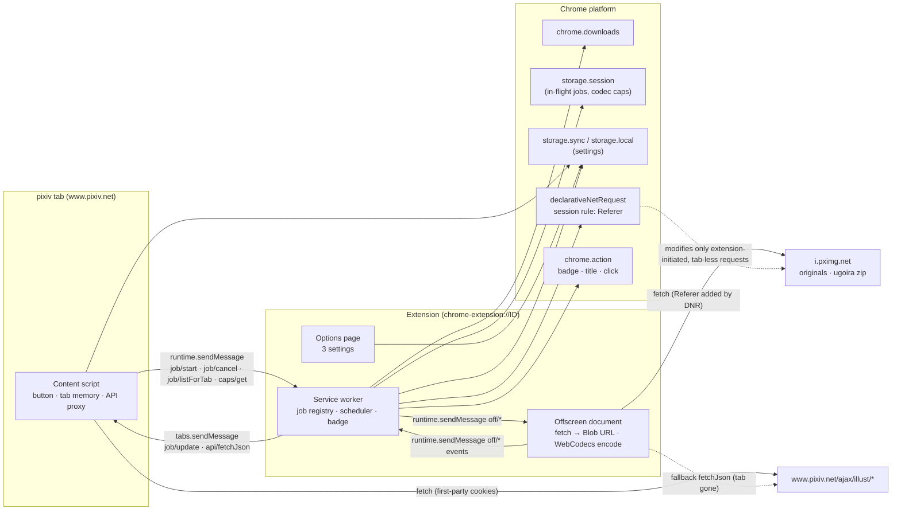
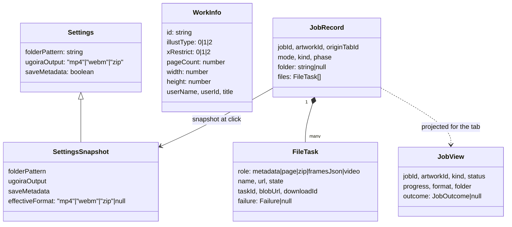

# Helper for Pixiv — System Design

> Last updated: 2026-10-22 18:08:04 (UTC+9)
> Serves: prd-000 (CUJ-1 … CUJ-5)
> Chapters: [design-download-engine.md](design-download-engine.md) · [design-offscreen-worker.md](design-offscreen-worker.md) · [design-artwork-button.md](design-artwork-button.md) · [design-settings-model.md](design-settings-model.md) · [design-options-page.md](design-options-page.md) · [design-test-harness.md](design-test-harness.md)

This chapter holds the cross-cutting architecture: runtime contexts, tech stack, the shared data model, message conventions, the network/Referer strategy, the retry policy, the error model, security/privacy/i18n/a11y conventions, build/release, and the constraints table. Component chapters own everything specific to one context.

---

## 1. Overview & guiding philosophy

Helper for Pixiv is a Manifest V3 Chrome extension. It injects one button into pixiv artwork pages. One click saves the whole artwork (originals, `metadata.json`, and for ugoira the frame zip, `frames.json` and a browser-encoded video) into a folder under Chrome's Downloads directory (PRD-000 §1, §4.3).

The system has four runtime contexts. Each one owns a single concern.

| Context | Owns | Lifetime | Chapter |
|---|---|---|---|
| **Content script** (`content.js`, every `https://www.pixiv.net/*` top frame) | The button: discovery, rendering, state, a11y. Per-tab memory. First-party pixiv API calls (render-time metadata, and API proxy for jobs). | One pixiv document | [design-artwork-button.md](design-artwork-button.md) |
| **Service worker** (`sw.js`) | **Job truth**: job registry, scheduling, `chrome.downloads`, badge/title, DNR rule, toolbar click. | Ephemeral: Chrome stops it after 30 s idle. All state is write-through to `chrome.storage.session`. | [design-download-engine.md](design-download-engine.md) |
| **Offscreen document** (`offscreen.html`) | **Bytes**: fetching originals and frame zips, building Blob URLs, codec probing, ugoira decode/encode. | Created on demand, closed 5 s after the last job ends. Not subject to the SW idle timer. | [design-offscreen-worker.md](design-offscreen-worker.md) |
| **Options page** (`options.html`, full tab) | The three settings. | One tab | [design-options-page.md](design-options-page.md) |

The domain logic all four contexts share (settings schema, folder pattern grammar, sanitization, Chrome path safety) is specified once in [design-settings-model.md](design-settings-model.md).

### Guiding principles

1. **Tab-independent by construction** (PRD NFR "Tab independence", §4.1 #6). The content script only renders and asks. Every step of a job runs in the SW or the offscreen document, so closing the tab cannot cancel anything.
2. **The SW owns truth; the offscreen document owns bytes.** The SW never holds file bytes, because it cannot create Blob URLs and a fetch taking more than 30 s to respond gets the worker terminated. The offscreen document never decides policy, because it can only use `chrome.runtime`.
3. **Assume the SW dies at every `await`.** Every job mutation is persisted to `chrome.storage.session` before its side effect is issued. Hydration reconciles against `chrome.downloads.search` and the offscreen task table (PRD §4.8, CUJ-4 "Service-worker restart").
4. **Pure core, thin shells.** Folder resolution, sanitization, `metadata.json` construction, retry policy, progress math, label/width candidates and outcome classification are pure TypeScript modules in `src/shared/`. They make no `chrome.*` calls at import time, and they are unit-tested, with the parity rules checked against golden vectors generated from `ref/pixiv-dl`.
5. **Parity is proven, not asserted** (PRD Goal 2). Behaviors carried over from `ref/pixiv-dl` (sanitization, `metadata.json`, `plain_text`, retry) are pinned by golden tests produced by the script itself (ENG-003).
6. **Minimal surface** (PRD index "Privacy & security"): 4 permissions, 2 hosts, no UI framework, no telemetry, no remote code.
7. **Every failure maps to exactly one button outcome.** A deterministic classifier (§10) turns low-level failures into the PRD's states. No failure is swallowed.

---

## 2. Architecture



**One-sentence data flow.** The user clicks, and the content script sends `job/start`. The SW creates and persists a job, then resolves the plan through pixiv's API, using the originating tab as a first-party proxy (§8.3). It queues files, and asks the offscreen document to fetch each one (Referer added by DNR) and hand back a `blob:` URL. The SW then calls `chrome.downloads.download(blobUrl, folder/name, uniquify)`, counts completions from `downloads.onChanged`, updates the badge, and pushes `JobView` snapshots to the tab.

---

## 3. Tech stack

| Area | Choice (version) | Why | Rejected |
|---|---|---|---|
| Language | **TypeScript ~6.0.3**, `strict: true`, `noUncheckedIndexedAccess: true`, `exactOptionalPropertyTypes: true` | Type-checked message protocol and state machines. The pin is below 6.1 because `typescript-eslint` 8.72 declares `typescript <6.1.0` as its peer range. TS 7 (native) is not yet supported by the lint toolchain. | TS 7.x (lint incompatibility); plain JS |
| Bundler | **esbuild ^0.28** driven by `scripts/build.mjs` | There are four entry points with two output formats (content script must be a classic IIFE; SW, offscreen and options are ESM). esbuild builds each in milliseconds with no plugin layer. The build script also copies `manifest.json`, `_locales/`, HTML/CSS and icons. The output is plain, readable JS, which helps Web Store review. | Vite + `@crxjs/vite-plugin` (HMR has little value for a 1-button UI; plugin maintenance history is uneven); WXT (a full framework with file-based magic; too much indirection for 4 entry points) |
| Unit/integration tests | **Vitest ^5** + **happy-dom ^21** (DOM tests opt in per file with `// @vitest-environment happy-dom`) | Fast, native TS/ESM, fake timers for retry/backoff. | Jest (ESM friction) |
| End-to-end | **@playwright/test ^1.64**, bundled Chromium (Chrome for Testing) | Branded Chrome ≥ 137 ignores `--load-extension`; CfT/Chromium do not. CfT ships proprietary codecs, so H.264 is testable. | Puppeteer (Playwright is the QA role's tool) |
| Lint/format | **ESLint ^10** flat config + **typescript-eslint ^8.72** (`recommendedTypeChecked`) + **Prettier ^3** | Type-aware rules catch floating promises, the main SW bug class. | — |
| Video muxing/encoding | **mediabunny ^1.62** (MPL-2.0, pure TS, no WASM, `sideEffects: false`) | Wraps WebCodecs `VideoEncoder`. Writes MP4 (H.264) and WebM (VP9). Has backpressure-aware `VideoSampleSource.add()`, quantizer rate control with bitrate fallback, `canEncodeVideo()` probes, and exact ms timestamps (MP4 track `frameRate: 1000` → timescale 1000; WebM TimestampScale is 1 ms natively). Successor of `mp4-muxer`/`webm-muxer`. | ffmpeg.wasm (banned by PRD §4.1 #4); `mp4-muxer` + `webm-muxer` (deprecated in favor of mediabunny) |
| Zip reading | **fflate ^0.8.3** (MIT), `unzipSync` with a per-frame `filter` | Reads one frame at a time from the retained zip bytes, satisfying PRD "Memory". Tiny, with no workers or eval when the sync API is used. | JSZip (heavier, async-only); `@zip.js/zip.js` (more surface, worker config to neutralize); hand-written reader (needless risk) |
| Chrome typings | **@types/chrome ^0.3** | `offscreen`, `runtime.getContexts`, `declarativeNetRequest` types. | — |
| UI | **No framework.** Vanilla TS + a ~40-line `h()` element helper in `src/shared/dom.ts` | The injected button is one component with a state machine. The options page has 3 controls. A framework would add bytes to a content script running on every pixiv page, plus a second rendering model to fight pixiv's React. | Preact, Lit |
| Dev runtime | Node ≥ 22 (dev only), npm with committed `package-lock.json` | — | — |

Runtime dependencies are exactly `mediabunny` and `fflate`. Both are bundled into the offscreen document only. The content script and SW bundles contain no third-party code.

---

## 4. Repository layout

```
/
├── package.json  package-lock.json  tsconfig.json  eslint.config.js  .prettierrc  vitest.config.ts  playwright.config.ts
├── scripts/
│   ├── build.mjs            # esbuild + static copy → dist/ ; --watch ; --prod
│   ├── zip.mjs              # dist/ → helper-for-pixiv-<version>.zip (store upload)
│   ├── gen-golden.py        # golden vectors from ref/pixiv-dl (ENG-003)
│   ├── render-icons.mjs     # assets/icon.svg → src/icons/*.png (one-off)
│   └── owner-lint.sh        # (existing)
├── src/
│   ├── manifest.json        # version injected from package.json at build
│   ├── _locales/{en,ja,zh_CN,zh_TW}/messages.json
│   ├── icons/icon-{16,32,48,128}.png
│   ├── shared/              # pure modules; no chrome.* at import time
│   │   ├── constants.ts     # hosts, limits, timings, colors, storage keys (single source)
│   │   ├── types.ts         # Settings, JobView, JobOutcome, Failure, WorkInfo …
│   │   ├── messages.ts      # message catalog + runtime guards
│   │   ├── settings.ts      # schema, defaults, read/merge/write (sync+local)
│   │   ├── pattern.ts       # validate · resolve · sanitizeToken · chromeSafeSegment
│   │   ├── metadata.ts      # buildMetadata · plainText · serialize (byte parity)
│   │   ├── html-entities.ts # generated by scripts/gen-golden.py (Python html.entities.html5)
│   │   ├── retry.ts         # fetchWithRetry (policy §9)
│   │   ├── pixiv-api.ts     # URL builders, response parsing, API failure mapping
│   │   ├── outcome.ts       # classifyOutcome (§10)
│   │   ├── progress.ts      # ugoira percent mapping, monotonic clamp
│   │   ├── i18n.ts          # t(key, subs), localeTag(), splitOnPlaceholder()
│   │   ├── log.ts           # leveled console logger, debug-gated
│   │   └── dom.ts           # h() helper (used by content + options)
│   ├── background/          # SW: sw.ts (entry), registry.ts, scheduler.ts, resolver.ts, downloads.ts,
│   │                        #     offscreen-client.ts, tab-client.ts, badge.ts, dnr.ts, options-tab.ts, caps.ts
│   ├── offscreen/           # offscreen.html, offscreen.ts (router), tasks.ts, fetch-bytes.ts,
│   │                        #     ugoira/{zip.ts, encode.ts, codec.ts, timeline.ts}
│   ├── content/             # content.ts (entry), router.ts, pixiv-dom.ts (ALL pixiv selectors),
│   │                        #     mount.ts, tab-memory.ts, api-proxy.ts, button/{model.ts, labels.ts,
│   │                        #     width.ts, view.ts, styles.ts, icons.ts, live-region.ts}
│   └── options/             # options.html, options.css, options.ts
├── test/
│   ├── unit/                # *.test.ts per shared module + background/content logic
│   ├── golden/              # *.json produced by scripts/gen-golden.py (committed)
│   ├── fakes/chrome.ts      # in-memory chrome.* fakes for SW integration tests
│   └── fixtures/            # pixiv JSON bodies, zips, DOM snapshots
└── e2e/                     # Playwright: fake-pixiv server, launcher, CDP helpers, specs (design-test-harness.md)
```

**Rule:** `src/content/pixiv-dom.ts` is the only file that knows pixiv's DOM (selectors, theme marker, login marker). This keeps fixes for pixiv redesigns in one place (PRD index Risks).

---

## 5. Manifest, permissions, minimum Chrome

```jsonc
{
  "manifest_version": 3,
  "name": "__MSG_ext_name__",                 // "Helper for Pixiv" (R-002)
  "description": "__MSG_ext_description__",
  "default_locale": "en",
  "version": "1.0.0",                         // injected from package.json
  "minimum_chrome_version": "116",
  "icons": { "16": "icons/icon-16.png", "32": "icons/icon-32.png", "48": "icons/icon-48.png", "128": "icons/icon-128.png" },
  "action": { "default_title": "__MSG_action_title_idle__", "default_icon": { "16": "icons/icon-16.png", "32": "icons/icon-32.png" } },
  "background": { "service_worker": "sw.js", "type": "module" },
  "options_ui": { "page": "options.html", "open_in_tab": true },
  "content_scripts": [{
    "matches": ["https://www.pixiv.net/*"],
    "js": ["content.js"],
    "run_at": "document_end",
    "all_frames": false
  }],
  "permissions": ["downloads", "storage", "offscreen", "declarativeNetRequestWithHostAccess"],
  "host_permissions": ["https://www.pixiv.net/*", "https://i.pximg.net/*"]
}
```

There is no `default_popup`, so `chrome.action.onClicked` fires (PRD §4.8). There are no `web_accessible_resources` (icons are inline SVG in the content script), no `declarative_net_request.rule_resources` (the rule needs `chrome.runtime.id` at runtime, §8.2), and no `content_security_policy` override (MV3 default).

The content script matches all of `www.pixiv.net/*`, not only `/artworks/*`. pixiv is an SPA, so a user who lands on the home page and clicks into an artwork never triggers a new content-script injection (PRD §4.2).

### Permission justifications (Web Store dashboard text)

| Permission | Used for | Justification |
|---|---|---|
| `downloads` | `chrome.downloads.download/search/cancel`, `onChanged` | Saves the artwork's files into the user's Downloads folder (the single purpose). |
| `storage` | `storage.sync/local` (3 settings), `storage.session` (in-flight jobs) | Remembers the three settings. Keeps running downloads alive across service-worker restarts. Nothing persists after Chrome quits. |
| `offscreen` | One offscreen document | WebCodecs and `URL.createObjectURL` are not available in service workers. The offscreen document encodes ugoira videos and hands downloaded bytes to Chrome's downloader. |
| `declarativeNetRequestWithHostAccess` | One session rule that sets `Referer: https://www.pixiv.net/` | pixiv's image host returns 403 without this Referer. The rule matches only the extension's own requests to `i.pximg.net`, never browsing traffic. |
| host `https://www.pixiv.net/*` | Content script; artwork API | Shows the button on artwork pages and reads the artwork's page list. |
| host `https://i.pximg.net/*` | Fetch originals and frame zips; DNR header modification | Downloads the original-size images. |

Explicitly **not** requested (PRD index): `tabs`, `cookies`, `<all_urls>`, `webRequest`, `history`, `scripting`, `downloads.ui`. The design never needs them:
- `sender.tab.id` and `tabs.sendMessage/create/update` work without `tabs`.
- Finding an open options tab uses `runtime.getContexts`, not `tabs.query({url})`.

A unit test (`test/unit/manifest.test.ts`) asserts the permission and host lists equal exactly this set. That guards against permission creep.

### `minimum_chrome_version: "116"`

| API | First Chrome |
|---|---|
| `chrome.offscreen` | 109 |
| Offscreen messages reset SW idle timer | 109 |
| `chrome.action.setBadgeTextColor` | 110 |
| `chrome.storage.session` (10 MB quota) | 102 (quota raised in 112) |
| DNR `initiatorDomains` / `requestDomains` | 101 |
| Navigation API (`navigation.oncurrententrychange`) | 102 |
| WebCodecs `VideoEncoder` | 94 |
| **`chrome.runtime.getContexts`** | **116** (binding constraint) |

The esbuild `target` is `chrome116`. Code must not call web APIs newer than 116 without a feature check. (mediabunny's quantizer rate control falls back to bitrate on older encoders, so it is not a hard requirement.)

---

## 6. Shared data model

The canonical TypeScript definitions live in `src/shared/types.ts`. Component chapters extend them; they never redefine them.



```ts
// src/shared/types.ts (normative sketch)
export type UgoiraOutput = 'mp4' | 'webm' | 'zip';
export interface Settings { folderPattern: string; ugoiraOutput: UgoiraOutput; saveMetadata: boolean; }
export interface SettingsSnapshot extends Settings { effectiveFormat: UgoiraOutput | null; } // null for non-ugoira

export interface WorkInfo {            // parsed from GET /ajax/illust/{id} → body
  id: string;                          // body.illustId ?? body.id
  illustType: 0 | 1 | 2;
  xRestrict: 0 | 1 | 2;
  pageCount: number;
  width: number; height: number;       // page-0 / ugoira frame size
  userName: string | null; userId: string | null; title: string | null;
}

export type FailureKind =
  | 'http'        // status set; never 2xx
  | 'pixivError'  // 2xx/4xx JSON with { error: true }
  | 'network'     // fetch TypeError (DNS, reset, offline)
  | 'timeout'     // 30 s inactivity (§9)
  | 'disk'        // chrome.downloads interrupt FILE_* or "Invalid filename"
  | 'dismissed'   // interrupt USER_CANCELED (Save As dialog dismissed) — never retried
  | 'encode'      // zip parse / decode / encoder / muxer error
  | 'aborted';    // our own cancel
export interface Failure { kind: FailureKind; status?: number; detail?: string; attempts: number; }

export type JobMode = 'full' | 'retryPages' | 'retryEncode' | 'retryMetadata';
export type ErrorCause = 'offline' | 'refused' | 'server' | 'disk';
export type JobOutcome =
  | { type: 'saved'; folder: string; pages?: number; format?: UgoiraOutput }
  | { type: 'partial'; folder: string; total: number; saved: number; failedPages: number[] }
  | { type: 'metadataOnly'; folder: string; total: number }
  | { type: 'encodeFailed'; folder: string; format: 'mp4' | 'webm' }
  | { type: 'error'; cause: ErrorCause }
  | { type: 'needsLogin' }
  | { type: 'unavailable' }
  | { type: 'cancelled' };

export type JobProgress =
  | { kind: 'pages'; done: number; total: number }                 // done includes retry offset
  | { kind: 'percent'; percent: number; phase: 'frames' | 'encode'; indeterminate: boolean };

export interface JobView {               // pushed SW → tab; full snapshot, idempotent
  jobId: string; artworkId: string;
  kind: 'pages' | 'ugoira' | 'unknown';  // unknown while resolving
  status: 'running' | 'ended';
  progress: JobProgress | null;          // null while resolving
  format: UgoiraOutput | null;
  folder: string | null;
  outcome: JobOutcome | null;            // non-null iff status === 'ended'
}
```

### Storage inventory (complete; nothing else may be stored)

| Area | Key | Value | Written by | Lifetime |
|---|---|---|---|---|
| `storage.sync` | `settings` | `{ v: 1, folderPattern, ugoiraOutput, saveMetadata, updatedAt }` | options page | until changed |
| `storage.local` | `settings` | mirror of the above (fallback; newest-wins read, see [design-settings-model.md](design-settings-model.md)) | options page | until changed |
| `storage.session` | `job:<jobId>` | `JobRecord` | SW | until the job ends, then removed; gone when Chrome quits |
| `storage.session` | `caps:<w>x<h>` | `{ avc: string \| null, vp9: boolean }` (avc = chosen codec string) | SW | browser session |

**No history** (PRD §4.1 #1): a job's record is deleted in the same mutation that marks it ended. "Saved"/"Error" memory lives only in the content script's per-document map.

---

## 7. Message protocol conventions

The full catalog lives in `src/shared/messages.ts`. Each chapter documents the messages its context handles.

| Rule | Detail |
|---|---|
| Envelope | `{ target: 'sw' \| 'offscreen' \| 'tab'; type: string; …payload }`. Every listener ignores messages whose `target` is not its own and **returns `undefined`**, so it never holds the channel open. `runtime.sendMessage` from a content script also reaches the offscreen document, which is why routing by `target` is mandatory. |
| Transport | content → SW: `chrome.runtime.sendMessage`. SW → tab: `chrome.tabs.sendMessage(tabId, msg, { frameId: 0 })`. SW ↔ offscreen: `chrome.runtime.sendMessage` both ways. No long-lived ports: they would keep the SW alive and complicate restarts. |
| Request/response | The listener returns `true` and calls `sendResponse` once. Responses are `{ ok: true, … } \| { ok: false, error: ErrorCode }`. Promise-returning listeners are not used, because their support postdates Chrome 116. |
| Push messages | `job/update` carries a **full `JobView`**, never a delta. A lost or duplicated message is harmless, and any receiver can render from one message. |
| Validation | Every handler validates the payload with a hand-written guard in `messages.ts`: artwork IDs `/^\d{1,12}$/`, folders via `isSafeRelativeFolder()`, URLs via host allowlist. Invalid → `{ ok: false, error: 'BAD_REQUEST' }` and a `warn` log. |
| Sender checks | The SW accepts content-script types only when `sender.tab?.id` is set and `sender.id === chrome.runtime.id`. It accepts offscreen event types only when `sender.url === chrome.runtime.getURL('offscreen.html')`. The offscreen document accepts only messages with no `sender.tab`. |
| Serialization | Messages are JSON-serialized. No `ArrayBuffer`/`Blob` crosses a message, and bytes travel as `blob:` URLs created in the offscreen document. |
| Versioning | Not needed: all contexts ship in one package and update atomically. |

---

## 8. Network strategy

### 8.1 Decision

| Request | Made from | Credentials | Referer |
|---|---|---|---|
| `GET /ajax/illust/{id}` at render (button hint, needs-login, unavailable) | Content script | First-party cookies (same-origin) | Browser default (page URL) |
| Job API calls: `/ajax/illust/{id}`, `/pages`, `/ugoira_meta` | **Originating tab's content script**, proxied by the SW (`api/fetchJson`). **Fallback:** offscreen document when the tab is unreachable. | First-party via tab; `credentials: 'include'` in fallback | Browser default |
| Originals and frame zip on `i.pximg.net` | **Offscreen document** `fetch()` | `credentials: 'omit'` | `https://www.pixiv.net/`, set by the DNR session rule (§8.2) |
| File writes | SW `chrome.downloads.download({ url: blobUrl, filename, conflictAction: 'uniquify', saveAs: false })` | — | — |

### 8.2 Referer via declarativeNetRequest (session rule)

`chrome.downloads.download` cannot set `Referer` (PRD §4.2). Fetch from an extension page cannot set a cross-origin `referrer`. The offscreen document's fetches therefore get the header from a DNR rule. Chrome documents that DNR applies to `fetch()` issued by extension contexts that reach the network stack.

```ts
// src/background/dnr.ts — run at every SW start (idempotent), awaited by the SW `ready` promise
const REFERER_RULE_ID = 1;
await chrome.declarativeNetRequest.updateSessionRules({
  removeRuleIds: [REFERER_RULE_ID],
  addRules: [{
    id: REFERER_RULE_ID,
    priority: 1,
    action: { type: 'modifyHeaders', requestHeaders: [{ header: 'Referer', operation: 'set', value: 'https://www.pixiv.net/' }] },
    condition: {
      requestDomains: ['i.pximg.net'],
      initiatorDomains: [chrome.runtime.id],   // only this extension's own requests
      tabIds: [-1],                            // TAB_ID_NONE: never a tab's (browsing) request
      resourceTypes: ['xmlhttprequest'],       // fetch() from the offscreen document
    },
  }],
});
```

- **Session rule**, not static: `initiatorDomains` needs `chrome.runtime.id`, which a static ruleset cannot know for both unpacked and store builds. `tabIds` is session-only. Session rules survive SW restarts and vanish on browser quit, the same lifetime as jobs.
- **Both scoping conditions** keep the PRD privacy promise ("set only on the extension's own requests to `i.pximg.net`, never on the user's browsing traffic").
- **Verification is a blocking spike (ENG-002).** If `initiatorDomains: [chrome.runtime.id]` does not match extension-initiated requests in current Chrome, the rule falls back to `tabIds: [-1]` + `resourceTypes: ['xmlhttprequest']` only. The residual exposure would be a page service worker fetching `i.pximg.net` (tab −1), which pixiv itself would send with a pixiv Referer anyway. The fallback and the observed behavior are recorded here when ENG-002 completes.

### 8.3 Why API calls go through the tab

Chrome documents that an extension's requests to a host it has permission for are treated as same-site **"does not apply if third-party cookies are blocked"** (developer.chrome.com, Storage and cookies). A user who blocks third-party cookies would send no `PHPSESSID` on SW/offscreen fetches. `/pages` and `/ugoira_meta` for R-18 works would then be refused, and the button would show "pixiv refused this work" for a user who is logged in. P1 (Aoi) is exactly the logged-in R-18 user.

The originating tab's content script fetches same-origin. It carries first-party cookies under every cookie setting, and sends the same `Origin`/`Sec-Fetch-Site` as pixiv's own frontend. The SW therefore asks that tab first (`api/fetchJson`). It falls back to the offscreen document only if the tab is gone or no longer has the content script (closed, or navigated off pixiv). This keeps the job tab-independent (the fallback always exists) while being correct in the common case. The fallback path's failure mode, 3P cookies blocked and tab closed during the sub-second API phase on an R-18 work, is accepted.

### 8.4 Alternatives considered (bytes path)

| Criterion | A: `downloads.download(i.pximg.net URL)` + DNR | **B: offscreen `fetch` + DNR → `blob:` → `downloads.download`** | C: content-script fetch + blob (PPD's approach) | D: SW fetch → `data:` URL |
|---|---|---|---|---|
| Referer satisfiable | Only if DNR matches download-manager requests (undocumented) | Yes (DNR on extension fetch, documented) | Yes, but DNR must touch tab traffic | Yes (same as B) |
| PRD retry parity: status codes 429/5xx vs 403, `Retry-After`, 30 s timeout | No. Only coarse interrupt reasons (`SERVER_FAILED`), no headers, no timeout. | **Exact** | Exact | Exact, but a >30 s response kills the SW |
| AC "retries observable in the extension's network log" | No | **Yes** (offscreen DevTools) | Page DevTools | Yes |
| Retries pollute `chrome://downloads` | Yes. Each failed attempt is a "Failed" entry, and retries may get `(1)` names. | **No.** Only final bytes are handed over. | No | No |
| Tab independence | Yes | **Yes** | **No** (dies with the tab) | Yes |
| Memory | None in extension | ≤ 5 files per job buffered as Blobs | Same as B, in the page | base64 strings, +33%, URL limit 2 MB |
| Chrome bubble shows per-file progress | Yes | No. Files appear when complete. | No | No |
| Extra permissions | None | None | None | None |
| **Verdict** | Rejected: cannot meet §4.5.2 | **Selected** | Rejected: violates tab independence | Rejected: SW lifetime, size limits |

**Trade-off accepted:** Chrome's download bubble lists each file when its bytes are complete, rather than showing per-file progress. A cancelled job leaves no "Canceled" entries, because in-flight files are fetches and not Chrome downloads. This differs from wording in PRD CUJ-1 steps 2 and 5. The PRD explicitly leaves the mechanism to engineering (§4.2), but the descriptive wording needs a spec-sync (§15).

---

## 9. Retry policy (shared, `src/shared/retry.ts`)

This implements PRD §4.5.2 with parity to `Fetcher.__call__` in `ref/pixiv-dl`. It is used by the content script (render fetch, API proxy) and the offscreen document (bytes, fallback API).

```ts
export interface RetryOptions {
  signal?: AbortSignal;                 // cancel → Failure{kind:'aborted'}
  onProgress?: (loaded: number, total: number | null) => void;   // body bytes
  init?: RequestInit;                   // credentials etc.
  responseType: 'json' | 'bytes';       // bytes → Blob (streamed), json → parsed object
  random?: () => number;                // injectable for tests
  sleep?: (ms: number, signal?: AbortSignal) => Promise<void>;
}
export type RetryResult<T> = { ok: true; value: T; status: number; attempts: number } | { ok: false; failure: Failure };
export function fetchWithRetry<T>(url: string, opts: RetryOptions): Promise<RetryResult<T>>;
```

| Aspect | Rule |
|---|---|
| Attempts | `MAX_ATTEMPTS = 4` per request (1 + 3 retries) |
| Retried | HTTP 429, 500, 502, 503, 504; `network`; `timeout` |
| Never retried | 403 and every other non-2xx; `pixivError` bodies; `aborted` |
| Delay before retry *n* (n = 0,1,2) | `Retry-After` if the failed response has one that parses as a positive number of seconds → `min(value, 30)` s. Otherwise `1.5 × 2ⁿ + U(0, 0.5)` s. **Parity detail:** the script's `_retry_after(e) or _backoff(...)` treats `Retry-After: 0` as falsy, so `0`, negative, or HTTP-date values fall through to the backoff. |
| No sleep after the last attempt | as in the script |
| Timeout | **30 s inactivity**, matching `urlopen(timeout=30)` socket semantics. Response headers must arrive within 30 s, and then every body chunk within 30 s of the previous one. A slow but progressing download of a large original is never cut off. Implemented with an `AbortController` re-armed per chunk. |
| Body | Streamed via `response.body.getReader()`; chunks collected into an array, then `new Blob(chunks, { type })`. The stream yields byte progress (ugoira zip, PRD §4.7.5) and the stall timer. |
| Session refresh | **Not ported.** The script re-reads the cookie once on 403. The extension never reads cookies (PRD index "Privacy"), so 403 fails immediately (PRD §4.5.2). |
| Logging | Each attempt logs `debug` with URL host+path, status and delay (never headers or cookies). |
| Test time scale | All delays and the stall timeout are multiplied by the compile-time constant `__RETRY_TIME_SCALE__`. It is `1` in every shipped build (`build`, `build:prod`); only `build:e2e` sets `0.01`, and `scripts/build.mjs` refuses it elsewhere ([design-test-harness.md](design-test-harness.md)). |

---

## 10. Error model & outcome classification

Low-level failures are `Failure` values (§6). They are classified into exactly one `JobOutcome` by the pure function `classifyOutcome(job, navigatorOnLine)` in `src/shared/outcome.ts`. The precedence below is applied top to bottom, and the first match wins:

| # | Condition | Outcome | Button (PRD) |
|---|---|---|---|
| 1 | Job cancelled by the user | `cancelled` | idle, no styling (CUJ-1 step 5, CUJ-5 step 10) |
| 2 | `/ajax/illust/{id}` → HTTP 404 or `pixivError`; or `/pages`/`ugoira_meta` → 404 | `unavailable` | Unavailable (CUJ-5 step 7) |
| 3 | Any API call (`/ajax/illust`, `/pages`, `ugoira_meta`) → 401/403 or `pixivError` | `error: refused` | `Retry`, tip_refused (CUJ-5 step 6) |
| 4 | Any `i.pximg.net` byte request (original or zip) → 403 | `needsLogin` (the job stops dispatching new files at the first 403) | Log in to download (CUJ-5 step 9) |
| 5 | Ugoira: zip + `frames.json` saved, encode failed | `encodeFailed` | `Retry · MP4/WebM`, tip_encode_failed (CUJ-5 step 8) |
| 6 | Pages job: ≥ 1 page saved and ≥ 1 page failed | `partial` | `Retry · N failed` (CUJ-5 step 4) |
| 7 | Pages job: every page saved, `metadata.json` failed | `metadataOnly` | `Retry`, tip_metadata_only |
| 8 | Nothing saved (0 pages or ugoira zip not saved), cause from the failures: all `disk`/`dismissed` → `disk`; else `navigator.onLine === false` or every failure `network` → `offline`; else (5xx, 429, `timeout`, other 4xx) → `server` | `error: <cause>` | `Retry`, cause tooltip (CUJ-5 step 6) |
| 9 | Ugoira: zip saved, video encoded but its save failed (`disk`) | `error: disk` | `Retry`, tip_disk |
| 10 | Everything required landed | `saved` | Saved (CUJ-1 step 6, CUJ-2 step 5) |

Rows 4, 8 and 9 contain mappings the PRD does not state verbatim (zip 403 treated like originals, `dismissed` grouped with `disk`, ugoira video-save failure). They are derived, and listed in §15 for pm.

---

## 11. Cross-cutting concerns

### 11.1 Security
- **No dynamic HTML.** `innerHTML`/`insertAdjacentHTML` are allowed only with compile-time constant strings (the SVG icons in `icons.ts`). All user content (titles, artist names, folders in tooltips) goes through `textContent` or attributes. The ESLint `no-restricted-properties` rule bans `innerHTML` outside `icons.ts`.
- **URL allowlist.** Before any fetch, `pixiv-api.ts` asserts `https://www.pixiv.net/ajax/illust/<digits>(/pages|/ugoira_meta)?` for API calls and `https://i.pximg.net/` for bytes. An original URL from pixiv's API that fails the allowlist becomes a `refused` failure, never a fetch.
- **File names** come from `basename(new URL(url).pathname)` and must match `/^[0-9A-Za-z_.-]{1,128}$/`. Folders must pass `isSafeRelativeFolder()` ([design-settings-model.md](design-settings-model.md)) at resolution and again when a retry request echoes a folder back from the tab.
- **Cookies** are never read, stored or sent explicitly. The design relies on the browser's own same-origin cookie behavior (§8.3).
- **Remote code:** none. All code is bundled, and MV3's default CSP applies to extension pages.

### 11.2 Privacy
There is no analytics, telemetry, crash reporting or remote config. The only network destinations are `www.pixiv.net` and `i.pximg.net`, plus `accounts.pixiv.net` and `github.com` via user-initiated navigation. The storage inventory in §6 is exhaustive.

### 11.3 Observability
- `src/shared/log.ts`: `debug | info | warn | error`, prefixed `[hfp:<context>]`. `debug` is compiled out of `--prod` builds (`define: { __DEBUG__: false }`). `warn`/`error` always print, so they show on `chrome://extensions` → Errors, which is the only error channel a user can share in a GitHub issue (R-001).
- Logs never contain cookies, headers, or full URLs with query strings. Artwork IDs and file names are allowed (local only).
- Each job logs one `info` line at start (`jobId, artworkId, mode, kind`) and one at end (`outcome.type`, counts, duration ms).
- E2E tests capture SW and offscreen console output (Playwright `worker.on('console')`) and fail on any `error` log not explicitly expected.

### 11.4 Internationalization
- `src/_locales/{en,ja,zh_CN,zh_TW}/messages.json`. `en` is `default_locale`, so missing keys in other locales fall back to English at runtime.
- **Keys are the PRD Appendix A IDs verbatim**, plus: `ext_name`, `ext_description`, `locale_tag` (`en` / `ja` / `zh-CN` / `zh-TW`), singular variants with an `_one` suffix where English needs them (`action_title_one_single`, `aria_busy_pages_one`, `aria_saved_pages_one`, `live_start_one`, `live_saved_one`, `live_failed_one`), and `tip_partial_one` (already in the PRD).
- **Resolved locale** = `chrome.i18n.getMessage('locale_tag')`. This returns the locale Chrome actually resolved after fallback (`zh_HK` → `en`), unlike `getUILanguage()`. It is used for the `lang` attribute (PRD index "CJK rendering") and for the per-locale width floor.
- **Placeholders** use `$1`…`$9` substitutions. Where part of a message needs different styling (monospace token in `err_unknown_token`, pattern in `opt_still_using`), `splitOnPlaceholder(key, n)` calls `getMessage` with the sentinel `\u0000` as the substitution, splits on it, and builds DOM nodes. No HTML ever enters `messages.json`.
- Numbers are ASCII digits everywhere (`String(n)`; never `toLocaleString`).
- A unit test asserts that all four `messages.json` files have identical key sets and identical placeholder counts per key. Missing translations fail CI instead of silently falling back. Translations are drafts until native review (PRD Appendix A).

### 11.5 Accessibility and theming
These are owned by the component chapters, which implement the PRD index "Accessibility" and "Theming" sections: [design-artwork-button.md](design-artwork-button.md) §A11y and [design-options-page.md](design-options-page.md) §A11y. Shared rule: every interactive element is a native `<button>`/`<input>` (or `role="switch"` on a `<button>`), and `prefers-reduced-motion` disables all transitions and animations.

### 11.6 Performance budgets

| Budget (PRD NFR) | Design mechanism | Verified by |
|---|---|---|
| Button within 500 ms of the action row rendering | `MutationObserver` + rAF-coalesced placement check (≤ 1 frame after the row appears); render-time metadata fetched in parallel, not awaited | e2e timing assertion (fake pixiv renders the row after a delay) |
| Floating fallback within 3 s | 3 s timer from artwork-route entry | e2e |
| Busy feedback ≤ 100 ms after click | Optimistic local `busy 0/N` before the SW round-trip | e2e (`performance.now` delta) |
| State change ≤ 300 ms | SW pushes `job/update` synchronously after the final mutation persists | e2e |
| Badge ≤ 1 s | Badge recomputed after every mutation (coalesced 50 ms); recomputed on SW start before anything else | SW integration test + e2e after CDP SW stop |
| ≤ 5 files in flight per artwork | Scheduler cap counts `fetching ∪ ready ∪ saving` | unit + fake-server concurrency counter |
| Ugoira memory: one frame at a time | `unzipSync` filter per frame; `await source.add()` backpressure; frame closed after add | unit (mock), manual heap check |
| Encode progress ≥ 1/s | Offscreen progress events every 250 ms max, at least every 1 s while encoding | e2e (long-ugoira fixture) |

---

## 12. Build, test, release

| Command | Does |
|---|---|
| `npm run build` | dev build → `dist/` (unminified, sourcemaps inline, `__DEBUG__ = true`) |
| `npm run build:prod` | prod build → `dist/` (unminified for review readability, no sourcemaps, `__DEBUG__ = false`, `THIRD_PARTY_NOTICES.txt` emitted) |
| `npm run watch` | rebuild on change. Reload the extension from `chrome://extensions`. |
| `npm run typecheck` | `tsc -p tsconfig.json --noEmit` (zero errors required) |
| `npm run lint` | `eslint .` + `prettier --check .` |
| `npm test` | `vitest run` (unit + golden + SW integration with fakes) |
| `npm run build:e2e` | e2e build → `dist-e2e/` (`__RETRY_TIME_SCALE__ = 0.01`, `__TEST_HOOKS__ = true`) |
| `npm run test:e2e` | `build:e2e` + `playwright test` (fake-pixiv harness) |
| `npm run qa:fake` / `npm run qa:live` | headed Chromium with the extension against the fake pixiv / real pixiv, for the QA role |
| `npm run golden` | `python3 -I scripts/gen-golden.py` (regenerate golden vectors) |
| `npm run check` | typecheck + lint + test + build. **The coder's done-gate.** |
| `npm run zip` | `build:prod` → `helper-for-pixiv-<version>.zip` |

- **Versioning:** SemVer in `package.json` is the single source. `build.mjs` writes it into `manifest.json`, and the options footer reads `chrome.runtime.getManifest().version` (PRD CUJ-3 step 10).
- **Test pyramid and QA harness:** [design-test-harness.md](design-test-harness.md).
- **Release:** manual upload of the `npm run zip` artifact to the Chrome Web Store. Prerequisites (PRD index "Store readiness", R-001): the repository is public, the store listing is in 4 locales, privacy disclosures say "no data collected", and the permission justifications in §5 are pasted into the dashboard.
- **Licensing:** mediabunny is MPL-2.0, which requires its license text and source availability. The package is unmodified and its source is public on npm/GitHub. `THIRD_PARTY_NOTICES.txt` in the zip carries the MPL-2.0 text for mediabunny and MIT for fflate.

---

## 13. Constraints

Every implementation-shape constraint in PRD-000 and the index, classified by what it rests on. (User-facing constraints such as latencies, colors and copy are pm's and are not repeated here.)

| Constraint | Source | Basis | Design impact |
|---|---|---|---|
| Manifest V3, Chrome Web Store, desktop Chrome only | PRD §1, index | External fact: the Chrome Web Store accepts only MV3. Plus product scope. | SW + offscreen architecture (§2). |
| No remotely hosted code | index "Store readiness" | External fact: MV3 / Web Store policy | Everything bundled; no CDN libraries. |
| Permissions exactly `downloads`, `storage`, `offscreen`, `declarativeNetRequestWithHostAccess`; hosts `www.pixiv.net`, `i.pximg.net`; never broaden host access | index "Privacy & security" | PRD reason: minimal permissions for store review + privacy | Design needs nothing more (§5). Manifest test locks the set. |
| Encoding via built-in WebCodecs; no WASM codec bundles (ffmpeg.wasm rejected) | PRD §4.1 #4, NFR "Payload" | PRD reason: ~24 MB payload, slower | mediabunny (pure TS) over WebCodecs. |
| Output only through `chrome.downloads`, relative to the Downloads folder | PRD §4.1 #2 | Product decision (settled in discovery) | Blob URL hand-off (§8). |
| Orchestration in the SW, encoding in an offscreen document | PRD §4.1 #6, NFR | PRD reason (tab independence) + external fact (no WebCodecs/Blob URLs in SW, PRD §4.2) | §2 split. |
| ≤ 5 files of one artwork in flight | PRD §4.1 #5, NFR | PRD reason: parity with script `-j 5` | Scheduler cap counts fetches + hand-offs. |
| Retry: 4 attempts, 1.5·2ⁿ+U(0,0.5) s backoff, `Retry-After` ≤ 30 s, 30 s timeout, never 403 | PRD §4.5.2 | PRD reason: parity with script | §9. It decided the bytes-path choice (§8.4). |
| Token value ≤ 60 UTF-8 bytes + script sanitization | PRD §4.4 | PRD reason: parity with `safe_component` (macOS 255-byte component limit) | [design-settings-model.md](design-settings-model.md). |
| Folder pattern ≤ 200 characters | PRD §4.9 (assumption — confirm) | PRD reason (CUJ-3 edge: "path stays bounded"). The number is pm's open assumption. | `maxlength=200`; zero design cost. Not challenged. |
| In-flight job state in session-scoped storage; no persisted history | PRD §4.1 #1, §4.8, index | Product decision + privacy reason | `storage.session` write-through; records deleted at job end. |
| Settings in `storage.sync` with `storage.local` fallback | PRD §4.9 | Product decision | Dual write + newest-wins read ([design-settings-model.md](design-settings-model.md)). |
| Locales `en`/`ja`/`zh_CN`/`zh_TW` via `_locales`, UI follows Chrome's language, no selector | PRD §3, index | Product decision | §11.4. |
| Badge text ≤ 4 chars (`999+`) | PRD §4.8 | External fact: Chrome badge space | `formatBadge()`. |
| Ugoira frames decoded/encoded one at a time | NFR "Memory", §4.6 | PRD reason: a 300-frame 1080p ugoira would need ~2.4 GB if held at once | Streaming pipeline; zero extra cost. |
| WebM codec = VP9 | PRD §4.6 (assumption — confirm) | PRD assumption. VP9 is also the engineering preference: better quality per bit than VP8, and libvpx encode is in every Chrome. | None; designed to it. |
| `minimum_chrome_version` = lowest supporting all APIs | index NFR "Platform" | External fact (API availability) | 116 (§5). |
| pixiv selectors kept in one place | index "Risks" | PRD reason: fast redesign fixes | `pixiv-dom.ts` rule (§4). |

**Result of the review:** every implementation-shape constraint rests on an external fact, a recorded PRD reason, or a settled product decision. None stands in for an unstated goal in a way that costs the architecture. **No requirement challenge filed.**

---

## 14. Key decisions (summary)

| ID | Decision | Rationale (detail in) |
|---|---|---|
| D1 | Offscreen `fetch` + DNR session Referer rule + `blob:` hand-off for all file bytes | Only option meeting retry parity and tab independence (§8.4) |
| D2 | Job API calls proxied through the originating tab, offscreen fallback | First-party cookies regardless of 3P-cookie settings (§8.3) |
| D3 | SW owns job truth, write-through to `storage.session`; offscreen owns bytes | SW may die at any await; offscreen cannot call `chrome.downloads` ([design-download-engine.md](design-download-engine.md)) |
| D4 | mediabunny + WebCodecs, MP4 `frameRate: 1000` timescale, crop-to-even, quantizer "very-high" | Exact ms timing, sharper than resampling, CRF-18-class quality ([design-offscreen-worker.md](design-offscreen-worker.md)) |
| D5 | fflate `unzipSync` per frame from retained bytes | Memory rule, tiny dependency ([design-offscreen-worker.md](design-offscreen-worker.md)) |
| D6 | Codec capability probed in the offscreen document, cached per size in `storage.session` | Same context as the encoder; "cached for the browser session" (PRD §4.6) |
| D7 | Shadow-DOM button, vanilla TS, Navigation API + MutationObserver | Style isolation from pixiv; no framework in a page-wide content script ([design-artwork-button.md](design-artwork-button.md)) |
| D8 | Chrome path-safety pass after script-parity sanitization | Chrome's `IsSafePortablePathComponent` rejects more than PRD §4.4 strips ([design-settings-model.md](design-settings-model.md)) |
| D9 | esbuild + Vitest + Playwright (CfT) + fake-pixiv HTTPS harness | Simple build, deterministic CUJ-5 fault coverage ([design-test-harness.md](design-test-harness.md)) |

---

## 15. Open questions, risks, and PRD spec-sync items

### Spec-sync items for pm (`/design-feature` or `/spec-sync`; the PRD is not edited here)
1. **CUJ-1 steps 2 and 5, CUJ-4 "Chrome's own downloads button" (bubble wording).** Under D1, files appear in Chrome's bubble when complete, not "as they start", and cancel leaves no "Canceled" entries. The user-visible acceptance criteria (≤ 5 in flight, nothing new starts after cancel, completed files remain) all hold.
2. **§4.5.2 `Retry-After` "(assumption — confirm)"** is resolved in the PRD's favor: the chosen mechanism sees headers, so `Retry-After` is honored.
3. **§4.4 sanitization is incomplete for Chrome.** Chrome also rejects format characters (e.g. ZWJ U+200D in emoji artist names), Unicode noncharacters, `~` / `.` / whitespace at segment ends, Windows reserved names (`CON`, `nul.txt`, `desktop.ini`, …), shell-integrated extensions (`.lnk`, `.url`, `.local`, `.scf`, `.{…}`), and on Windows short-name-shaped segments containing `~`. Golden probe: `safe_component("~sora~") == "~sora~"`, which Chrome refuses. The design adds a deterministic Chrome-safety pass (D8). It is applied to whole segments, so it also normalizes literal text such as a trailing space, a narrow exception to "literal text is used as typed". The preview shows the result.
4. **Singular copy:** derived `_one` variants (§11.4) for `aria_busy_pages`, `aria_saved_pages`, `live_start`, `live_saved`, `live_failed`, `action_title_one`.
5. **Derived outcome mappings** (§10 rows 4, 8, 9), WebM-selected-but-VP9-unsupported → MP4 (if H.264 is encodable), and copy for an ugoira whose only failure is `metadata.json` (design: treated as `error: disk` with a full retry, because `tip_metadata_only` speaks of pages).

### Risks
| Risk | Likelihood | Mitigation |
|---|---|---|
| DNR `initiatorDomains: [extension id]` does not match extension-initiated requests | Low–medium | ENG-002 spike before engine work; `tabIds: [-1]`-only fallback (§8.2) |
| pixiv DOM redesign breaks action-row discovery | Medium over product life | Floating fallback; selectors only in `pixiv-dom.ts`; live-DOM fixture refresh (ENG-002) |
| Undocumented pixiv AJAX shape changes | Low | Parsing in `pixiv-api.ts` with tolerant defaults; failures surface as button states |
| Hardware H.264 encoder session limits with concurrent ugoira encodes | Low | On encoder `configure`/`error`, retry once with `hardwareAcceleration: 'prefer-software'` before failing ([design-offscreen-worker.md](design-offscreen-worker.md)) |
| Very long literal pattern text exceeds 255 bytes per component or Windows path limits | Low | Surfaces as `disk` (`FILE_NAME_TOO_LONG`); bounded by the 200-character field |
| Enhanced Safe Browsing deep-scan prompts on blob-sourced `.zip` | Low | None needed by design; noted for QA on Windows |
